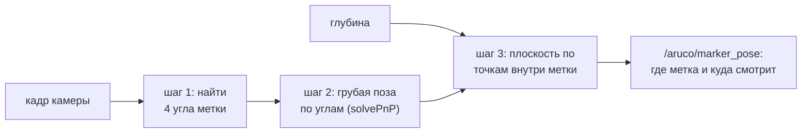
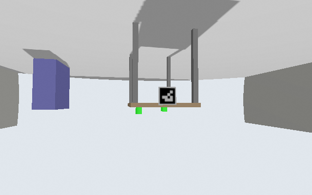
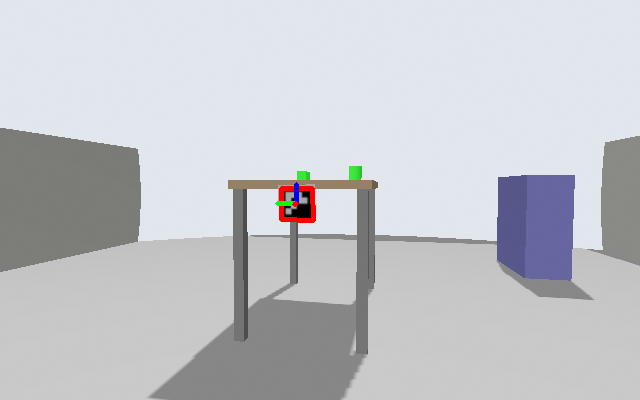
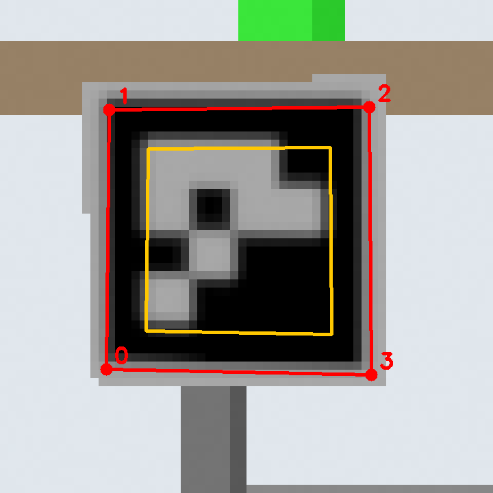
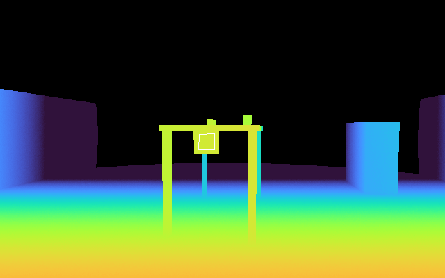
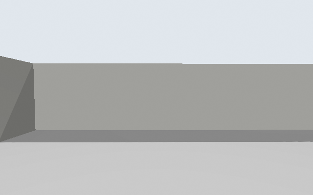

# Метка ArUco и команда «паркуйся»

Как тележка находит стол по метке и встаёт к нему боком, стороной руки. Здесь собрано всё в одном
месте: команды запуска во всех вариантах, как распознаётся метка (со снимками из симуляции), какие
части кода за что отвечают. Справочник по параметрам и ограничениям — [NAV.md](NAV.md) §8а и §8б.

> Состояние на 2026-11-13: работает в симуляции без руки. На настоящей тележке не проверялось.

Словарь на эту страницу:

- **ArUco-метка** — чёрно-белый квадрат с узором из клеток. Камера узнаёт его на кадре и по нему
  считает, где она находится относительно метки.
- **Передняя камера** — Orbbec на носу тележки. Даёт цветной кадр и **глубину** (расстояние до
  каждой точки кадра). Метку распознаёт только она; камера на руке в парковке не участвует.
- **Nav2** — готовая система навигации ROS 2: строит путь по карте и ведёт тележку.
- **Доводка** — последний отрезок пути, который тележка едет сама, без Nav2, медленно и прямо.

## 1. Команды запуска

Все команды — из `~/ros2k_ws` после `source install/setup.bash`. Сценарий один:
`cart_nav_gz.launch.py`, варианты включаются аргументами.

| Что нужно | Команда |
|---|---|
| **Без руки, с окном Gazebo и RViz** (по умолчанию) | `ros2 launch cart_xarm_bringup cart_nav_gz.launch.py` |
| **Без руки, без окна Gazebo** (легче для процессора) | `ros2 launch cart_xarm_bringup cart_nav_gz.launch.py headless:=true` |
| Без руки, без Gazebo и без RViz (самый лёгкий с парковкой) | `ros2 launch cart_xarm_bringup cart_nav_gz.launch.py headless:=true use_rviz:=false use_octomap:=false` |
| **С рукой** (тяжело, см. ниже) | `ros2 launch cart_xarm_bringup cart_nav_gz.launch.py arm:=true` |
| С рукой и узлами захвата | `ros2 launch cart_xarm_bringup cart_nav_gz.launch.py arm:=true manipulation_nodes:=true` |
| С рукой, без окна Gazebo | `ros2 launch cart_xarm_bringup cart_nav_gz.launch.py arm:=true headless:=true` |
| Старт тележки в другом месте | добавить `spawn_x:=-1.5 spawn_y:=-1.0 spawn_yaw:=0.8` |
| Без парковки / без детектора метки | добавить `parking:=false` / `aruco:=false` |

**Окно Gazebo отдельно.** Симуляцию можно запустить с `headless:=true`, а окно открыть потом,
вторым терминалом, и закрывать когда угодно — симуляция при этом не останавливается:

```bash
source ~/ros2k_ws/install/setup.bash
export GZ_SIM_RESOURCE_PATH=$GZ_SIM_RESOURCE_PATH:$(ros2 pkg prefix cart_xarm_bringup)/share/cart_xarm_bringup/worlds
gz sim -g
```

Строка с `GZ_SIM_RESOURCE_PATH` нужна, чтобы окно нашло картинку метки (иначе метка — серый
квадрат). Если симуляция запущена с `GZ_PARTITION=...`, то же значение надо задать и здесь.

**Команда «паркуйся»** (когда Nav2 поднялся — через 1–2 минуты после запуска):

```bash
ros2 service call /park std_srvs/srv/Trigger                              # начать
ros2 topic pub --once /park_command std_msgs/String "data: 'паркуйся'"    # то же текстом
ros2 topic echo /park/status                                              # ход и итог
ros2 service call /park/cancel std_srvs/srv/Trigger                       # остановить
```

**Посмотреть, что видит детектор:**

```bash
ros2 topic echo /aruco/status                          # «метка 0: 1.72 м, угол 12.1° (по глубине)»
ros2 run rqt_image_view rqt_image_view /aruco/image    # кадр с контуром метки
```

⚠️ **С рукой.** На этом ПК Nav2 с включённой рукой за 150 с не поднялся (нагрузка 825 % ядра
против 333 % без руки), поэтому парковка с рукой **не проверялась**. Если SLAM или Nav2 не
поднялись и без руки (в логе «frame map does not exist» дольше двух минут): остановить, выполнить
`fastdds shm clean` и `ros2 daemon stop`, запустить снова.

## 2. Как распознаётся метка

Метка — `DICT_4X4_50`, номер 0, чёрный квадрат 16 см с белой рамкой 2 см. Висит в центре торца
стола, на высоте 0.8 м, лицом к тележке. Работу делает узел
[aruco_detector.py](../src/r2_robot/cart_xarm_bringup/scripts/aruco_detector.py).



### Шаг 0. Кадр камеры

Так кадр приходит с камеры: тележка стоит в 2.5 м от стола, чуть сбоку. **Кадр перевёрнут** —
камера на тележке закреплена вверх ногами, как на настоящей. Детектору это не мешает: метка
читается в любом повороте.



### Шаг 1. Найти углы метки

Тот же кадр, повёрнутый для удобства, с результатом детектора: красный контур — найденная метка,
цветные оси — её система координат (синяя ось смотрит из метки наружу).



Метка на этом кадре — всего **32 пикселя** в ширину, одна клетка узора — около 5 пикселей.
Увеличенный фрагмент: красные точки 0–3 — четыре угла, которые выдаёт OpenCV.



Код ([aruco_detector.py:79-83](../src/r2_robot/cart_xarm_bringup/scripts/aruco_detector.py#L79-L83) — настройка,
[:128](../src/r2_robot/cart_xarm_bringup/scripts/aruco_detector.py#L128) — сам поиск):

```python
prm = cv2.aruco.DetectorParameters() if new_api else cv2.aruco.DetectorParameters_create()
# Метка издалека мелкая (на 1.7 м ~34 px, клетка ~6 px), белое отрисовано серым: при чтении
# клеток с 4 px на клетку (по умолчанию) декодирование срывается; 8 px — читается.
prm.perspectiveRemovePixelPerCell = 8
prm.cornerRefinementMethod = cv2.aruco.CORNER_REFINE_SUBPIX   # точнее углы -> точнее поза
...
corners, ids, _ = self.detect(gray)        # углы всех меток на кадре и их номера
```

Без этих двух настроек метка дальше ~1.7 м не читалась вовсе.

### Шаг 2. Грубая поза по углам

Размер метки известен (16 см), параметры объектива известны (`camera_info`). По четырём углам
функция `solvePnP` считает, где метка и как повёрнута
([aruco_detector.py:89-92](../src/r2_robot/cart_xarm_bringup/scripts/aruco_detector.py#L89-L92),
[:144](../src/r2_robot/cart_xarm_bringup/scripts/aruco_detector.py#L144)):

```python
s = float(self.get_parameter('marker_size').value) / 2
# углы метки в её системе (как выдаёт detectMarkers: лев-верх, прав-верх, прав-низ, лев-низ),
# ось z — из лицевой стороны к камере
self.obj = np.array([[-s, s, 0], [s, s, 0], [s, -s, 0], [-s, -s, 0]], np.float32)
...
ok, rvec, tvec = cv2.solvePnP(self.obj, c, self.K, self.D, flags=cv2.SOLVEPNP_IPPE_SQUARE)
```

Этого мало. Ошибка углов в полпикселя на метке в 32 пикселя — это уже проценты расстояния:
по одним углам дальность ошибалась на 5–34 см, а курс — до 9°.

### Шаг 3. Уточнение по глубине

Камера даёт ещё и глубину — расстояние до каждой точки. На снимке цвет = расстояние (жёлтое —
ближе, синее — дальше, чёрное — нет данных). Белый квадрат — область внутри метки, из которой
берутся точки.



На увеличенном фрагменте выше эта область обведена жёлтым: она отступает от краёв на 15 %, потому
что на краях глубина смешивается с фоном. В этом кадре внутри неё 553 точки, все на расстоянии
1.69–1.74 м. Через них проводится плоскость:

- **расстояние** = где луч на центр метки пересекает эту плоскость;
- **курс** = куда смотрит перпендикуляр к плоскости.

Код ([aruco_detector.py:170-208](../src/r2_robot/cart_xarm_bringup/scripts/aruco_detector.py#L170-L208), сокращённо):

```python
# внутри метки, с отступом 15 % от краёв (на краях глубина смешивается с фоном)
ctr = c.mean(0)
inner = (ctr + 0.7 * (c - ctr)).astype(np.int32)
...
P = np.stack([(u - cx) * zz / fx, (v - cy) * zz / fy, zz], 1)   # пиксели + глубина -> точки в метрах
c0 = P.mean(0)
_, _, vt = np.linalg.svd(P - c0)       # плоскость через облако точек
n = vt[2]                              # её нормаль
if n @ c0 > 0:          # нормаль — к камере (из лица метки наружу)
    n = -n
ray = np.array([(ctr[0] - cx) / fx, (ctr[1] - cy) / fy, 1.0])
t = ray * (n @ c0) / (n @ ray)          # луч на центр метки ∩ плоскость
```

Если глубины нет или точек меньше 30 (`min_depth_points`), остаётся поза по углам, а в статусе
вместо «по глубине» пишется «по углам».

### Что получается

Узел публикует `/aruco/marker_pose` — положение и поворот метки относительно камеры — и текст в
`/aruco/status`. Для кадра выше: `метка 0: 1.72 м, угол 12.1° (по глубине)`.

Точность в симуляции (`tools/check_aruco_accuracy.py`, 9 поз тележки):

| До метки | Только по углам | С глубиной |
|---|---|---|
| 0.64 м | 49 мм, курс 4.0° | 0.7–18 мм, курс до 1.5° |
| 1.0–1.1 м | 70–80 мм, курс до 9.4° | 1.4–3.8 мм, курс до 0.7° |
| 1.64 м | 245 мм, курс 3.1° | 4.6–5.7 мм, курс до 0.4° |
| 2.64 м | 337 мм, курс 3.7° | 5.9–12.8 мм, курс до 0.2° |

В симуляции глубина идеальная. У настоящей камеры на 1–2 м шум глубины — сантиметры; на железе
точность не измерялась.

**Когда метку не видно:** ближе 0.25 м (камера не видит вблизи), метка не целиком в кадре вместе с
белой рамкой, дальше ~2.8 м, или тележка стоит к ней боком или задом.

## 3. От метки до стоянки

Команду выполняет узел
[table_parking.py](../src/r2_robot/cart_xarm_bringup/scripts/table_parking.py). Шаги и
ответственные функции:

| Шаг | Что происходит | Функция |
|---|---|---|
| 1 | метка видна — идём дальше; нет — поворот на месте, если по лидару свободно 0.75 м | [`find_marker`](../src/r2_robot/cart_xarm_bringup/scripts/table_parking.py#L198) |
| 2 | 10 замеров метки переводятся в карту и усредняются: центр торца и ось стола | [`measure_table`](../src/r2_robot/cart_xarm_bringup/scripts/table_parking.py#L223) |
| 3 | расчёт стоянки и точки подхода | [`targets`](../src/r2_robot/cart_xarm_bringup/scripts/table_parking.py#L266) |
| 4 | Nav2 везёт к точке подхода | [`nav_to`](../src/r2_robot/cart_xarm_bringup/scripts/table_parking.py#L276) |
| 5 | доводка: поворот на курс, затем прямо вдоль кромки | [`rotate_to`](../src/r2_robot/cart_xarm_bringup/scripts/table_parking.py#L295), [`creep`](../src/r2_robot/cart_xarm_bringup/scripts/table_parking.py#L309) |
| 6 | проверка итога, «стою» | [`run`](../src/r2_robot/cart_xarm_bringup/scripts/table_parking.py#L336) |

Главное место — расчёт стоянки. Вся геометрия в десяти строках:

```python
def targets(self, c, u):                   # c — центр торца (метка), u — ось стола, от метки внутрь
    side = 1 if int(self.p('side')) >= 0 else -1
    v = np.array([-u[1], u[0]])             # влево от оси стола
    h = side * u                             # курс тележки: тогда её правый борт смотрит на кромку
    off = self.p('table_width') / 2 + self.p('gap') + HALF_WIDTH
    park = c + u * self.p('along') + v * side * off - h * ARM_X
    pre = park - h * self.p('approach')
    yaw = math.atan2(h[1], h[0])
    return park, pre, yaw
```

По словам: от метки отступаем вдоль стола на `along` (0.3 м — там встанет основание руки) и вбок
на «полстола + зазор 7 см + полтележки». Точка подхода `pre` — на 0.9 м раньше по той же линии.
`ARM_X` и `HALF_WIDTH` — где на тележке стоит рука и половина ширины корпуса.

Доводка — простое правило руления
([table_parking.py:319-331](../src/r2_robot/cart_xarm_bringup/scripts/table_parking.py#L319-L331)):

```python
rest = -d.dot(h)            # сколько осталось вдоль линии
lat = d.dot(n)              # + — левее линии
if rest < 0.005:
    break
v = min(self.p('creep_speed'), max(0.02, rest))                      # к концу замедляемся
w = -self.p('k_lat') * lat + self.p('k_head') * wrap(yaw - th)       # съехал влево — рулим вправо
```

После остановки камера смотрит вдоль стены: метка осталась сбоку и сзади, детектор пишет «метки не
видно». Это нормально — метка нужна только в начале.



### Результаты проверок

`tools/test_parking.py` вызывает `/park` и сравнивает итог с настоящей позой тележки в Gazebo.
Идеальная стоянка в этом мире — (0.631, 0.790), курс 0°.

| Старт тележки (x, y, курс) | Время | Ошибка вдоль кромки | Ошибка вбок | Курс | Зазор до стола |
|---|---|---|---|---|---|
| (−2.0, 0.0), 0° | ~90 с* | 5 мм | 9 мм | 0.4° | 61 мм |
| (−1.5, −1.0), 46° | 71 с | 8 мм | 6 мм | 1.3° | 64 мм |
| (−2.0, −0.6), 11° | 24 с | 2 мм | 6 мм | 0.5° | 64 мм |
| у стола, метки не видно | — | отказ: «поворачиваться опасно» | | | |

\* Время первого прогона завышено: считалось вместе с повторным запуском Nav2.

Графики третьего прогона (путь тележки сверху, скорость сближения, сравнение точности) — на
отдельной странице «Парковка по метке»: <https://claude.ai/artifact/CE4H8drpZvEdQ7cBwPFVv5> (личная страница
владельца проекта; другим её нужно открыть через «Поделиться»).

### Чего нет и что не проверено

- На доводке препятствия не проверяются: скорость идёт прямо в `/cmd_vel`, мимо защиты Nav2.
- Не проверялись: другая кромка (`side:=-1`), запуск с рукой, настоящая тележка.
- Чтобы рука брала после парковки, нужны предметы у кромки стола в `cart_nav.world`.

Подробнее про параметры и ограничения — [NAV.md](NAV.md) §8б.
