# Как мы учим робота узнавать предметы: подготовка моделей для OpenVINO

Документ написан для тех, кто **никогда не обучал нейросети**. Все слова объясняются по ходу и
собраны в словарь (раздел 3). Разделы 7–11 — пошаговые инструкции с командами, раздел 18 — шпаргалка
«повторить всё за один вечер». Если что-то пошло не так — раздел 15.

Связанные документы: запуск сценариев — [RUN_SCENARIOS.md](RUN_SCENARIOS.md), как детектор работает
в системе — [RECOGNITION_OPENVINO.md](RECOGNITION_OPENVINO.md), как мы улучшали модель (v4: предметы
вплотную, случайные цвета; следующий шаг — ракурсы) — [RECOGNITION_IMPROVEMENT.md](RECOGNITION_IMPROVEMENT.md),
выбор моделей и подходов — [RECOGNITION_MODELS.md](RECOGNITION_MODELS.md), как название от нейросети
используется при взятии («возьми куб 1», осмотр с разных сторон) — [PICK_PLACE.md](PICK_PLACE.md).

> **Состояние на 2026-11-13.** Рабочая модель — **`sim_shapes_v3`**
> (`~/.local/share/quasi/models/sim_shapes_v3/model_fp16.xml`, запускать с `detector_conf:=0.2`).
> Модель `sim_shapes_v4` лучше на трудных кадрах, но в живой сцене хуже узнаёт куб, поэтому рабочей не
> стала ([RECOGNITION_IMPROVEMENT.md](RECOGNITION_IMPROVEMENT.md)). В сцене «рука на столе» сейчас
> **7 предметов четырёх форм**: 4 формы + повторы `cube_2`, `cube_3`, `cylinder_2`. Модель v3 училась
> на сцене из 4 предметов без повторов. Сборщик датасета с 2026-11-13 умеет сцену с повторами и
> снимки с разных ракурсов (раздел 7.2), но новый датасет на нём ещё не снимали.

Схемы здесь нарисованы в формате mermaid (их показывают GitHub и VS Code), графики — картинки из
[`img/`](img/), их строит [`img/make_figures_training.py`](img/make_figures_training.py).

---

## 0. Что получилось (коротко)

Робот различает четыре формы предметов: **куб, параллелепипед, прямоугольная пластина,
цилиндр**. Мы обучили нейросеть узнавать их по цветному кадру камеры на запястье руки и подключили к
системе. Обучали на сцене, где было по одному предмету каждой формы, и в ней сеть называла все четыре
верно (с 2026-11-09 на столе семь предметов: добавлены ещё два куба и цилиндр, см. ниже):

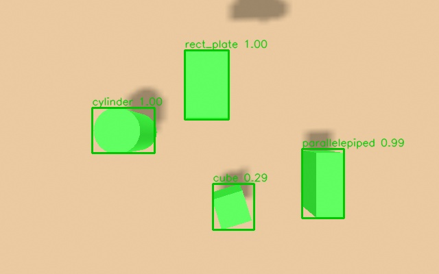

*Кадр из симуляции: нейросеть нарисовала рамки и подписала предметы. Число после названия —
уверенность модели (1.00 = полностью уверена). Куб уверен на 0.29: у него самый «неочевидный» вид
сверху (квадрат).*

| Что | Результат |
|---|---|
| Качество на картинках, которых модель не видела (mAP) | **0.945** (fp16), чем ближе к 1, тем лучше |
| Скорость | **6.4 мс** на кадр на обычном процессоре (то есть ≈150 кадров в секунду) |
| Размер файла модели | **4.5 МБ** (fp16) |
| Найдено предметов при пороге уверенности 0.2 | **97%**, ложных рамок 1 на 75 кадров |
| Проверка в симуляции «рука на столе», 4 предмета (2026-11-02) | **4 из 4** названы верно |
| То же, сцена из 7 предметов с повторами (2026-11-09) | **6 из 7** названы (один куб без названия, ещё один на уверенности 0.22) |
| Осмотр с 5 ракурсов и голосование (2026-11-13) | три куба узнаются уверенно: 3–4 голоса из 5 ([PICK_PLACE.md](PICK_PLACE.md)) |
| Время на весь цикл (сбор + обучение + экспорт) | около 40 минут: сбор 20, обучение 10, остальное 10 (так было для v3; со случайными цветами сбор в 3–4 раза дольше, раздел 7) |

Чего **ещё нет** (честно): модель не проверялась на настоящей камере и настоящих предметах и на самой
тележке (Intel NUC). Куб остаётся самым неуверенным классом. Команда «возьми куб 1» уже работает
(`pick_by_name`, [PICK_PLACE.md](PICK_PLACE.md)): название от нейросети она берёт, если уверенность
не ниже 0.3, иначе класс по размерам из облака. См. раздел 16.

---

## 1. Зачем это нужно

Робот должен знать **что** лежит на столе: не просто «какой-то предмет высотой 6 см», а «это куб» или
«это цилиндр». Так делят работу две части системы:

| Вопрос | Кто отвечает | Чем |
|---|---|---|
| **Где** предмет, какой он формы и размера | облако точек (камера глубины) | наш код `perception.py` |
| **Что** это (имя) | нейросеть по цветному кадру | **модель, которую мы здесь готовим** |

Готовая модель, обученная на тысячах бытовых фотографий (набор COCO), знает кошек, стулья и
телевизоры. Ей **не из чего выбрать** слова «куб», «цилиндр» или «пластина»: в её списке из 80
названий таких нет, и от цвета предмета это не зависит. Поэтому её **доучивают** на картинках наших
предметов.

Весь процесс в одну строку: **собрать картинки → подписать, где на них что → обучить → превратить
результат в формат, который быстро считает OpenVINO → проверить**.

## 2. Картина целиком

Удобная аналогия — обучение ученика:

| Школа | У нас |
|---|---|
| Учебник с ответами | **датасет**: картинки + правильные рамки и названия |
| Ученик | **модель** (нейросеть) |
| Что ученик запомнил | **веса** (файл) |
| Занятия | **обучение**: ученик решает задачи и сверяется с ответами |
| Контрольная на новых задачах | **проверка** на картинках, которые ученик не видел |
| Работник на производстве | **OpenVINO**: быстро читает «память ученика» и отвечает на вопросы |

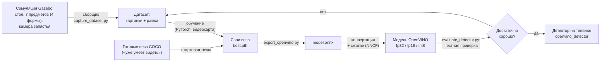

Если качество не устроило, чаще всего помогает **добавить или улучшить картинки** (стрелка «нет»
ведёт к датасету), а не «покрутить» обучение.

## 3. Словарь: что значат слова

Слова сгруппированы по темам. В колонке «Как представить» — бытовая аналогия.

### Данные

| Слово | Что это простыми словами | Как представить |
|---|---|---|
| **Класс** | Название категории: `cube`, `cylinder`. Модель различает только те классы, на которых её учили | Подпись на ячейке в сортировщике |
| **Рамка (bounding box)** | Прямоугольник вокруг предмета на картинке: левый верхний угол, ширина, высота в пикселях | Рамка, которую обводят маркером |
| **Разметка (аннотации)** | Список рамок и классов для каждой картинки. Обычно рисуют вручную. **У нас её считает компьютер**: симулятор знает, где что лежит | Ключи ответов к тесту |
| **Датасет** | Набор картинок вместе с разметкой | Учебник с ответами |
| **Обучающая / проверочная выборка (train / val)** | Часть картинок идёт на обучение, часть откладывается: на ней модель **не учится**, по ней честно проверяют | Задачи для урока и задачи для контрольной |
| **Аугментация** | Искусственное разнообразие картинок прямо при обучении: изменить яркость и цвет, приблизить, сдвинуть, отразить | Тот же рисунок под разным светом |
| **Сид (seed)** | Число, задающее «случайность». С тем же сидом тот же результат | Номер раскладки колоды карт |

### Обучение

| Слово | Что это простыми словами | Как представить |
|---|---|---|
| **Нейросеть, модель** | Программа, которая не написана руками, а «настроена» на примерах | Ученик |
| **Архитектура** | «Устройство» модели: из каких слоёв состоит. У нас SSDlite с «глазами» MobileNetV3 | Устройство мозга, но не его знания |
| **Веса (weights)** | «Память» модели: миллионы чисел, подобранных при обучении. Это то, что сохраняется в файл (`.pth`, `.onnx`, `.bin`). Модель без весов — пустая форма | Конспект, который ученик выучил |
| **Предобученные веса** | Веса модели, уже обученной на огромном датасете (COCO, 80 бытовых классов). Она уже «умеет видеть» края, формы, текстуры | Ученик, который умеет читать, и ему осталось выучить наши слова |
| **Дообучение (fine-tuning)** | Берём предобученные веса и доучиваем на своих предметах. Нужно намного меньше картинок и времени, чем учить с нуля | Выучить новую тему, а не учиться читать заново |
| **Обучение (training)** | Модель много раз смотрит картинки, сравнивает ответ с правильным и понемногу исправляется | Решение задач с проверкой по ответам |
| **Эпоха** | Один полный проход по всем картинкам. Обучение — это десятки эпох | Одно прочтение учебника |
| **Потери (loss)** | Число: насколько модель ошибается. В ходе обучения должно **падать** | Количество ошибок в тренировочной работе |
| **Переобучение** | Модель идеально знает обучающие картинки и плохо работает на новых | Зазубрил ответы, но не понял тему |
| **Видеокарта (GPU)** | Считает обучение в десятки раз быстрее процессора. У нас GTX 1050 Ti | Бригада вместо одного работника |

### Качество

| Слово | Что это простыми словами |
|---|---|
| **mAP** | Главная оценка детектора, от 0 до 1 (выше — лучше): насколько точно лежат рамки и угаданы классы. Считается на **проверочных** картинках. **mAP@0.5** — мягче: рамка верна, если перекрывает настоящую хотя бы наполовину. 0.9 и выше — отлично |
| **Уверенность** | К каждой рамке модель добавляет число от 0 до 1 («уверена на 0.9») |
| **Порог уверенности** | Рамки с уверенностью ниже порога отбрасываются. Выше порог — меньше ложных рамок, но больше пропусков |
| **Ложная рамка** | Рамка там, где предмета нет, или с неверным названием |
| **Якоря (anchors)** | Заранее расставленные по всей картинке «шаблонные» рамки (у нас 3234 штуки для входа 320). Модель не рисует рамку с нуля, а говорит про каждый якорь: «здесь предмет, и рамку надо чуть сдвинуть». Нужны и при обучении, и в детекторе, поэтому лежат в файле `anchors.npy` рядом с моделью |
| **Подавление дублей (NMS)** | Модель рисует несколько почти одинаковых рамок на один предмет. Подавление оставляет самую уверенную |

### Форматы и скорость

| Слово | Что это простыми словами |
|---|---|
| **PyTorch** | Библиотека, в которой модель **учится** (тяжёлая) |
| **ONNX** | Универсальный формат файла модели. Промежуточный шаг: PyTorch → ONNX → OpenVINO |
| **OpenVINO** | Программа от Intel, которая **быстро запускает уже обученную** модель на процессорах и графике Intel. Сама не учит и не улучшает качество |
| **OpenVINO IR** | «Родной» формат OpenVINO: `.xml` (схема) + `.bin` (веса) |
| **FP32 / FP16 / INT8** | Точность чисел внутри модели. FP32 — самая точная и тяжёлая; FP16 — вдвое легче, качество практически то же; INT8 (целые числа) — ещё легче и быстрее, качество может чуть упасть |
| **Квантование** | Превращение FP32 в INT8. Нужна «калибровка»: пара сотен картинок **без разметки**, по которым подбирается, как сжать числа с минимальной потерей |
| **Файл-спутник (`.meta.json`)** | Маленький текстовый файл рядом с моделью: тип, классы, якоря, размер входа. Детектор читает его сам, поэтому для новой модели не надо править код |

## 4. Почему сначала симуляция

- **Бесплатная разметка.** Реальные фотографии надо размечать руками: сотни рамок, часы работы.
  В симуляции рамка считается из известной позиции предмета.
- **Много разнообразия.** Сборщик каждый раз ставит предметы в новые места и повороты.
- **Проверяем всю цепочку заранее.** Даже когда предметы станут настоящими, путь «картинки →
  обучение → OpenVINO → детектор в системе» тот же. Мы его уже отладили.
- **Честное ограничение — «разрыв симуляция → реальность».** Картинки симуляции слишком «чистые»:
  однотонные предметы, ровный свет, нет шума. Модель, обученная на них, **сама не заработает на
  настоящей камере и настоящих предметах**. Для настоящих предметов нужны настоящие фотографии
  (раздел 16).

## 5. Какая модель и почему

Мы учим **SSDlite320 на основе MobileNetV3** из библиотеки torchvision (лицензия BSD-3, свободная).

- **SSD** — семейство детекторов, которые за один проход по картинке выдают все рамки сразу (быстро).
- **Lite / MobileNetV3** — «облегчённая версия для слабых устройств»: 3.4 млн параметров, файл в
  единицы мегабайт, быстро считает даже на процессоре NUC.
- **320** — картинка перед сетью сжимается до 320×320 пикселей.
- **Предобученные веса** — официальные, на COCO, их скачивает сама torchvision.

**Почему не YOLO.** Для обучения YOLOX нужно скачать с GitHub и установить чужой репозиторий. Проверка
безопасности среды, в которой я работаю, это заблокировала («запуск чужого кода»), и обходить её я не
стал. Вместо этого взял детектор, который уже входит в torchvision (ставится вместе с PyTorch с
официального индекса), а цикл обучения написал сам. Готовая YOLOX при этом остаётся рабочей моделью
для проверки самого детектора. Ultralytics YOLO (другая реализация) под лицензией AGPL, см.
[RECOGNITION_MODELS.md](RECOGNITION_MODELS.md) §5.2.

**Что это значит на практике.** SSDlite быстрее и легче YOLOX-s, но на сложных сценах немного менее
точна. Для нескольких заметных предметов на однотонном столе этого достаточно.

## 6. Что где лежит

| Что | Где |
|---|---|
| Описание предметов сцены (единый список) | `src/r2_robot/cart_xarm_bringup/config/arm_table_objects.yaml` |
| Генератор мира из этого списка | `src/r2_robot/cart_xarm_bringup/tools/gen_arm_table_scene.py` |
| Сборщик датасета | `src/r2_robot/cart_xarm_bringup/tools/capture_dataset.py` |
| Обучение, экспорт, оценка, разбор ошибок | `src/xarm_grasping/training/{train_ssdlite,export_openvino,evaluate_detector,analyze_detector}.py` |
| Склейка нескольких съёмок в один датасет | `src/r2_robot/cart_xarm_bringup/tools/merge_datasets.py` |
| Детектор в системе (в том числе разбор якорей SSD) | `src/xarm_grasping/xarm_grasping/detector.py` |
| Датасеты | `~/.local/share/quasi/training/datasets/<имя>/` |
| Результаты обучения (веса, журнал) | `~/.local/share/quasi/training/runs/<имя>/` |
| Готовые модели для детектора | `~/.local/share/quasi/models/<имя>/` |
| Окружение обучения (PyTorch, видеокарта) | `~/.venvs/yolox` (название историческое) |
| Окружение детектора (только OpenVINO) | `~/.venvs/openvino` |

Тяжёлые файлы (датасеты, веса, модели) лежат **вне репозитория** и в git не попадают.

Наборы, которые существуют на этом ПК:

| Датасет | Что в нём | Модели |
|---|---|---|
| `sim_tabletop_v1` | первый набор: 8 мелких коробок и цилиндров (362 кадра) | `sim_tabletop_v1`, `sim_tabletop_v2_480` |
| `sim_shapes_v1` | пять форм, включая пирамиду (500 кадров) | `sim_shapes_v1`, `sim_shapes_v2_480` |
| **`sim_shapes_v3`** | **четыре формы, по одному предмету (500 кадров)** | **`sim_shapes_v3`** (рабочая) |
| `sim_shapes_v4` | те же 4 предмета, вплотную и со случайными цветами (612 кадров; склейка съёмок `sim_shapes_v4a` и `sim_shapes_v4b`) | `sim_shapes_v4` (не рабочая: хуже на кубе в живой сцене) |

Датасета для сцены из 7 предметов (с повторами) и с ракурсами пока нет.

## 7. Шаг 1. Собрать датасет

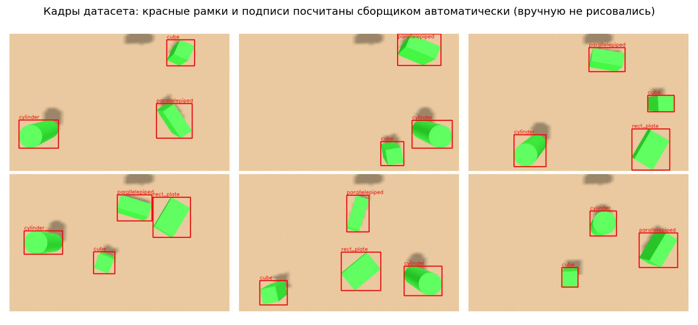

*Шесть кадров из датасета. Красные рамки и подписи сборщик посчитал сам.*

**Как сборщик это делает.** В цикле: случайно ставит предметы на стол (не меньше трёх на виду,
остальные убирает на край стола, вне кадра), ждёт секунду, пока они успокоятся, снимает кадр камерой
запястья и **считает рамки**: берёт известные размеры и позу предмета, проецирует его углы (у
цилиндра — окружности) в кадр через параметры камеры (`camera_info`) и позу камеры (TF).

**Откуда берётся класс (название) предмета.** Список предметов сборщик читает из
`arm_table_objects.yaml`. Класс — это поле `class`, если оно задано у предмета, иначе имя модели без
хвоста `_N`: `cube_2` и `cube_3` дают класс `cube`, `cylinder_2` — `cylinder`. Поэтому три куба на
столе — это один класс `cube`, а не три разных (так было до 2026-11-13: имя модели считалось классом).

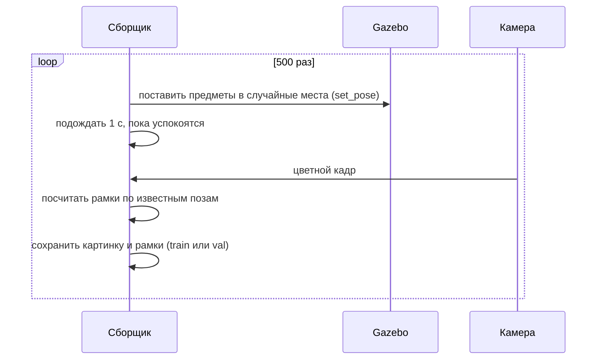

```bash
# Окно 1: симуляция «рука на столе» с лёгкой камерой (640×400).
# ВАЖНО: свой ROS_DOMAIN_ID и GZ_PARTITION, чтобы не пересечься с другими симуляциями
export ROS_DOMAIN_ID=74 GZ_PARTITION=capture
ros2 launch cart_xarm_bringup arm_table_gz.launch.py use_moveit:=false headless:=true \
    use_rviz:=false gripper_camera_preview:=true
#   use_moveit:=false можно, только пока не нужны ракурсы (--view-frac 0, как здесь).
#   Для ракурсов (раздел 7.2) — use_moveit:=true.

# Окно 2 (те же две переменные!), через ~60 секунд, когда запустилась камера
export ROS_DOMAIN_ID=74 GZ_PARTITION=capture
python3 ~/ros2k_ws/src/r2_robot/cart_xarm_bringup/tools/capture_dataset.py \
    --out ~/.local/share/quasi/training/datasets/МОЙ_ДАТАСЕТ --count 500 --preview 12
```

> **Внимание: умолчания сборщика изменились после v3.** С 2026-11-04 по умолчанию половина кадров —
> предметы вплотную (`--tight-frac 0.5`), три четверти — со случайными цветами и светом
> (`--color-frac 0.75`); это рецепт v4 ([RECOGNITION_IMPROVEMENT.md](RECOGNITION_IMPROVEMENT.md)).
> Чтобы снять датасет «как v3»: `--tight-frac 0 --color-frac 0 --view-frac 0`. Проверка закрытых
> рамок по глубине (`--min-surface`, раздел 7.2) включена по умолчанию; совсем выключить её —
> `--depth-topic ''`.

### 7.0. Все параметры сборщика

| Параметр | По умолчанию | Что делает |
|---|---|---|
| `--out` | — (обязателен) | папка датасета |
| `--count` | 20 | сколько кадров снять |
| `--val-fraction` | 0.15 | доля проверочных кадров |
| `--seed` | 1 | «случайность»: с тем же сидом те же расстановки, цвета и ракурсы |
| `--settle` | 1.0 | сколько секунд ждать после расстановки, пока предметы успокоятся |
| `--min-visible` | 0.6 | какая доля рамки должна попасть в кадр; меньше — рамку не ставим (см. «Известная особенность» ниже) |
| `--preview` | 12 | сколько первых кадров с рамками сохранить в `preview/` для проверки глазами |
| `--world` | `arm_table_world` | имя мира Gazebo |
| `--objects` | `config/arm_table_objects.yaml` | список предметов (имена, формы, размеры, класс) |
| `--tight-frac` | 0.5 | доля кадров с предметами вплотную ([RECOGNITION_IMPROVEMENT.md](RECOGNITION_IMPROVEMENT.md) §2) |
| `--color-frac` | 0.75 | доля кадров со случайными цветами и светом (там же, §3) |
| `--view-frac` | 0 | доля кадров, снятых **с ракурса вокруг предмета** (раздел 7.2); 0 — все кадры из позы наблюдения, как раньше. Нужен MoveIt |
| `--view-dist` | 0.30 0.45 | расстояние камера — предмет для ракурса, м (от и до) |
| `--view-elev` | 40 80 | наклон взгляда для ракурса, градусы (90 — строго сверху) |
| `--view-roll` | 25 | поворот кадра вокруг оси взгляда, ± градусы |
| `--observe-joints` | `0 -0.596 -1.013 0 1.609 0` | поза наблюдения руки (углы суставов 1–6), куда рука возвращается для обычных кадров |
| `--group`, `--tip-link` | `xarm6`, `link_tcp` | группа MoveIt и звено, которым рука «целится» |
| `--depth-topic` | `/gripper_camera/aligned_depth/image_raw` | кадр глубины для проверки перекрытий; `''` — не проверять |
| `--min-surface` | 0.12 | какая доля точек поверхности предмета должна быть видна по глубине; меньше — предмет закрыт соседом, рамку не ставим |
| `--image-topic`, `--camera-info`, `--optical-frame`, `--base-frame` | топики и фреймы камеры запястья | менять не нужно |

Скорость: около 2.3 с на кадр без случайных цветов (500 кадров — около 20 минут), около 8 с на кадр
со случайными цветами (`--color-frac` больше 0). Сколько добавляют ракурсы (рука каждый раз едет) — не
измерено. **Пока идёт сбор, не запускайте тяжёлое** (обучение, чужие симуляции): вызовы к Gazebo
начнут терять ответы.

Что получается:

```
МОЙ_ДАТАСЕТ/
  images/train/000003.jpg …   обучающие картинки (85%)
  images/val/000007.jpg …     проверочные картинки (15%), модель на них не учится
  annotations/train.json      разметка в формате COCO: картинки, рамки, классы
  annotations/val.json
  class_names.txt             имена классов по строке (без повторов: cube, parallelepiped, …)
  meta.json                   как собран: сид, дата, камера, параметры, сколько кадров каждого вида
  preview/*.jpg               кадры с рамками для проверки глазами
```

У каждой картинки в разметке есть поля, по которым можно потом оценивать отдельно разные условия
(`evaluate_detector.py --filter`): `layout` (`tight`/`spread`), `appearance` (`random`/`default`),
`min_gap_mm`, `view` (`observe` — из позы наблюдения, `orbit` — ракурс) и `view_info` (у ракурса:
вокруг какого предмета, азимут, наклон, расстояние, поворот кадра).

### 7.1. Проверка датасета ДО обучения (обязательно)

Обучать на испорченном датасете — 20 минут впустую. Перед обучением сделайте **две проверки**:

1. **Откройте `preview/` и посмотрите.** Красные рамки должны плотно охватывать предметы.
2. **Убедитесь, что кадры разные.** Предметы должны стоять по-разному от кадра к кадру. Сборщик сам
   прерывается, если 5 кадров подряд одинаковые, но смотреть всё равно нужно.

Так выглядит **испорченный** датасет, который мне однажды достался: рамки на красивых местах, а предметы
стоят на одном и том же месте на всех кадрах.

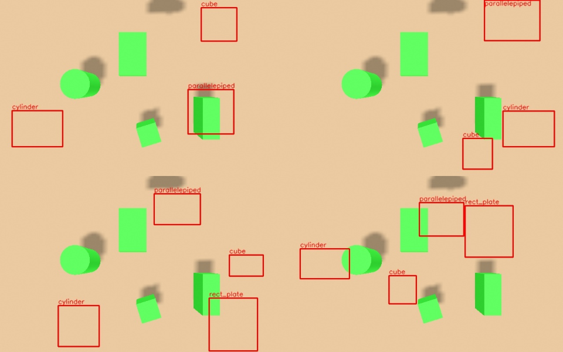

*Рамки (красные) «гуляют» по кадру, а сами зелёные предметы не двигаются. Причина: команды переставить
предметы попали в другую симуляцию, запущенную в том же `GZ_PARTITION`. Обучение на таких данных даёт
mAP 0.002, то есть ничего.*

### 7.2. Ракурсы вокруг предмета и закрытые предметы (новое, 2026-11-13)

**Зачем.** Все прежние датасеты сняты из одной позы наблюдения, почти сверху. Сверху куб — это просто
квадрат, поэтому модель к нему неуверенна. А осмотр стола перед взятием (`survey_objects`,
[PICK_PLACE.md](PICK_PLACE.md)) смотрит на предметы сбоку под 45°: таких кадров модель не видела.

**Как.** С `--view-frac` больше 0 часть кадров снимается так: сборщик выбирает один из видимых
предметов, точку для камеры вокруг него (азимут в пределах ±100° от направления «предмет → основание
руки», наклон `--view-elev`, расстояние `--view-dist`, поворот кадра `--view-roll`) и просит MoveIt
(`/compute_ik` и `/move_action`) поставить туда камеру. Если за 6 попыток рука не достала, кадр
снимается из позы наблюдения. Поэтому для ракурсов симуляцию запускают с **`use_moveit:=true`**; без
MoveIt сборщик сразу прерывается с подсказкой.

**Закрытые предметы.** Сбоку предметы закрывают друг друга. Рамка у нас считается по полной форме
предмета, даже если его не видно. Чтобы не учить сеть «вот куб» там, где куба не видно, сборщик
сравнивает точки поверхности предмета с кадром глубины: если видна меньше чем `--min-surface` (0.12)
доля, рамку не ставит. Сколько рамок так отброшено, видно в `meta.json` (`frames.hidden_boxes`).

```bash
# Окно 1: с MoveIt
ros2 launch cart_xarm_bringup arm_table_gz.launch.py use_moveit:=true headless:=true \
    use_rviz:=false gripper_camera_preview:=true
# Окно 2: половина кадров — с ракурсов
python3 ~/ros2k_ws/src/r2_robot/cart_xarm_bringup/tools/capture_dataset.py \
    --out ~/.local/share/quasi/training/datasets/МОЙ_ДАТАСЕТ --count 300 --view-frac 0.5
```

**Что проверено.** Только короткий прогон на 6 кадров (2026-11-13). Полный датасет с ракурсами не
снимали, модель на нём не обучали: даст ли это прирост на кубе — **не проверено**.

**Известная особенность.** Предмет, у которого в кадр попало меньше `--min-visible` (0.6) рамки
(частично за краем кадра), остаётся **без рамки**, хотя его кусок на картинке виден. Для сети это
пример «здесь ничего нет», что немного её путает. С ракурсов таких обрезанных предметов больше, чем
сверху. Не исправлено; варианты — ставить рамку на видимую часть или закрашивать такой кусок.

## 8. Шаг 2. Обучить (получить свои веса)

```bash
~/.venvs/yolox/bin/python ~/ros2k_ws/src/xarm_grasping/training/train_ssdlite.py \
    --data ~/.local/share/quasi/training/datasets/sim_shapes_v3 \
    --out ~/.local/share/quasi/training/runs/shapes_v3 --epochs 60 --batch 16 --size 320
```

**Что происходит.** Скрипт берёт предобученную модель COCO, заменяет у неё последний слой («какой
класс?») на слой под наши 4 класса, остальные 464 из 476 блоков переносятся как есть, и доучивает. Каждые
две эпохи он считает mAP на проверочных картинках и сохраняет **лучшие** веса (`best.pth`). Обучение
идёт на видеокарте GTX 1050 Ti: около 10 секунд на эпоху, 60 эпох — около 10 минут.

На выходе в `runs/shapes_v3/`: `best.pth` (лучшие веса), `last.pth` (последние), `log.csv` (потери и
mAP по эпохам), `classes.txt`, `config.json` (с каким размером входа учили).

Параметры: `--epochs` (сколько проходов), `--batch` (сколько картинок за раз; при нехватке памяти
видеокарты уменьшайте), `--lr` (скорость обучения, 0.01), `--size` (размер входа, кратно 32),
`--zoom-out` (вероятность «отдалить» кадр при аугментации), `--seed`, `--no-pretrained`
(учить с нуля, обычно хуже).

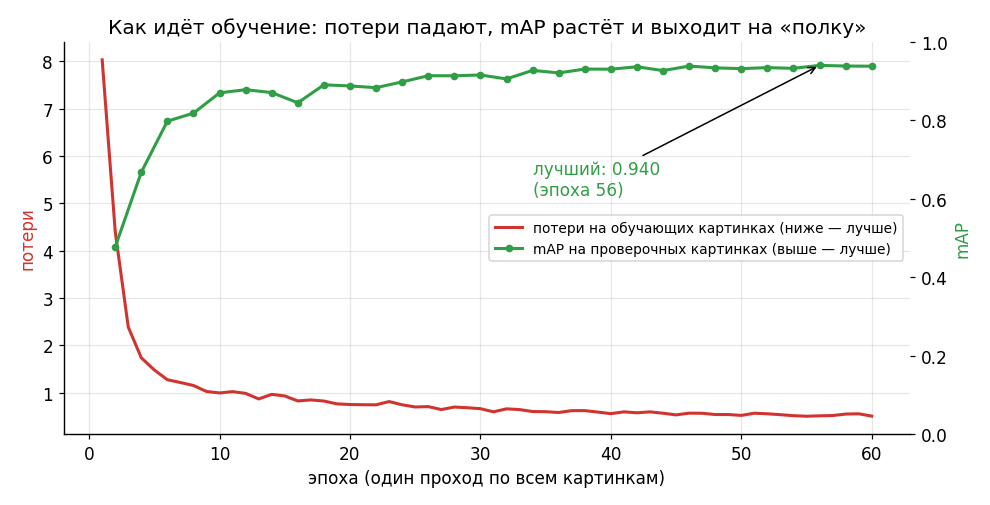

**Как читать ход обучения.**
- Красная линия (потери) **падает**: модель всё меньше ошибается на обучающих картинках.
- Зелёная (mAP на проверочных) **растёт** и выходит на «полку» около 0.94: дальше учить смысла нет.
- Если потери падают, а mAP на проверочных не растёт или падает, это **переобучение**: остановитесь,
  лучшие веса уже сохранены в `best.pth`.
- Если потери **не падают вообще** (застряли на 5–6) и mAP около нуля, это не «слабая модель», а
  скорее всего **неисправные данные** (см. 7.1 и раздел 15).

## 9. Шаг 3. Превратить веса в модели для OpenVINO

```bash
~/.venvs/yolox/bin/python ~/ros2k_ws/src/xarm_grasping/training/export_openvino.py \
    --weights ~/.local/share/quasi/training/runs/shapes_v3/best.pth \
    --data ~/.local/share/quasi/training/datasets/sim_shapes_v3 \
    --out ~/.local/share/quasi/models/sim_shapes_v3
```

Скрипт делает по порядку:
1. веса → `model.onnx`;
2. сохраняет якоря в `anchors.npy`;
3. конвертирует в OpenVINO в **трёх точностях**: `model_fp32.xml/.bin`, `model_fp16.xml/.bin`,
   `model_int8.xml/.bin` (для INT8 берёт 300 картинок из обучающей выборки для калибровки);
4. пишет файл-спутник `.meta.json` к каждой модели.

В модель встроена подготовка кадра: детектор подаёт «сырой» кадр BGR (0..255), перекраска в RGB и
нормировка делаются внутри. Поэтому нет риска, что при обучении и в детекторе картинку подготовили
по-разному.

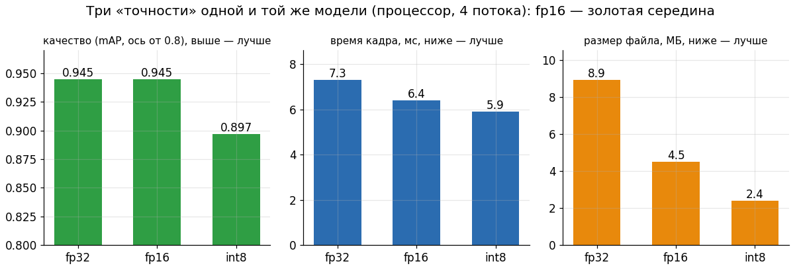

*Одна и та же модель в трёх «весовых категориях». fp16 вдвое легче fp32 и **не теряет в качестве**.
int8 ещё легче и быстрее, но здесь потеряла 0.05 mAP. Поэтому для нашей сцены выбран **fp16**.*

Общее правило выбора: если int8 почти не хуже fp16, берём int8 (на слабом железе выигрыш больше);
если заметно хуже, берём fp16.

## 10. Шаг 4. Проверить качество честно

```bash
~/.venvs/yolox/bin/python ~/ros2k_ws/src/xarm_grasping/training/evaluate_detector.py \
    --data ~/.local/share/quasi/training/datasets/sim_shapes_v3 \
    --models ~/.local/share/quasi/models/sim_shapes_v3/model_{fp32,fp16,int8}.xml \
    --device CPU --threads 4
```

Проверяются ровно те файлы, что поедут на тележку, нашим детектором (а не PyTorch), на проверочных
картинках, которых модель не видела. В таблице: mAP, mAP@0.5, время кадра и размер.

> **Почему числа mAP разные в двух местах?** При обучении mAP считает сама torchvision, а в
> `evaluate_detector.py` — наш детектор OpenVINO с собственной обработкой рамок. Числа могут
> отличаться на несколько сотых (0.940 при обучении и 0.945 в проверке) — это нормально.
> Верить нужно проверке: она считает то, что реально работает на тележке.

**Проверка, что разбор ответа сети написан верно.** Один и тот же кадр прогнали через PyTorch-модель и
через OpenVINO: рамки и оценки FP32 совпали до пикселя, FP16 — до тысячных.

### 10.1. Порог уверенности

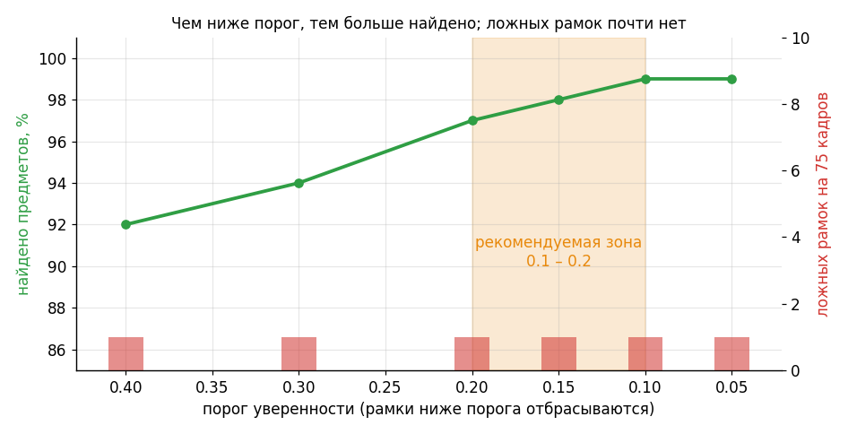

*Чем ниже порог, тем больше предметов найдено (зелёная линия). Красные столбики — ложные рамки (на нашей
проверке их всего 1 на 75 кадров при любом пороге).*

Порог 0.4 привычен для готовых моделей. Для нашей модели он отсекает неуверенный куб, поэтому
рекомендуется **0.1–0.2** (аргумент `detector_conf`). Ложные рамки в системе не так страшны: рамка
должна **попасть на кластер облака точек**, а без кластера её никто не получит (раздел 11).

### 10.2. Уверенность по классам

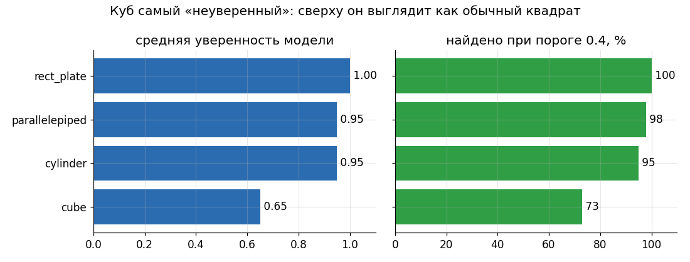

*Пластина и цилиндр с параллелепипедом узнаются почти безошибочно. Куб — самый «неуверенный»: сверху
он выглядит как обычный квадрат, и сеть чуть сомневается.*

## 11. Шаг 5. Подключить в систему и проверить в симуляции

```bash
ros2 launch cart_xarm_bringup arm_table_gz.launch.py detector:=true \
    detector_model:=$HOME/.local/share/quasi/models/sim_shapes_v3/model_fp16.xml \
    detector_conf:=0.2 gripper_camera_preview:=true

# в других окнах (в каждом сначала две строки source, см. RUN_SCENARIOS.md §4.1):
ros2 run rqt_image_view rqt_image_view /detections/image          # картинка с рамками
python3 src/r2_robot/cart_xarm_bringup/tools/show_objects.py     # таблица: предмет, размеры, название от нейросети
```

Детектор сам прочитает файл-спутник (тип, классы, якоря). Если всё работает, у каждого предмета в
`/objects` в поле `detector_label` стоит его настоящий класс, определённый нейросетью по картинке.

**Как класс попадает к предмету.** Облако точек даёт кластер (положение, форму, размер), нейросеть даёт
рамку на картинке с названием. Кластер получает название рамки, если **в неё попадает не менее
половины его точек**:

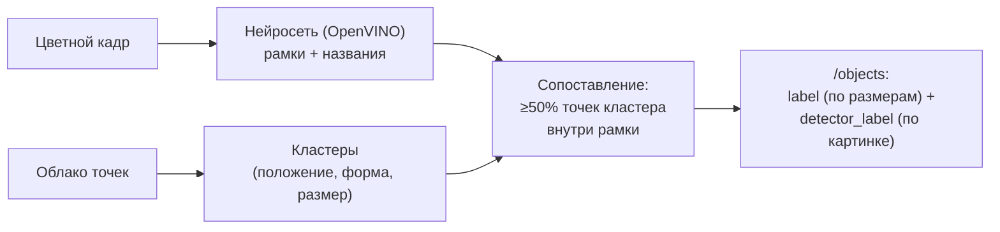

Два названия сосуществуют: `label` (по размерам из облака) и `detector_label` (по картинке). От
`label` зависит захват (размеры, зона). `detector_label` используют команды текстом «возьми куб 1»
(`pick_by_name`: верит названию от нейросети при уверенности не ниже 0.3, иначе берёт класс по
размерам) и осмотр с разных сторон (`survey_objects`: голосование по 5 ракурсам, результат в
`/objects_refined`). Подробно — [PICK_PLACE.md](PICK_PLACE.md).

Путь к модели и порог надо указывать **явно**: по умолчанию launch запускает готовую YOLOX
(`yolox_tiny.onnx`, 80 бытовых классов COCO) с порогом 0.4, а не нашу модель.

Аргументы `detector_model`, `detector_device` (`CPU`, `GPU`, `NPU`, `AUTO`) и `detector_conf`
описаны в [RUN_SCENARIOS.md](RUN_SCENARIOS.md).

## 12. Результаты и история экспериментов

Мы сделали шесть прогонов обучения. Каждый учил чему-то своему (на рисунке — первые пять).

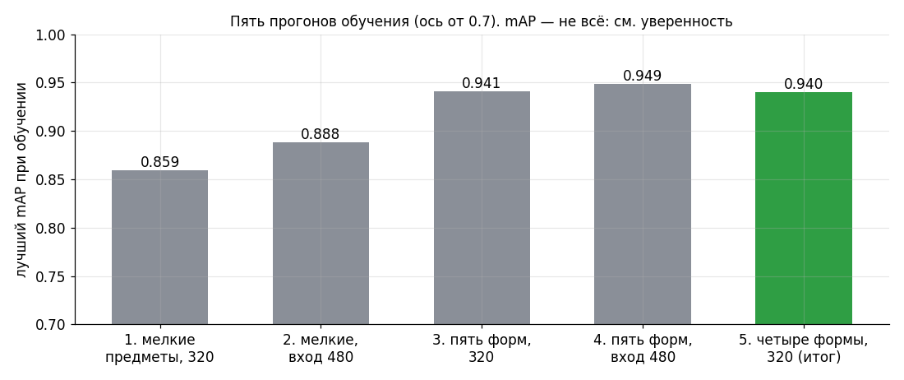

| № | Что учили | Вход | Лучший mAP (обучение) | Что выяснилось |
|---|---|---|---|---|
| 1 | 8 мелких предметов (362 кадра) | 320 | 0.859 | четыре крупных предмета узнаются; **два мелких (5 см) модель видит, но неуверенно** |
| 2 | те же 8 предметов | 480 | 0.888 | mAP чуть выше, но **мелкие по-прежнему пропадают** при пороге 0.4 |
| 3 | 5 форм (куб, параллелепипед, пластина, цилиндр, пирамида), 500 кадров | 320 | 0.941 | отлично, но пирамиду присоска не возьмёт, и по картинке она путалась с кубом |
| 4 | те же 5 форм | 480 | 0.949 | **хуже в деле**: уверенность куба и пирамиды ниже, кадр вдвое дольше |
| **5** | **4 формы (без пирамиды), 500 кадров** | **320** | **0.940** | **рабочая модель `sim_shapes_v3`** |
| 6 | те же 4 формы, вплотную и со случайными цветами (`sim_shapes_v4`, 612 кадров) | 320 | 0.899 (на более трудных проверочных кадрах v4) | лучше v3 на трудных кадрах, но в живой сцене хуже на кубе — **рабочей не стала** ([RECOGNITION_IMPROVEMENT.md](RECOGNITION_IMPROVEMENT.md)) |

**Главный урок — «mAP не всё».** Общий mAP во всех прогонах высокий. Но у мелких предметов (прогон 1,
2) он скрывал низкую **уверенность**:

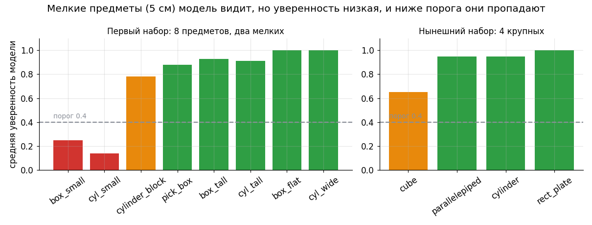

*Серая пунктирная линия — порог 0.4. Мелкие `box_small` и `cyl_small` модель находит, но с уверенностью
0.25 и 0.14: ниже порога, поэтому в системе они «пропадают». Для нового набора крупных предметов такой
проблемы нет.*

Поэтому мы **заменили набор предметов** (крупные, разной формы), а не «мучили» модель на мелких.
Увеличение входа с 320 до 480 не помогло: не размер картинки был причиной.

### 12.1. Рабочая модель: `sim_shapes_v3`

Датасет: 500 кадров (425 обучающих, 75 проверочных, 259 рамок в проверке), по 3–4 предмета на кадре.
Обучение: вход 320, 60 эпох, около 10 минут.

| Модель | mAP | mAP@0.5 | Кадр, мс | Файл |
|---|---|---|---|---|
| fp32 | 0.945 | 1.000 | 7.3 | 8.9 МБ |
| **fp16 (рабочая)** | 0.945 | 1.000 | 6.4 | 4.5 МБ |
| int8 | 0.897 | 0.988 | 5.9 | 2.4 МБ |

Уверенность по классам (int8): пластина 1.00, цилиндр 0.95, параллелепипед 0.95, куб 0.65. Найдено при
пороге 0.4 — 92%, при 0.2 — 97%, при 0.1 — 99%.

**В симуляции** (`detector_conf:=0.2`, сцена из 4 предметов, 2026-11-02): 4 из 4 названы верно —
пластина 1.00, цилиндр 1.00, параллелепипед 0.99, куб 0.29. В сцене из 7 предметов (2026-11-09): 6 из 7
(один куб без названия, ещё один на 0.22). При осмотре с 5 ракурсов (2026-11-13) три куба узнаны
уверенно: 3–4 голоса из 5.

### 12.2. Что мы узнали по дороге

- **Мелкие предметы (5 см) на таком кадре — плохая идея.** Нужны предметы покрупнее.
- **Размер входа 480 не лечит неуверенность** и вдвое замедляет модель (11 мс вместо 6).
- **Вся цепочка проверена на симуляции**, значит, для настоящих предметов остаётся доснять фото.
- **Сборщик может сломаться тихо** (раздел 7.1) — смотреть картинки датасета обязательно.
- **mAP смотреть вместе с уверенностью по классам.**

## 13. Частые вопросы

**Сколько нужно картинок?** Для нескольких заметных однотонных предметов в симуляции хватает
нескольких сотен (мы взяли 425 для обучения). Для настоящих предметов в разных условиях обычно нужно
больше: ориентир — несколько сотен на старт и добавлять там, где модель ошибается.

**Что значит «веса»?** Файл с тем, что модель выучила. Модель — это схема, веса — её память. Одну и
ту же схему можно обучить на разных данных и получить разные веса. Файлы весов: `best.pth` (формат
PyTorch, для дальнейшего обучения), `model.onnx` и `model_*.bin` (для работы на тележке).

**Зачем нужны и `.pth`, и `.onnx`, и `.xml/.bin`?** `.pth` читает только программа обучения, `.onnx` —
универсальный обменный формат, `.xml/.bin` — формат OpenVINO, самый быстрый на Intel. На тележку идут
только `.xml/.bin` (и `anchors.npy`, `.meta.json` рядом).

**Как понять, что модель обучилась хорошо?** По проверочным картинкам: mAP выше 0.7 — хорошо для такой
простой сцены, около 0.9 и выше — отлично. Считать нужно именно на проверочных картинках, которые
модель не видела. И смотреть уверенность по классам (раздел 12).

**Можно ли просто перекрасить предметы вместо обучения?** Нет. Готовая модель называет предмет только
словом из своего списка (80 бытовых классов), и в нём нет «куба» или «цилиндра». Цвет тут ни при чём.

**Почему модель, обученная на симуляции, не работает на настоящей камере?** Картинки симуляции
«идеальные»: однотонные предметы, ровный свет, нет шума. Настоящая камера даёт другой вид. Для
настоящих предметов нужны настоящие фотографии (раздел 16).

**Можно ли использовать веса, обученные на одной камере, на другой?** Да, если вид похож (расстояние,
угол, освещение). Если камера другая или стоит иначе, лучше доснять и дообучить.

**Что делать, если модель путает два предмета?** Посмотреть кадры, где она ошибается, и добавить в
датасет больше таких примеров или сделать их различия заметнее (цвет, этикетка, другой ракурс). У нас
так было с кубом и пирамидой: сверху они одинаковы.

**Как повторить обучение с тем же результатом?** Взять тот же датасет, тот же сид (`--seed`) и те же
параметры. Полной одинаковости не гарантирует видеокарта, но результат будет очень близким.

**Делает ли OpenVINO качество лучше?** Нет. Он только быстро запускает готовую модель. Качество
зависит от датасета и обучения.

## 14. Как добавить новый предмет в сцену и переобучить

1. Добавьте строку в `src/r2_robot/cart_xarm_bringup/config/arm_table_objects.yaml` (имя, форма
   `box`/`cylinder`, размер, место на столе). Класс для датасета — поле `class`, а если его нет, имя
   без хвоста `_N` (`cube_2` → `cube`). Второй предмет той же формы называйте `<класс>_2`, `<класс>_3`.
2. Добавьте правило класса в `src/xarm_grasping/config/objects.yaml` (размеры для облака точек).
3. Запустите генератор мира: `python3 src/r2_robot/cart_xarm_bringup/tools/gen_arm_table_scene.py`
   и пересоберите пакет `colcon build --symlink-install --packages-select cart_xarm_bringup xarm_grasping`.
4. Проверьте сцену в симуляции (кадр камеры).
5. Соберите **новый** датасет (шаг 1), обучите (шаг 2), экспортируйте (шаг 3), проверьте (шаг 4).

Старый набор из 8 предметов хранится в `config/arm_table_objects_8_old.yaml`. Генератор умеет и
`shape: pyramid` (он сам пишет сетку `worlds/meshes/pyramid.obj`), но в сцене её сейчас нет.

## 15. Если что-то пошло не так

| Симптом | Вероятная причина | Что делать |
|---|---|---|
| **Потери застряли около 5–6, mAP ≈ 0** | Испорчен датасет (предметы не двигались, рамки не те) | Посмотреть `preview/` и сравнить кадры между собой (7.1). Удалить датасет, собрать заново в чистом `GZ_PARTITION` |
| Сборщик пишет «set_pose не прошёл» и пропускает кадры | Машина перегружена или в разделе чужая симуляция | Закрыть лишнее, использовать свои `ROS_DOMAIN_ID`/`GZ_PARTITION`, `fastdds shm clean` |
| Сборщик: «5 кадров подряд одинаковые» | `set_pose` уходит не в ту симуляцию | Остановить старые симуляции (`ps`), перезапустить чисто |
| Сборщик жалуется на имя мира | Запущена не та сцена | Параметр `--world`, по умолчанию `arm_table_world` |
| `CUDA out of memory` при обучении | Не хватает памяти видеокарты (4 ГБ) | `--batch 8` или меньше |
| Установился PyTorch под CUDA 13 | pip взял чужой индекс | `pip install torch --index-url https://download.pytorch.org/whl/cu126` (для GTX 1050 Ti) |
| Скрипт установки «заблокирован проверкой безопасности» | Попытка скачать и запустить чужой код | Не обходить; брать библиотечные модели (torchvision) |
| Детектор не находит предметы | Порог слишком высок, камера смотрит не туда, не тот `detector_model` | `detector_conf:=0.1`, посмотреть `/detections/image`, проверить путь к модели |
| Модель не грузится в OpenVINO | Не тот интерпретатор | Запускать `~/.venvs/openvino/bin/python`, а не системный `python3` |
| Куб иногда пропадает | Он самый неуверенный (0.29–0.65) | `detector_conf:=0.1`; осмотр с разных сторон (`survey_objects`, [PICK_PLACE.md](PICK_PLACE.md)); в перспективе — датасет с ракурсами (7.2) |
| Сборщик: «рука не поехала в позу наблюдения» | Задан `--view-frac` больше 0, а MoveIt не запущен | Запустить симуляцию с `use_moveit:=true` или поставить `--view-frac 0` |
| В `class_names.txt` 7 классов (`cube`, `cube_2`, …) вместо 4 | Старая версия сборщика (до 2026-11-13) | Обновить репозиторий: теперь класс — поле `class` или имя без `_N` |

## 16. Что дальше: настоящие предметы

Чтобы модель узнавала **ваши** предметы, есть несколько путей, их можно смешивать:

| Путь | Подойдёт? | Что важно |
|---|---|---|
| **Раскрашивать предметы и менять фон/свет в симуляции** (случайные цвета и текстуры) | Да, полезно | Модель перестаёт запоминать «зелёное пятно» и учит форму. Рамки считаются так же |
| **Скачанные 3D-модели** из интернета | Да | Проверьте лицензию (CC0/CC-BY нормально, «только некоммерческое» не годится). Формат OBJ/DAE подключается в Gazebo так же, как наша пирамида |
| **Видео, где вы снимаете предмет по кругу** | Да, самое ценное | Нужна **разметка** кадров: один предмет на ровном фоне — рамку находит программа; иначе вручную в CVAT/Label Studio. Снимать лучше той же камерой, что на руке (Orbbec Gemini 335Le) |
| **Скан предмета камерой RealSense D455** | Да | Из скана получают сетку (RTAB-Map, Open3D) и ставят в симуляцию как скачанную модель; либо берут цветные кадры как фотографии. D455 — не рабочая камера, вид чуть другой |

Рекомендуемая смесь: **симуляция** (много данных и бесплатная разметка) + **несколько сотен реальных кадров**
рабочей камерой (правильный «вид»).

Что **ещё не сделано** и ограничивает проект:
- модель не проверена на **настоящей камере и предметах**;
- не проверена на **Intel NUC** (устройства `GPU`/`NPU`/`AUTO`, скорость);
- датасета для сцены из **7 предметов с повторами** и **с ракурсами** пока нет (сборщик готов, раздел 7.2);
- куб остаётся самым неуверенным классом;
- сценарии тележки и навигации детектор пока не запускают.

Уже сделано (2026-11-09…13): команда «возьми куб 1» (`pick_by_name`) использует название от нейросети,
осмотр с 5 ракурсов (`survey_objects`) уточняет его голосованием — [PICK_PLACE.md](PICK_PLACE.md).
Сам `/pick_place` работает по номеру предмета (`object_id`), название ему передаёт `pick_by_name`.

## 17. Журнал: что делал по шагам

**2026-11-02.**
1. **Окружение обучения** `~/.venvs/yolox`: PyTorch под видеокарту GTX 1050 Ti (сборка `cu126`: новые
   сборки под CUDA 13 не рассчитаны на это поколение). Первая попытка поставить всё одним скриптом была
   заблокирована проверкой безопасности (скрипт скачивал и запускал чужой код с GitHub), я её не обходил.
   Установка из PyPI потянула сборку под CUDA 13: остановил и поставил строго с индекса PyTorch для
   CUDA 12.6. Затем `pycocotools`, `onnx`, `openvino`, `nncf`, `opencv`.
2. **Сборщик датасета** `capture_dataset.py` (расстановка `gz service set_pose`, кадр, рамки через
   `camera_info` и TF). Проба из 14 кадров: рамки плотно лежат на предметах.
3. **Исправления сборщика:** повтор неудавшихся `set_pose`, проверочные кадры перемешаны равномерно,
   разметка сохраняется каждые 50 кадров, вызовы `set_pose` идут параллельно (кадр 2.3 с вместо 5).
4. **Выбор модели:** SSDlite из torchvision вместо YOLOX (раздел 5), цикл обучения `train_ssdlite.py`.
5. **Экспорт** `export_openvino.py`: ONNX, якоря, IR fp32/fp16/int8.
6. **Детектор научен разбирать SSD** (`detector.py`); YOLOX работает как раньше.
7. **Проверка разбора:** PyTorch и OpenVINO дали те же рамки до пикселя.
8. **Launch:** аргументы `detector_model`, `detector_device` (`arm_table_gz.launch.py`).
9. **Первый датасет** (8 мелких предметов): остановил на 362 кадрах из 600 (Gazebo начал терять
   вызовы). Обучил модель 1 и 2 (вход 480). Мелкие предметы неуверенны. Один раз ошибочно решил, что
   обучение закончилось, не посмотрев журнал (было 22 из 60 эпох): исправил.

**2026-11-02 (вечер), смена набора предметов** по просьбе пользователя:
10. **Пять форм** (куб, параллелепипед, пластина, цилиндр, пирамида): добавил `shape: pyramid` в
    генератор мира (первая сетка без нормалей роняла физику Gazebo: нормали добавлены), правила
    `objects.yaml`, сборщик; датасет `sim_shapes_v1` (500 кадров), модель mAP 0.941. Вход 480 не помог.
11. **Пирамиду убрали** (присоска её не возьмёт; к тому же путалась с кубом): четыре формы.
12. **Испорченный датасет:** первый сбор без пирамиды дал кадры, где предметы не двигались; mAP 0.002.
    Нашёл по логу и по картинкам, добавил защиту в сборщик, собрал заново в чистом разделе.
13. **Итоговая модель `sim_shapes_v3`:** mAP 0.945 (fp16), 4 из 4 в симуляции, аргумент
    `detector_conf`.

**2026-11-03.** Документация переписана целиком: рисунки, словарь, шпаргалка, разбор ошибок; пересмотрены
остальные документы под новую сцену из четырёх предметов.

**2026-11-04.** Сборщик: плотные расстановки и случайные цвета (`--tight-frac`, `--color-frac`),
инструменты `merge_datasets.py`, `analyze_detector.py`, `evaluate_detector.py --filter`. Модель
`sim_shapes_v4` — лучше на трудных кадрах, хуже на кубе в живой сцене; рабочей осталась v3
([RECOGNITION_IMPROVEMENT.md](RECOGNITION_IMPROVEMENT.md)).

**2026-11-09.** Сцена «рука на столе» — 7 предметов (повторы `cube_2`, `cube_3`, `cylinder_2`). v3 при
`detector_conf:=0.2` назвала 6 из 7. Команды текстом «возьми куб 1» (`pick_by_name`).

**2026-11-13.** Сборщик: класс = поле `class` или имя без `_N`; ракурсы вокруг предмета через MoveIt
(`--view-frac` и соседние параметры) и отбрасывание закрытых рамок по глубине (`--min-surface`).
Проверено только коротким прогоном на 6 кадров. Осмотр стола с 5 ракурсов (`survey_objects`): v3
узнаёт три куба уверенно (3–4 голоса из 5).

## 18. Шпаргалка: всё за один вечер

```bash
# 0. Подготовка
cd ~/ros2k_ws && source /opt/ros/kilted/setup.bash && source install/setup.bash
export ROS_DOMAIN_ID=74 GZ_PARTITION=capture                    # свои, чтобы не мешать другим симуляциям
fastdds shm clean                                                # если до этого что-то убивали

# 1. Сбор датасета (окно 1: симуляция; окно 2: сборщик через ~60 с).
#    ~20 минут при --color-frac 0; с умолчаниями (случайные цвета) ~8 с на кадр, 500 кадров ≈ 70 минут.
#    Для ракурсов (--view-frac 0.5) запускать симуляцию с use_moveit:=true
ros2 launch cart_xarm_bringup arm_table_gz.launch.py use_moveit:=false headless:=true use_rviz:=false gripper_camera_preview:=true
python3 src/r2_robot/cart_xarm_bringup/tools/capture_dataset.py --out ~/.local/share/quasi/training/datasets/МОЙ --count 500 --preview 12
#    -> ПОСМОТРЕТЬ preview/ и убедиться, что кадры разные (7.1)

# 2. Обучение. ~10 минут. Пока идёт, не запускать сборщик и чужие симуляции
~/.venvs/yolox/bin/python src/xarm_grasping/training/train_ssdlite.py \
    --data ~/.local/share/quasi/training/datasets/МОЙ --out ~/.local/share/quasi/training/runs/МОЙ --epochs 60 --batch 16

# 3. Экспорт в OpenVINO
~/.venvs/yolox/bin/python src/xarm_grasping/training/export_openvino.py \
    --weights ~/.local/share/quasi/training/runs/МОЙ/best.pth \
    --data ~/.local/share/quasi/training/datasets/МОЙ --out ~/.local/share/quasi/models/МОЙ

# 4. Проверка качества
~/.venvs/yolox/bin/python src/xarm_grasping/training/evaluate_detector.py \
    --data ~/.local/share/quasi/training/datasets/МОЙ \
    --models ~/.local/share/quasi/models/МОЙ/model_{fp32,fp16,int8}.xml --device CPU --threads 4

# 5. Подключить и посмотреть в симуляции
ros2 launch cart_xarm_bringup arm_table_gz.launch.py detector:=true \
    detector_model:=$HOME/.local/share/quasi/models/МОЙ/model_fp16.xml detector_conf:=0.2 gripper_camera_preview:=true
ros2 run rqt_image_view rqt_image_view /detections/image
```

Рисунки этого документа пересобираются командой `python3 docs/img/make_figures_training.py`.
