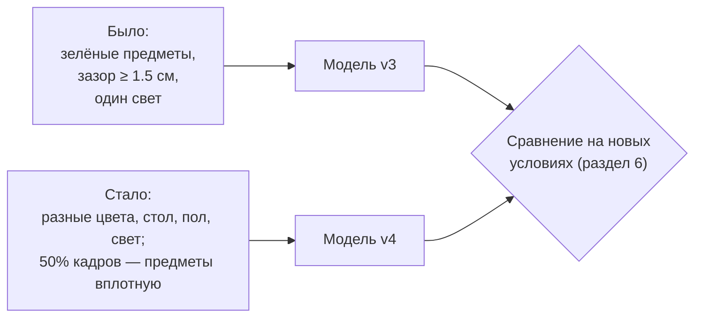
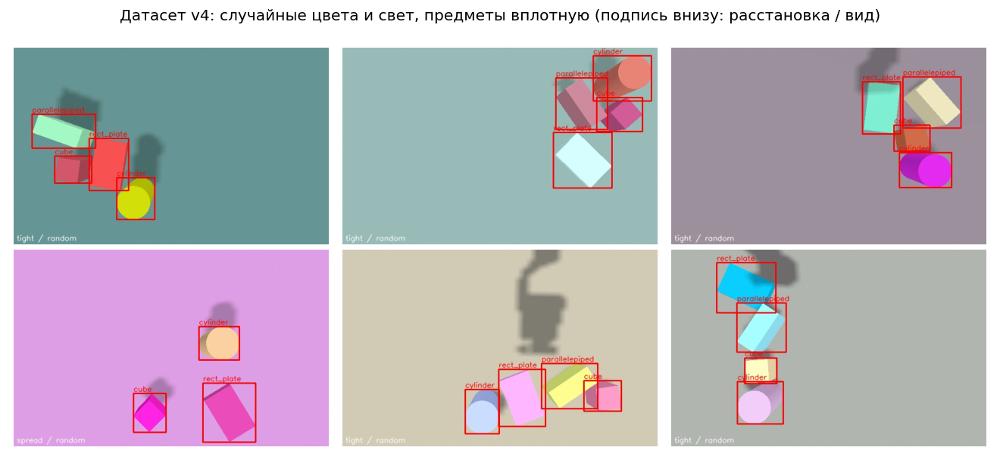
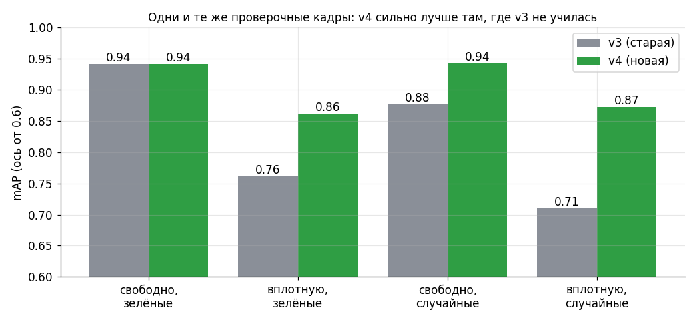

# Улучшение распознавания: плотные расстановки и случайный внешний вид

Журнал работы над качеством распознавания предметов. Здесь записано **зачем** сделано каждое
улучшение, **как оно устроено**, **как его проверить самому** и **что получилось** (с честными
цифрами и оговорками). Написано простым языком: термины («датасет», «веса», «mAP», «порог») объяснены в
[MODEL_TRAINING.md](MODEL_TRAINING.md), раздел 3.

Сначала прочитайте [MODEL_TRAINING.md](MODEL_TRAINING.md), разделы 0–3. Чек-лист работ — в
[CHECKLIST.md](CHECKLIST.md), блок 4а.

> **Итог на 2026-11-13.** Рабочей остаётся модель **v3**
> (`~/.local/share/quasi/models/sim_shapes_v3/model_fp16.xml`, `detector_conf:=0.2`). v4 лучше на
> трудных кадрах, но в живой сцене хуже узнаёт куб (раздел 7). Обе модели обучены на сцене из 4
> предметов; сейчас в сцене 7 предметов (4 формы + повторы `cube_2`, `cube_3`, `cylinder_2`). Следующий
> шаг — датасет с ракурсами и повторами (раздел 8). Неуверенность куба в работе пока закрывает осмотр
> с 5 ракурсов и голосование (`survey_objects`, [PICK_PLACE.md](PICK_PLACE.md)).

---

## 1. Что было не так и что мы сделали

Первая рабочая модель (`sim_shapes_v3`) узнавала предметы в симуляции безошибочно, но училась в
**слишком удобных условиях**:

| Как было | Чем это плохо на настоящем столе |
|---|---|
| Предметы стояли **с зазором** 1.5 см и больше | На настоящем столе предметы стоят вплотную. Облако точек склеивает их в один кластер, а нейросеть никогда не видела соседей «впритык» |
| Все предметы **зелёные**, стол всегда коричневый, свет всегда один | Модель может запомнить **цвет** вместо **формы**: «зелёное пятно такого размера = куб». На другом цвете она ошибётся |

Мы поменяли сборщик датасета ([`capture_dataset.py`](../src/r2_robot/cart_xarm_bringup/tools/capture_dataset.py)),
чтобы эти условия попали в обучение:

1. **Плотные расстановки** — часть кадров с предметами, почти касающимися друг друга.
2. **Случайный внешний вид** — часть кадров со случайными цветами предметов, стола и пола и со
   случайным светом.

Идея в общем виде называется **рандомизацией**: если модель при обучении видит много разных условий,
она учится тому, что важно (форма), а не тому, что случайно совпало (цвет). Рамки при этом считаются
так же автоматически, как раньше: форма и положение предмета известны симулятору, а цвет на класс не
влияет.



## 2. Пункт 1. Плотные расстановки

### 2.1. Как это устроено

Раньше сборщик считал «не пересекаются», сравнивая **описанные круги** предметов. Для длинной пластины
такой круг гораздо больше самого предмета, поэтому предметы разводились на лишние сантиметры.
Теперь сборщик считает зазор по **настоящим контурам** (прямоугольник у коробки, окружность у
цилиндра) методом разделяющих осей и умеет ставить предметы почти вплотную.

Каждый кадр — одного из двух видов:

| Вид | Что происходит | Зазор между предметами |
|---|---|---|
| **свободная** (`spread`) | предметы разбросаны по столу | не менее 15 мм |
| **плотная** (`tight`) | каждый следующий предмет ставится рядом с уже стоящим | около 3–22 мм, чаще 5–15 мм; на видимых кадрах обычно **все** предметы сцены (в v4 — четыре) |

Зазор не нулевой намеренно: физика Gazebo выталкивает пересекающиеся предметы, и они «взрываются». С
зазором в несколько миллиметров предметы стоят спокойно, а на картинке выглядят соприкасающимися.

Проверка расстановок без симуляции (400 расстановок, 4 предмета):

| Вид | Не поместилось | Зазор, мм (мин / медиана / макс) | Видимых предметов в среднем |
|---|---|---|---|
| свободная | 0 из 400 | 15.1 / 69.4 / 279.3 | 3.55 |
| плотная | 0 из 400 | 2.7 / 10.5 / 22.4 | 3.85 |

### 2.2. Что это даёт и чего не даёт

- **Даёт:** нейросеть видит предметы вплотную, с перекрывающимися рамками, и учится их разделять.
- **Не даёт:** предметы не лежат друг на друге (штабель не строится) и не наезжают друг на друга.
- **Оговорка про разметку:** рамка считается по полной геометрии предмета (**амодальная** рамка). Если
  высокий предмет частично закрыл соседа с точки зрения камеры, рамка закрытого всё равно охватывает
  его целиком. Камера смотрит почти сверху, поэтому закрытия небольшие, но в плотных кадрах они бывают.
- **Что это не лечит:** слитые кластеры облака точек. Это отдельная задача (разделение кластера по
  рамкам детектора, CHECKLIST 4а): модель лишь **видит** соседей, а кластеризация по облаку по-прежнему
  склеивает их.

## 3. Пункт 2. Случайный внешний вид

### 3.1. Что меняется

| Что | Как меняется | Диапазон |
|---|---|---|
| Цвет каждого предмета | независимо, случайный оттенок | насыщенность 0.35–1.0, яркость 0.45–1.0 |
| Цвет столешницы | 30%: серый/белый/тёмный; иначе случайный | насыщенность 0.15–0.75, яркость 0.35–0.95 |
| Цвет пола | серый | яркость 0.15–0.8 |
| Основной свет (`sun`) | направление, яркость, оттенок | яркость 0.55–1.0, оттенок ×0.85–1.0, мощность ×0.7–1.4 |
| Заполняющий свет (`fill`) | яркость | 0.2–0.7 |

**Контраст.** Цвет предмета подбирается так, чтобы он заметно отличался от цвета стола (расстояние в
цветовом пространстве RGB не меньше 0.4). Иначе предмет «сливался» бы со столом, а рамка стояла бы у
почти невидимого предмета, и это испортило бы обучение.

**Класс от цвета не зависит.** Цвета выбираются независимо для каждого предмета: куб бывает любого
цвета, и цилиндр тоже. Поэтому нейросеть не может использовать цвет как подсказку.

**Кадры «как раньше».** Только 75% кадров (параметр `--color-frac`) получают случайный вид, остальные 25%
возвращают сцену к исходной: зелёные предметы, коричневый стол, обычный свет. Так наша стандартная сцена
остаётся в датасете, и качество на ней не падает.

### 3.2. Как это делается технически

В Gazebo цвета и свет меняются **на лету**, без перезапуска симуляции:

| Что | Сервис Gazebo | Тип сообщения |
|---|---|---|
| Цвет предмета, стола, пола | `/world/arm_table_world/visual_config` | `gz.msgs.Visual` (поле `material`) |
| Свет | `/world/arm_table_world/light_config` | `gz.msgs.Light` |

Нюансы, на которых легко споткнуться:
- `visual_config` принимает **номер** визуального элемента (id), а не имя. Номера у каждого запуска
  симуляции свои, поэтому сборщик в начале читает их из описания сцены (`scene/info`).
- `light_config` заменяет свет **целиком**: если передать только имя и цвет, пропадают тени и направление.
  Поэтому сборщик каждый раз передаёт полное описание света.
- Цвет предмета в Gazebo — это сумма четырёх компонент (`ambient`, `diffuse`, `specular`, `emissive`).
  Мы задаём все четыре, иначе остаётся старый зелёный «подсвет» (`emissive`).

На каждый кадр уходит около 12 команд Gazebo (4 позы + 4 предмета + стол + пол + 2 источника света). Они
запускаются параллельно, но кадр теперь занимает **около 8 секунд**, а не 2.3 (700 кадров — около
полутора часов).



*Кадры нового датасета. Подпись внизу: расстановка / внешний вид. Красные рамки посчитаны автоматически.*

## 4. Параметры сборщика

```bash
python3 ~/ros2k_ws/src/r2_robot/cart_xarm_bringup/tools/capture_dataset.py \
    --out ~/.local/share/quasi/training/datasets/sim_shapes_v4 --count 700 \
    --tight-frac 0.5 --color-frac 0.75
```

| Параметр | По умолчанию | Что делает |
|---|---|---|
| `--tight-frac` | 0.5 | доля кадров с плотной расстановкой; `0` — все свободные |
| `--color-frac` | 0.75 | доля кадров со случайным внешним видом; `0` — не трогать цвета и свет |
| `--seed` | 1 | случайность; с тем же сидом те же расстановки и цвета |

Чтобы получить **прежнее поведение** (датасет `sim_shapes_v3`): `--tight-frac 0 --color-frac 0 --view-frac 0`
(и `--depth-topic ''`, чтобы выключить проверку закрытых рамок по глубине, появившуюся 2026-11-13).
Ракурсы вокруг предмета (`--view-frac` и др.) — раздел 8 и [MODEL_TRAINING.md](MODEL_TRAINING.md) §7.2,
полная таблица параметров — там же, §7.0.

В разметку каждой картинки добавлены поля, по которым потом можно **оценивать отдельно** разные условия:
`layout` (`tight`/`spread`), `appearance` (`random`/`default`) и `min_gap_mm` (минимальный зазор между
предметами); с 2026-11-13 ещё `view` (`observe`/`orbit`) и `view_info` (параметры ракурса). В
`meta.json` — сколько кадров каждого вида.

> **Не забудьте проверить датасет до обучения** ([MODEL_TRAINING.md](MODEL_TRAINING.md), 7.1): откройте
> `preview/` и убедитесь, что рамки плотно лежат на предметах и что кадры разные.

## 5. Как оценивать отдельно по условиям

Один общий mAP скрывает, **в каких условиях** модель слаба. Для этого к инструментам добавлены:

```bash
# качество только на кадрах определённого вида (поля layout/appearance из разметки)
~/.venvs/yolox/bin/python src/xarm_grasping/training/evaluate_detector.py \
    --data ~/.local/share/quasi/training/datasets/sim_shapes_v4 \
    --models ~/.local/share/quasi/models/sim_shapes_v4/model_fp16.xml \
    --filter layout=tight --filter appearance=random

# разбор ошибок: по порогам, по классам, кого с кем путает, лишние рамки
~/.venvs/yolox/bin/python src/xarm_grasping/training/analyze_detector.py \
    --data ~/.local/share/quasi/training/datasets/sim_shapes_v4 \
    --model ~/.local/share/quasi/models/sim_shapes_v4/model_fp16.xml --threshold 0.2
```

`analyze_detector.py` печатает три вещи: сколько предметов найдено верно / названо неверно / пропущено при
разных порогах, таблицу по классам и **матрицу ошибок** (строка — настоящий предмет, столбец — что сказала
модель, например «куб назван пластиной 3 раза»).

---

## 6. Результаты (2026-11-04)

**Данные.** Две серии съёмки (сиды 11 и 12), склеены `merge_datasets.py`: **612 кадров**
(521 обучающий, 91 проверочный), 2251 рамка. Расстановки: 290 плотных / 322 свободных; вид:
471 случайный / 141 «как раньше». Обе серии оборвались раньше задуманных 700 кадров: Gazebo под
нагрузкой переставал отвечать (см. раздел 7). Все кадры разные (проверено по хешам), рамки на
превью лежат плотно.

**Обучение.** SSDlite320, 60 эпох, батч 16, около 12 минут. Лучший mAP 0.899 на всех проверочных
кадрах v4. Экспорт в OpenVINO: fp32 / fp16 / int8 (mAP int8 0.871, 2.4 МБ, 4.9 мс).

### 6.1. v3 против v4 по условиям

Одни и те же 91 проверочных кадров, модели fp16, процессор:



| Условия | Кадров | v3 | v4 |
|---|---|---|---|
| свободно, зелёные (как раньше) | 14 | 0.942 | 0.942 |
| вплотную, зелёные | 11 | 0.761 | **0.862** |
| свободно, случайные цвета | 35 | 0.877 | **0.943** |
| вплотную, случайные цвета | 31 | 0.710 | **0.872** |
| старый проверочный набор v3 (регрессия) | 75 | 0.945 | 0.937 |

Выводы:
- Старые условия не ухудшились: 0.945 → 0.937 (разница в пределах шума).
- Там, где v3 не училась (вплотную, случайные цвета), mAP вырос с 0.71 до 0.87.
- mAP@0.5 («нашёл ли вообще») у v4 в трудных условиях 0.97–1.00, у v3 0.86–0.90. Остаток mAP
  — неточность самих рамок вплотную.

### 6.2. Разбор ошибок v4 (`analyze_detector.py`, порог 0.2)

| Порог | Верно | Неверное имя | Пропуск | Лишних рамок |
|---|---|---|---|---|
| 0.40 | 87% | 0 | 43 | 2 |
| 0.20 | 95% | 0 | 15 | 4 |
| 0.10 | 99% | 0 | 2 | 6 |

Предметы **не путаются между собой ни разу**. Все пропуски при пороге 0.2 — куб (66 из 81,
средняя уверенность 0.62): сверху он выглядит как обычный квадрат и модель к нему осторожна. Как и
раньше, рекомендуем `detector_conf:=0.2` или ниже.

## 7. Ограничения и честные оговорки

- **Проверочные кадры v4 взяты из той же съёмки, что обучающие** (другие расстановки, но те же
  правила генерации). Для v3 они «чужие». Поэтому рост в таблице частично отражает то, что v4
  училась на этом распределении. Честная проверка — на реальных фото и в реальных условиях; её пока нет.
- **Проверка в живой сцене (зелёные предметы, `detector_conf:=0.2`, `show_objects.py`, 4 замера):**
  цилиндр, параллелепипед и пластина названы всегда (уверенность 0.99–1.00); **куб назван только в 1 из 4
  замеров с уверенностью 0.20, то есть на самом пороге.** С v3 в этой же сцене было 4 из 4. Значит, на
  кубе v4 в нашей стандартной сцене не лучше, а возможно хуже v3. Причина не выяснена (кадров мало).
  Практически: для v4 ставьте `detector_conf:=0.1`, либо оставайтесь на v3 для стандартной сцены.
- Проверочных кадров в группах мало (11–35): цифры ±0.03 не стоит считать значимыми.
- Рамки амодальные (раздел 2.2), слитые кластеры облака точек это не лечит.
- Реальный стол, блики, тени от руки, другие цвета, чем мы подбирали, не проверялись.
- Съёмка медленная (около 8 с на кадр) и срывается под нагрузкой: за съёмкой не запускайте
  ничего тяжёлого. Оба прогона оборвались на 294 и 318 кадрах; для будущих съёмок лучше брать
  партии по 300 кадров и склеивать.

## 8. Следующий шаг: ракурсы и сцена с повторами (сборщик готов 2026-11-13, датасета ещё нет)

**Что мешает сейчас.**
- Все датасеты (v3, v4) сняты из одной позы наблюдения, почти сверху. Сверху куб — просто квадрат, и
  модель к нему осторожна (пропуски куба в разделе 6.2, 1 из 4 замеров у v4 в живой сцене).
- В сцене теперь 7 предметов с повторами, а обе модели видели только по одному предмету каждой формы.
- Осмотр стола перед взятием (`survey_objects`, [PICK_PLACE.md](PICK_PLACE.md)) смотрит на предметы
  под 45°. v3 и так узнаёт по 5 ракурсам три куба уверенно (3–4 голоса из 5), но таких кадров она
  при обучении не видела.

**Что уже сделано в сборщике** (`capture_dataset.py`, подробно — [MODEL_TRAINING.md](MODEL_TRAINING.md) §7.2):
- класс = поле `class` в `arm_table_objects.yaml` или имя без хвоста `_N` (`cube_2` → `cube`): повторы
  дают один класс, а не новые;
- `--view-frac` — доля кадров, где рука через MoveIt ставит камеру вокруг одного из предметов
  (`--view-dist` 0.30–0.45 м, `--view-elev` 40–80°, `--view-roll` ±25°, поза возврата
  `--observe-joints`); по умолчанию 0 — как раньше; нужен `use_moveit:=true`;
- `--depth-topic` и `--min-surface` (0.12) — рамка предмета, закрытого соседом (по кадру глубины видно
  меньше 12% его поверхности), не ставится;
- в разметке поля `view` и `view_info` — по ним можно отдельно оценить кадры с ракурсов
  (`evaluate_detector.py --filter view=orbit`; фильтр по коду сравнивает любое поле разметки, но на
таком датасете ещё не запускался).

**Что проверено:** только короткий прогон на 6 кадров. Полной съёмки и обучения не было.

**Известная особенность:** предмет, у которого в кадр попало меньше `--min-visible` (0.6) рамки, остаётся
без рамки, хотя его часть видна. С ракурсов обрезанных краем кадра предметов больше. Если это помешает
обучению, исправлять в сборщике (рамка по видимой части или закрашивание куска).

**План.**
1. Снять датасет на сцене из 7 предметов: часть кадров с ракурсов (например, `--view-frac 0.5`), партиями
   по 300 кадров (раздел 7), склеить `merge_datasets.py`; проверить `preview/` глазами.
2. Обучить, сравнить с v3 на старом проверочном наборе v3, на кадрах с ракурсов и **в живой сцене**
   (`show_objects.py` и осмотр `survey_objects`), отдельно по кубу.
3. Рабочей модель делать, только если куб в живой сцене не хуже v3.
