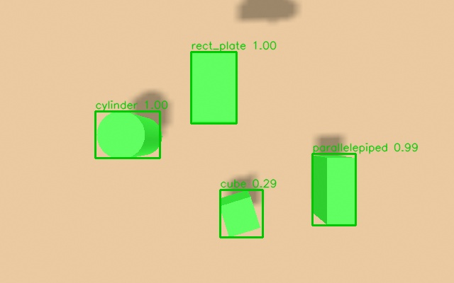

# Запуск сценариев: рука на столе и рука на тележке

Полное руководство: что запускать, с какими аргументами, что при этом поднимается, как проверить,
что всё работает, и как повторить проверки, которые я делал при разработке. Все команды и
значения по умолчанию сняты с настоящих launch-файлов (`src/r2_robot/cart_xarm_bringup/launch/*.py`,
последняя сверка с кодом — 2026-11-13), а перечни узлов, топиков и действий — с живых запусков
2026-11-02…2026-11-13. Где что-то не проверялось, так и написано.

Содержание: [0. Какой сценарий выбрать](#0-какой-сценарий-выбрать) ·
[0.1. Лёгкие сценарии без руки](#01-лёгкие-сценарии-без-руки-аргумент-arm) ·
[1. Подготовка](#1-подготовка) · [2. Рука на столе](#2-сценарий-а-рука-на-столе-arm_table_gz) ·
[3. Рука на тележке](#3-сценарий-б-рука-на-тележке) ·
[4. Распознавание объектов (OpenVINO)](#4-распознавание-объектов-openvino) ·
[5. Как повторить мои проверки](#5-как-повторить-мои-проверки) ·
[6. Нагрузка на ПК](#6-нагрузка-на-пк) · [7. Готовые рецепты](#7-готовые-рецепты) ·
[8. Неполадки](#8-неполадки) · [9. Что не проверено](#9-что-не-проверено)

---

## 0. Какой сценарий выбрать

| Сценарий | Launch-файл | Для чего | Что умеет |
|---|---|---|---|
| **А. Рука на столе** | `arm_table_gz.launch.py` | отладка захвата вакуумной присоской, восприятия, pick&place, команд «возьми куб 1» | полный конвейер: объекты по камере → сцена MoveIt → взять и поставить; команды по названию, осмотр стола с разных сторон |
| **Б1. Тележка с рукой, ручное управление** | `cart_xarm6_gz.launch.py` | проверка тележки с рукой целиком: датчики, камеры, MoveIt, вакуум | датчики тележки (лидар, ToF, IMU, передняя камера), рука с MoveIt и вакуумом, ручной захват |
| **Б2. Тележка, навигация** | `cart_nav_gz.launch.py` | езда по карте: Nav2 + SLAM + OctoMap + метка ArUco у стола | автономная езда по целям; **по умолчанию без руки** (`arm:=false`), рука включается `arm:=true` |

- В **А** рука закреплена на столе, тележки нет: всё, что связано с объектами на столе, работает
  только здесь (`/objects`, `/pick_place`, `/pick_command`, `/survey_objects`, зоны, детектор классов).
- В **Б1** (и в **Б2** при `arm:=true`) рука стоит на тележке `c2l-v3`. Конвейера pick&place на
  тележке пока **нет**: подъезда к столу ещё нет, а с тележки рука достаёт до стола, только если
  встать к нему задом ([NAV.md](NAV.md) §8а).
- **Б2** — это тот же стенд, что **Б1** (он включается внутрь), но с навигацией, без нод захвата
  и — по умолчанию — без руки.

### 0.1. Лёгкие сценарии без руки (аргумент `arm`)

Рука со всем, что к ней относится, — самая тяжёлая часть симуляции тележки. Для тестов езды,
навигации, датчиков и метки ArUco её можно не запускать: launch-аргумент **`arm`** (внутри он
передаётся в xacro как `with_arm`, файл `quasi_cart_description/urdf/cart_with_arm.urdf.xacro`).

| | `cart_xarm6_gz` (Б1) | `cart_nav_gz` (Б2) |
|---|---|---|
| `arm` по умолчанию | `true` (с рукой) | **`false`** (без руки) |

**Что пропадает при `arm:=false`:** рука xArm6 в модели, камера запястья (мост и облако
`/gripper_camera/...`), вакуум (`DetachableJoint`, `vacuum_gripper_sim`, кнопка RViz), контроллеры
руки (`joint_state_broadcaster`, `xarm6_traj_controller`, `arm_hold_controller`), парковка
`arm_parking`, MoveIt (`move_group`, `moveit_world_tf`) и ноды захвата (`scene_markers`,
`grasp_analyzer`). Аргументы `use_moveit`, `arm_parked`, `arm_initial_positions`,
`manipulation_nodes`, `gripper_camera_preview`, `camera_model`, `arm_offset_*` при этом ни на что
не влияют. **Остаётся** вся тележка: Gazebo, привод и `/odom`, лидар `/scan`, ToF
`/range1_pcl`…`/range8_pcl`, IMU `/imu` (только в навигации), передняя камера `/front_camera/...`, часы, RViz
(в Б1 — обычный `cart_xarm.rviz`, даже если `use_moveit:=true`).

**Какой сценарий — какие аргументы — что запускается — сколько грузит:**

| Сценарий | Команда | Что запускается | Нагрузка (замер) |
|---|---|---|---|
| Навигация без руки (**по умолчанию**) | `ros2 launch cart_xarm_bringup cart_nav_gz.launch.py headless:=true` | тележка с датчиками + Nav2, SLAM, OctoMap, ArUco | **27 процессов, ≈ 333 % ядра**; Nav2 поднимается (2026-11-13, headless, 20 с) |
| Навигация с рукой | `... cart_nav_gz.launch.py headless:=true arm:=true` | то же + рука на тормозе в позе «U», контроллеры, `arm_parking` | **30 процессов, ≈ 825 % ядра**; Nav2 за 150 с **не поднялся** (тот же замер) |
| Тележка без руки, ручная езда | `ros2 launch cart_xarm_bringup cart_xarm6_gz.launch.py arm:=false` | тележка с датчиками, RViz; езда `/cmd_vel` | не измерялось (меньше, чем с рукой) |
| Тележка с рукой (Б1 по умолчанию) | `ros2 launch cart_xarm_bringup cart_xarm6_gz.launch.py` | всё: рука, MoveIt, вакуум, ноды захвата | не измерялось отдельно; см. §6 |
| Рука на столе (А) | `ros2 launch cart_xarm_bringup arm_table_gz.launch.py` | тележки нет, рука нужна всегда (аргумента `arm` нет) | см. §6 |

**Как включить руку обратно в навигации:**

```bash
ros2 launch cart_xarm_bringup cart_nav_gz.launch.py headless:=true arm:=true
```

При `arm:=true` в навигации действуют аргументы руки (значения по умолчанию — как в §3.2):
`arm_parked:=true` (рука на тормозе с самого старта; снять — `/arm_parking/set {data: false}`),
`arm_initial_positions:="1.5708 0.06 -0.48 0 0.47 0"` (поза «перевёрнутая U»),
`manipulation_nodes:=false` (вакуум и ноды захвата выключены; `true` — вернуть),
`use_moveit:=false` (MoveIt — по желанию). Помните, что с рукой навигация на этом ПК может не
подняться (замер выше): закройте другие симуляции, `use_octomap:=false`, `use_rviz:=false`.

---

## 1. Подготовка

### 1.1. Один раз на машину

Базовая установка ROS 2 Kilted, Gazebo, сборка — в [INSTALL.md](INSTALL.md). Кроме неё для
перечисленных сценариев нужны:

```bash
sudo apt install ros-kilted-navigation2 ros-kilted-nav2-bringup ros-kilted-slam-toolbox \
                 ros-kilted-octomap-server ros-kilted-octomap-rviz-plugins \
                 ros-kilted-topic-tools ros-kilted-depth-image-proc
```

- `topic_tools` — прореживание часов `/clock` (без него симуляция не получает времени).
- `depth_image_proc` — облака точек камер из глубины.
- Навигация, SLAM, OctoMap — только для Б2.

Сборка (всегда из корня workspace):

```bash
cd ~/ros2k_ws
source /opt/ros/kilted/setup.bash
colcon build --symlink-install
source install/setup.bash
```

С `--symlink-install` правки launch, xacro, Python и yaml подхватываются сразу; **новые** файлы
требуют пересборки пакета (`colcon build --symlink-install --packages-select <пакет>`).

Распознавание объектов (OpenVINO) — отдельная установка, см. §4.7. Для сценариев без детектора
она не нужна.

### 1.2. В каждом терминале

```bash
source /opt/ros/kilted/setup.bash
source ~/ros2k_ws/install/setup.bash
```

### 1.3. Перед каждым запуском

```bash
pgrep -a gz            # должно быть пусто; если висит gz sim server — закрыть: kill <pid>
fastdds shm clean      # убирает мёртвые сегменты Fast DDS (см. §8: из-за них сервисы «не находятся»)
```

### 1.4. Как остановить

`Ctrl+C` в терминале с launch и подождать 10–15 секунд, пока завершатся все процессы.
Если после этого осталось лишнее (`pgrep -a gz`), закрыть вручную. **Не** убивать процессы
`kill -9`: от этого копится мусор в общей памяти (§8).

### 1.5. Несколько симуляций одновременно

Две симуляции в одном домене ROS мешают друг другу (двойные часы, двойные контроллеры). Для
второй задайте отдельные домен и раздел Gazebo:

```bash
export ROS_DOMAIN_ID=77 GZ_PARTITION=my_test
```

### 1.6. Экран

Gazebo (если без `headless:=true`) и RViz открываются на экране. На машине без экрана или по SSH
используйте `headless:=true use_rviz:=false` и смотрите данные через `ros2 topic ...` (§5).

---

## 2. Сценарий А: рука на столе (`arm_table_gz`)

### 2.1. Что это

Рука xArm6 с вакуумной присоской и камерой Orbbec Gemini 335Le на запястье стоит на столе,
тележки нет. Сборка руки та же, что на тележке (`arm_on_table.urdf.xacro` → `cart-arm.xacro`),
поэтому всё, что отлажено здесь, переносится на тележку. Система координат: кадр `world` =
`link_base` (база руки), верх стола на z = 0.

### 2.2. Что стоит на столе

Мир `worlds/arm_table.world` и мост `config/gz_bridge_arm_table.yaml` **генерируются** из
`config/arm_table_objects.yaml` инструментом `tools/gen_arm_table_scene.py` (запустить и
пересобрать пакет, если меняете список). Сейчас **7 предметов**: 4 формы и повторы куба и цилиндра
(с 2026-11-09 — для номеров «куб 1/2/3» и диалога «этот?»). Имя модели в Gazebo — любое уникальное:
класс в `/objects` определяется **по размерам** (`xarm_grasping/config/objects.yaml`), поэтому `cube`,
`cube_2`, `cube_3` — все «куб». Прежний набор из 8 мелких коробок и цилиндров лежит в
`config/arm_table_objects_8_old.yaml` (чтобы вернуть: скопировать его поверх `arm_table_objects.yaml`,
запустить генератор, вернуть правила в `objects.yaml` из git и пересобрать). Координаты `xy` — в кадре
`link_base`:

| Имя модели | Форма | Размер, м | xy |
|---|---|---|---|
| `cube` | куб | 0.06 × 0.06 × 0.06 | (0.50, 0.00), поворот 0.3 рад |
| `cube_2` | куб | 0.06 × 0.06 × 0.06 | (0.52, −0.13) |
| `cube_3` | куб | 0.06 × 0.06 × 0.06 | (0.55, 0.10), поворот 0.6 рад |
| `parallelepiped` | параллелепипед | 0.12 × 0.05 × 0.07 | (0.45, 0.18) |
| `rect_plate` | прямоугольная пластина | 0.14 × 0.09 × 0.02 | (0.25, −0.05) |
| `cylinder` | цилиндр | радиус 0.04, высота 0.10 | (0.35, −0.20) |
| `cylinder_2` | цилиндр | радиус 0.04, высота 0.10 | (0.33, 0.08) |

В `/objects` они получают id «класс_номер»: `cube_0…cube_2`, `cylinder_0`, `cylinder_1`,
`parallelepiped_0`, `rect_plate_0` (номер — порядок, в котором `object_perception` впервые увидел
предмет этого класса, а не имя модели). Номер в командах «возьми куб 1» считается иначе — по
положению на столе, см. [PICK_PLACE.md](PICK_PLACE.md).

> Сборщик датасета `tools/capture_dataset.py` берёт класс из поля `class` или из имени модели без
> `_N` (`cube_2` → `cube`), так что повторы ему не мешают. Модель `sim_shapes_v3` обучена ещё на 4
> предметах без повторов.

Зоны, куда ставить объекты, — `xarm_grasping/config/place_zones.yaml` (`zone_boxes`,
`zone_cylinders`); классы по размерам — `xarm_grasping/config/objects.yaml`.

### 2.3. Запуск

```bash
ros2 launch cart_xarm_bringup arm_table_gz.launch.py                 # всё: Gazebo, RViz с MoveIt
ros2 launch cart_xarm_bringup arm_table_gz.launch.py headless:=true use_moveit:=false use_rviz:=false
# + классы по картинке нашей моделью (§4):
ros2 launch cart_xarm_bringup arm_table_gz.launch.py detector:=true \
    detector_model:=$HOME/.local/share/quasi/models/sim_shapes_v3/model_fp16.xml detector_conf:=0.2
```

Старт занимает около минуты (таймеры в launch): Gazebo и мосты сразу, спавн руки (3 с), контроллеры
(6 с), вакуум, кнопка и маркеры сцены (8 с), восприятие, сцена, анализатор, детектор и RViz (10 с),
MoveIt (12 с), `pick_place_server`, `pick_by_name`, `survey_objects` (16 с).

### 2.4. Аргументы

| Аргумент | По умолчанию | Что делает и когда менять |
|---|---|---|
| `use_moveit` | `true` | `true` — поднимаются `move_group`, `pick_place_server`, `pick_by_name` (команды «возьми куб 1») и `survey_objects` (осмотр стола с разных сторон), окно RViz MoveIt (панель MotionPlanning). `false` — без них: `/pick_place`, `/pick_command`, `/survey_objects` нет, но руку можно двигать утилитой `arm_goto_tcp.py`, а вакуум и восприятие работают. Для отладки камеры и вакуума, а также если нужна лёгкая нагрузка |
| `use_rviz` | `true` | открыть RViz. С MoveIt — окно MoveIt (`cart_xarm_moveit.rviz`), без него — обычное (`cart_xarm.rviz`). `false` — без окна RViz (данные доступны в топиках) |
| `headless` | `false` | `true` — Gazebo без окна (физика и рендер камер работают). Рекомендуется для проверок, а также когда окно мешает нагрузкой (§6) |
| `gripper_camera_preview` | `false` | `true` — камера запястья 640×400 вместо 1280×800: облако в 4 раза легче. Для отладки движений и при низкой скорости симуляции. Распознавание на лёгком кадре хуже |
| `arm_initial_positions` | `0 -0.596 -1.013 0 1.609 0` | начальные углы `joint1..joint6` (рад) через пробел. Это **поза наблюдения**: присоска вниз в (0.30, 0, 0.40); `pick_place_server` распознаёт объекты только из неё. Менять только для опытов |
| `detector` | `false` | `false` — без классов по картинке; `true` — запустить `openvino_detector` (§4); `stub` — детектор не запускать, но `object_perception` слушает `/detections` (для заглушки `tools/stub_detections.py`) |
| `detector_model` | `~/.local/share/quasi/models/yolox/yolox_tiny.onnx` | файл модели детектора (ONNX или OpenVINO IR `.xml`). Рядом может лежать `<имя>.meta.json` с типом, классами и якорями: тогда детектор читает всё сам. Готовая YOLOX по умолчанию **наших форм не знает**; наша текущая модель — `~/.local/share/quasi/models/sim_shapes_v3/model_fp16.xml` (см. [MODEL_TRAINING.md](MODEL_TRAINING.md)), её надо указывать явно |
| `detector_conf` | `0.4` | порог уверенности детектора. Для нашей модели `sim_shapes_v3` брать **0.2** (куб — самый неуверенный класс, 0.2–0.3) |
| `detector_device` | `CPU` | устройство OpenVINO: `CPU`, `GPU`, `NPU`, `AUTO`. На этом ПК брать `CPU` (`GPU` — это NVIDIA, в 8 раз медленнее); на NUC сравнить |
| `gz_args`, `gz_version`, `ign_*`, `debugger`, `debug_env`, `on_exit_shutdown` | см. `--show-args` | служебные аргументы включаемого `gz_sim.launch.py`; обычно не нужны |

### 2.5. Что поднимается

Узлы (по группам):

| Группа | Узлы | Зачем |
|---|---|---|
| Симуляция | `gazebo`, `create` (спавн), `robot_state_publisher`, `gz_bridge`, `gz_bridge_gripper_camera`, `clock_throttle`, `gripper_camera_proc` (+ `gripper_camera_points`) | мир, рука, TF, мост данных, часы `/clock` 200 Гц, облако точек камеры |
| Контроллеры | `joint_state_broadcaster`, `xarm6_traj_controller` (спавнеры) | управление суставами |
| Вакуум | `vacuum_gripper_sim`, `vacuum_rviz_button`, `scene_markers` | присоска на `DetachableJoint`, кнопка в RViz, истинная сцена в RViz |
| Восприятие | `object_perception`, `grasp_analyzer` | объекты на столе (`/objects`); старый анализатор захвата (ищет «цилиндр») |
| Планирование | `scene_manager`, `pick_place_server`, `move_group` | сцена MoveIt, зоны, «взять и поставить» (последние два — при `use_moveit:=true`) |
| Команды и осмотр | `pick_by_name`, `survey_objects` | «возьми куб 1» текстом (`/pick_command`) и осмотр стола с 5 ракурсов (`/survey_objects`, результат `/objects_refined`); только при `use_moveit:=true` |
| Классы по картинке | `openvino_detector` | только при `detector:=true` |

При запуске MoveIt в логе будут сообщения `Could not find the planner configuration 'RRTConnect' on
the param server` и `No 3D sensor plugin(s) defined for octomap updates`. Они есть и в рабочем
запуске, а `pick_place` при них проходил (проверка пользователя, 2026-10-27).

### 2.6. Что делать после запуска

**Посмотреть, что видит система.**

```bash
python3 ~/ros2k_ws/src/r2_robot/cart_xarm_bringup/tools/show_objects.py   # таблицей; сырой вариант: ros2 topic echo /objects --field objects (одна длинная строка) # id, класс, форма, поза, grasp_pose, detector_label
ros2 topic hz /gripper_camera/points         # облако камеры
```

Если консоль пишет `Unknown topic '/objects'`, подождите 10–20 секунд и повторите: объекты
появляются после первого облака, а консоль узнаёт о топике с задержкой.

**Включить и выключить вакуум** (подробности — в заголовке `arm_table_gz.launch.py` и
`docs/CAMERA_VACUUM_SIM.md`):

```bash
ros2 service call /vacuum_gripper/set std_srvs/srv/SetBool "{data: true}"   # включить
ros2 topic pub --once /vacuum_gripper/cmd std_msgs/msg/Bool "{data: false}" # выключить
ros2 topic echo /vacuum_gripper/ready        # можно ли брать (касание есть)
ros2 topic echo /vacuum_gripper/held         # что держим
```

В RViz — кнопка-кубик у присоски (инструмент Interact): клик включает и выключает вакуум, цвет —
«светофор» готовности.

**Взять и поставить по id** (нужен `use_moveit:=true`). id берите из таблицы `show_objects.py`
(проверено в симуляции: `rect_plate_0` 2026-11-09; остальные id после смены набора — не проверено):

```bash
ros2 action send_goal /pick_place xarm_grasping_msgs/action/PickPlace \
    "{object_id: cube_0}" --feedback                                      # зона по правилам
ros2 action send_goal /pick_place xarm_grasping_msgs/action/PickPlace \
    "{object_id: cylinder_0, zone: zone_cylinders}" --feedback
```

Шаги (`stage` в обратной связи): `detect` → поиск места в зоне → `plan_pregrasp` → `approach` →
`grip` → `lift` → `transfer` → `lower` → `release` → `retreat` → `detect`. После включения вакуума,
подъёма и переноса сервер проверяет `/vacuum_gripper/state` («взяли или нет»). Подробно —
[PICK_PLACE.md](PICK_PLACE.md).

**Взять по названию** (узел `pick_by_name`, нужен `use_moveit:=true`; лучше с `detector:=true` и нашей
моделью). Номер — порядок предметов класса на столе; если номер не назван, а предметов несколько,
узел спросит «этот?» и покажет стрелку на кадре `/pick_by_name/image` и в RViz:

```bash
ros2 topic echo /pick_status                                              # в отдельном окне: ответы
ros2 topic pub --once /pick_command std_msgs/msg/String "{data: 'куб 1'}" # команда
ros2 topic pub --once /pick_command std_msgs/msg/String "{data: 'да'}"    # ответ на «этот куб?» (нет / стоп)
ros2 run rqt_image_view rqt_image_view /pick_by_name/image                 # кадр со стрелкой
```

Перед каждой командой с названием `pick_by_name` вызывает осмотр стола `survey_objects` (5 ракурсов
под 45°, голосование нейросети). Осмотр можно вызвать и вручную:
`ros2 service call /survey_objects std_srvs/srv/Trigger`. Названия и синонимы —
`xarm_grasping/config/object_catalog.yaml`; подробно — [PICK_PLACE.md](PICK_PLACE.md).

**Другие действия:** `/detect_objects` (распознать сейчас), `/find_place_pose` (где поставить).

### 2.7. Справочник интерфейсов (с живого запуска)

| Тип | Что |
|---|---|
| Камера запястья | `/gripper_camera/color/image_raw`, `/gripper_camera/aligned_depth/image_raw`, `/gripper_camera/points`, `/gripper_camera/color/camera_info` |
| Объекты | `/objects` (`DetectedObjectArray`), `/objects/markers`, `/scene_markers` |
| Классы по картинке | `/detections`, `/detections/image` (при `detector:=true`) |
| Вакуум | `/vacuum_gripper/{cmd,state,held,ready,contact,status,markers}`, сервис `/vacuum_gripper/set`, `/vacuum/<объект>/{attach,detach,state}` |
| Захват (старый) | `/xarm_grasping/{best_grasp_pose,grasp_candidates,grasp_markers}` |
| Действия | `/pick_place`, `/detect_objects`, `/find_place_pose`, `/move_action`, `/execute_trajectory`, `/xarm6_traj_controller/follow_joint_trajectory` |
| Команды по названию (`use_moveit:=true`) | `/pick_command`, `/pick_status`, `/pick_status_json`, `/pick_by_name/image`, `/pick_by_name/marker` |
| Осмотр (`use_moveit:=true`) | сервис `/survey_objects`, `/objects_refined`, `/survey/status`, `/survey/votes`, `/survey/active` |
| Рука | `/joint_states`, `/dynamic_joint_states`, `/tf` |

### 2.8. Что должно быть, чтобы считать запуск удачным

1. В логе нет `process has died` (кроме завершения по Ctrl+C).
2. `python3 …/tools/show_objects.py` (§4.4) показывает таблицу из **7** предметов (`cube_0…2`,
   `cylinder_0…1`, `parallelepiped_0`, `rect_plate_0`).
3. `ros2 topic echo /vacuum_gripper/ready` отвечает.
4. (С MoveIt) `ros2 action list` содержит `/pick_place` и `/move_action`; `ros2 service list` —
   `/survey_objects`; `ros2 topic list` — `/pick_command`.
5. (С `detector:=true`) `ros2 topic hz /detections` ≈ 2 Гц (`max_rate_hz` в конфиге).

---

## 3. Сценарий Б: тележка (с рукой или без)

Тележка `c2l-v3` (два ведущих колеса сзади, два кастера спереди) с рукой на верхней плите, на
стороне ручки. В симуляции привод — `DiffDrive` на колёсах; рука стоит на тормозе (контроллер
удержания), когда её не используют. Руку можно не запускать вовсе (`arm:=false`, §0.1). Детали —
[NAV.md](NAV.md), [CLAUDE.md](../CLAUDE.md) («Gotchas»).

### 3.1. Б1. Тележка с рукой, ручное управление (`cart_xarm6_gz`)

**Для чего:** проверить тележку с рукой целиком: датчики, камеры, MoveIt, вакуум, ручную езду
командами `/cmd_vel`. Конвейера восприятия и `/pick_place` на тележке нет.

```bash
ros2 launch cart_xarm_bringup cart_xarm6_gz.launch.py                           # всё, с MoveIt
ros2 launch cart_xarm_bringup cart_xarm6_gz.launch.py use_moveit:=false         # RViz без MoveIt
ros2 launch cart_xarm_bringup cart_xarm6_gz.launch.py use_moveit:=false use_rviz:=false headless:=true
ros2 launch cart_xarm_bringup cart_xarm6_gz.launch.py arm_parked:=true          # рука на тормозе с самого старта
ros2 launch cart_xarm_bringup cart_xarm6_gz.launch.py arm:=false                # лёгкая: тележка без руки
```

| Аргумент | По умолчанию | Что делает и когда менять |
|---|---|---|
| `arm` | `true` | `false` — тележка **без руки** (лёгкая симуляция для езды и датчиков): нет руки, камеры запястья, вакуума, контроллеров руки, парковки, MoveIt и нод захвата (§0.1). Все аргументы ниже, относящиеся к руке, тогда не действуют |
| `world` | `worlds/cart_table_offline.world` | мир Gazebo. Варианты: `cart_nav.world` (комната 9×7 м с препятствиями и меткой ArUco), `cart_table.world` (нужен Fuel, интернет). Стол в `cart_table_offline` на x = 1.05, верх z = 0.925 |
| `use_moveit` | `true` | `true` — `move_group` и RViz MoveIt (`cart_xarm_moveit.rviz`); `false` — обычный RViz (`cart_xarm.rviz`) |
| `use_rviz` | `true` | открыть RViz |
| `headless` | `false` | Gazebo без окна |
| `robot_model` | `c2l-v3` | тип тележки: `c2l-v3` или `c2` (файл `quasi_cart_description/urdf/<модель>.urdf.xacro`, см. [CART_MODELS.md](CART_MODELS.md)). Точка крепления руки зависит от модели. `c2` в текущей сборке не проверялся |
| `spawn_x`, `spawn_y`, `spawn_z`, `spawn_yaw` | `-0.5`, `0.0`, `0.07`, `0.0` | где появляется тележка (м, рад). Стол на x = 1.05: при `spawn_x` ближе 0.3 м к столу кузов в него упрётся |
| `arm_initial_positions` | `1.5708 -0.9 -1.3 0 1.0 0` | начальные углы руки; по умолчанию камера смотрит вбок (K8 в STATUS.md). Для опытов с камерой — своя поза |
| `arm_parked` | `false` | `true` — рука под тормозом с самого старта и «не включается, пока нет запроса»; снять: `ros2 service call /arm_parking/set std_srvs/srv/SetBool "{data: false}"`. При `false` рука паркуется сама только на время езды |
| `manipulation_nodes` | `true` | ноды захвата (`vacuum_gripper_sim`, `vacuum_rviz_button`, `scene_markers`, `grasp_analyzer`, облако камеры запястья). `false` — только езда (`arm_parking` остаётся); при этом `pick_box` не приваривается к руке (`vacuum_targets:=none`) |
| `camera_model` | `gemini335le` | камера на запястье: Orbbec 335Le или `d435i` (старая RealSense, топики `/camera/...`) |
| `gripper_camera_preview` | `false` | камера запястья 640×400 вместо 1280×800 |
| `front_camera` | `true` | передняя камера тележки (`/front_camera/...`, 640×400). `false` — меньше нагрузка, но Nav2 теряет облако столешниц |
| `arm_offset_xyz`, `arm_offset_rpy` | `0 0 0` | дополнительное смещение и поворот базы руки относительно штатной точки крепления, м и рад |
| служебные | см. `--show-args` | `gz_args`, `gz_version`, `ign_*`, `debugger`, `debug_env`, `on_exit_shutdown` — от `gz_sim.launch.py` |

`use_rviz` в этом launch объявлен без описания; при `use_moveit:=true` (и `arm:=true`) открывается
окно RViz MoveIt, иначе — обычное `cart_xarm.rviz`.

**Что поднимается всегда (тележка):** `gazebo`, `robot_state_publisher`, `joint_state_publisher`
(`joint_state_merger`: суставы руки + колёса), `clock_throttle`; мосты `gz_bridge`,
`gz_bridge_cart_sensors` (лидар, ToF, IMU), `gz_bridge_front_camera` и облако `front_camera_proc`
(при `front_camera:=true`); `lidar_blackout_filter` (`/scan_raw` → `/scan` без стоек корпуса); RViz.

**Только при `arm:=true` (рука):** мост и облако камеры запястья (`gz_bridge_gripper_camera`,
`gripper_camera_proc`); контроллеры `joint_state_broadcaster`, `xarm6_traj_controller` и
`arm_hold_controller` (тормоз руки, спавнится выключенным); `arm_parking`; при
`manipulation_nodes:=true` — `vacuum_gripper_sim`, `vacuum_rviz_button`, `scene_markers`,
`grasp_analyzer`; при `use_moveit:=true` — `move_group` и `moveit_world_tf`.

**Интерфейсы тележки** (строки «Камера запястья», «Рука», «Вакуум», «Планирование» — только при
`arm:=true`):

| Что | Топики и сервисы |
|---|---|
| Езда | `/cmd_vel` (`geometry_msgs/Twist`, без штампа), `/odom` |
| Лидар | `/scan` (без стоек), `/scan_raw` (сырой), `/scan/points` |
| ToF 1–8 | `/range1_pcl` … `/range8_pcl` (облака; никем не используются, см. [NAV.md](NAV.md) §8а) |
| IMU | `/imu` (`sensor_msgs/Imu`, 50 Гц; только в навигации `cart_nav_gz`; никем не используется) |
| Передняя камера | `/front_camera/color/image_raw`, `/front_camera/aligned_depth/image_raw`, `/front_camera/points` |
| Камера запястья | `/gripper_camera/color/image_raw`, `.../aligned_depth/image_raw`, `.../points` |
| Рука | `/joint_states`, `/arm_parking/state` (`true` — запаркована), сервис `/arm_parking/set` |
| Вакуум | `/vacuum_gripper/{cmd,state,held,ready,contact,status,markers}`, сервис `/vacuum_gripper/set` |
| Планирование | действия `/move_action`, `/execute_trajectory`, `/xarm6_traj_controller/follow_joint_trajectory` |

**Проехать вручную:**

```bash
ros2 topic pub -r 10 /cmd_vel geometry_msgs/msg/Twist "{linear: {x: 0.2}}"        # вперёд 0.2 м/с
ros2 topic pub -r 10 /cmd_vel geometry_msgs/msg/Twist "{angular: {z: 0.5}}"       # поворот на месте
```

(`Ctrl+C` останавливает публикацию; тележка встанет.)

**Парковка руки:**

```bash
ros2 topic echo /arm_parking/state                                                  # true — на тормозе
ros2 service call /arm_parking/set std_srvs/srv/SetBool "{data: true}"             # запарковать
ros2 service call /arm_parking/set std_srvs/srv/SetBool "{data: false}"            # включить руку
ros2 control list_controllers      # при парковке: arm_hold_controller active, xarm6_traj_controller inactive
```

### 3.2. Б2. Рука на тележке, навигация (`cart_nav_gz`)

**Для чего:** автономная езда по целям в комнате 9×7 м (`worlds/cart_nav.world`): карта SLAM
(slam_toolbox), Nav2 (MPPI, costmap по лидару и передней камере), OctoMap по передней камере,
детектор метки ArUco на торце стола (заготовка парковки). **По умолчанию тележка без руки**
(`arm:=false`, §0.1). Подробное устройство, карты и неполадки — [NAV.md](NAV.md).

```bash
ros2 launch cart_xarm_bringup cart_nav_gz.launch.py                              # с окнами, без руки
ros2 launch cart_xarm_bringup cart_nav_gz.launch.py headless:=true               # рекомендуется для езды
ros2 launch cart_xarm_bringup cart_nav_gz.launch.py headless:=true use_octomap:=false  # ещё легче
ros2 launch cart_xarm_bringup cart_nav_gz.launch.py headless:=true arm:=true     # с рукой (тяжело, §0.1)
```

| Аргумент | По умолчанию | Что делает и когда менять |
|---|---|---|
| `arm` | **`false`** | `false` — лёгкая симуляция **без руки**, для езды и парковки. `true` — с рукой: поза `arm_initial_positions`, тормоз `arm_parked`, ноды захвата по `manipulation_nodes`, MoveIt по `use_moveit` |
| `use_rviz` | `true` | RViz навигации (`cart_nav.rviz`, Fixed Frame `map`): карта, costmap, путь, кнопка **Nav2 Goal** |
| `use_moveit` | `false` | MoveIt для руки (только при `arm:=true`). Для езды не нужен и тяжёлый |
| `headless` | `false` | **Рекомендуется `true`**: окно Gazebo ест 0.6–0.75 ядра, вместе с RViz и OctoMap процессор забивается (2026-10-29). Тележку и карты смотрите в RViz |
| `use_octomap` | `true` | 3D-карта по передней камере (`octomap_server`). `false` — меньше нагрузка; Nav2 её не использует |
| `aruco` | `true` | детектор метки ArUco на торце стола (`aruco_detector.py`, стартует через 10 с): `/aruco/marker_pose`, `/detected_dock_pose`, `/aruco/status`, `/aruco/image` — для будущей парковки, см. [NAV.md](NAV.md) §8а. `false` — экономия ~0.35 ядра |
| `arm_initial_positions` | `1.5708 0.06 -0.48 0 0.47 0` | (при `arm:=true`) поза руки на время езды: «перевёрнутая U» поперёк тележки на стороне ручки, присоска в 1.4 см над верхней плитой, пик руки 1.50 м (прежняя поза давала 1.78 м и торчала за борт) |
| `arm_parked` | `true` | (при `arm:=true`) рука под тормозом с самого старта и не включается, пока нет запроса (сервис `/arm_parking/set`) |
| `manipulation_nodes` | `false` | (при `arm:=true`) ноды захвата выключены: при езде рука ничего не держит. `true` — вернуть все (вакуум, анализатор, облако камеры запястья) |
| `gripper_camera_preview` | `true` | (при `arm:=true`) камера запястья 640×400 (экономит GPU и процессор) |
| `spawn_x`, `spawn_y`, `spawn_yaw` | `-2.0`, `0.0`, `0.0` | где стартует тележка (м, рад) |
| проходят в `cart_xarm6_gz` | | `camera_model`, `spawn_z`, `arm_offset_xyz`, `arm_offset_rpy`, `robot_model` — объявлены во вложенном launch и доходят до него (проверен только `camera_model`) |
| **не менять** | | `world` (нужен `cart_nav.world`), `front_camera`, а также `autostart`, `params_file`, `slam_params_file`, `use_lifecycle_manager`, `use_composition`, `namespace`, `graph`, `use_respawn`, `log_level`, `container_name`: их выставляет сам launch (`config/nav2_cart.yaml`, `config/slam_cart.yaml`) |

`robot_model:=c2` для навигации **не использовать**: контур тележки в `nav2_cart.yaml` задан под
c2l-v3 (при c2 Nav2 к тому же в моём пробном запуске не поднялся с первого раза).

**Порядок старта** (таймеры в launch): Gazebo и спавн тележки (4 с), мост TF одометрии и IMU (6 с),
SLAM, OctoMap, RViz и детектор ArUco (10 с), Nav2 и **страж запуска** (30 с). Nav2 готов, когда в терминале
появилась строка `lifecycle_manager_navigation: Managed nodes are active`. Страж
`nav_bringup_watchdog` через ~85 секунд после запуска проверяет SLAM и Nav2 и, если они не
поднялись (гонка при старте), сам делает сброс и запуск (до 4 раз); его сообщения в терминале
начинаются с `nav_bringup_watchdog`.

**Поставить цель.** В RViz кнопкой **Nav2 Goal** (щелчок — точка, протяжка — направление). Без RViz:

```bash
ros2 action send_goal /navigate_to_pose nav2_msgs/action/NavigateToPose \
  "{pose: {header: {frame_id: map}, pose: {position: {x: 0.0, y: -2.2}, orientation: {w: 1.0}}}}"
ros2 run nav2_map_server map_saver_cli -f ~/cart_map          # сохранить карту
```

**Что должно быть:** после `Managed nodes are active` кнопка **Nav2 Goal** принимает цели;
`ros2 topic echo --once /map --field info.width` даёт 179 (карта комнаты); цель из примера
выполняется (`status: SUCCEEDED`); `ros2 topic echo /aruco/status` печатает расстояние до метки,
когда она в кадре; (при `arm:=true`) `ros2 topic echo /arm_parking/state` — `true`.

**Рука при езде** (только `arm:=true`). Она запаркована тормозом в позе «U». Чтобы работать рукой:
снять парковку (`/arm_parking/set {data: false}`), двигать, затем вернуть в позу и запарковать.
Автоматического возврата в «U» нет.

---

## 4. Распознавание объектов: рамки на картинке (OpenVINO)

**Что это даёт.** Нейросеть смотрит на кадр камеры, обводит предметы **рамками** и подписывает, что
это (куб, цилиндр…). Подпись попадает к тому предмету, который уже нашло облако точек. Подробности —
[RECOGNITION_OPENVINO.md](RECOGNITION_OPENVINO.md), как модель обучена — [MODEL_TRAINING.md](MODEL_TRAINING.md).

**Что вы увидите.** Окно с кадром камеры, на котором нарисованы рамки с названиями, и таблицу в
терминале:



*Подпись у рамки: название и уверенность (1.00 — полностью уверена). Куб 0.29 — нормально, он
всегда самый неуверенный.*

### 4.1. Что где вводить: три терминала

Откройте **три отдельных окна терминала**. В каждом сначала введите две строки подготовки (они из §1.2;
без них команды `ros2` не находят наш код):

```bash
source /opt/ros/kilted/setup.bash
source ~/ros2k_ws/install/setup.bash
```

| Окно | Для чего | Что вводить | Когда |
|---|---|---|---|
| **1** | запустить симуляцию и нейросеть | команда из шага 1 ниже | первым |
| **2** | смотреть кадр с **рамками** | команда из шага 2 | через 1–2 минуты после окна 1 |
| **3** | видеть **таблицу** предметов | команда из шага 3 | когда окно 2 показывает картинку |

Окно 1 занято, пока работает симуляция: в нём ничего больше не вводите.

### 4.2. Шаг 1 (окно 1): запуск симуляции с нейросетью

```bash
# убрать мусор прошлых запусков (из §1.3)
pgrep -a gz            # должно быть пусто
fastdds shm clean

ros2 launch cart_xarm_bringup arm_table_gz.launch.py \
    use_moveit:=false use_rviz:=false gripper_camera_preview:=true \
    detector:=true \
    detector_model:=$HOME/.local/share/quasi/models/sim_shapes_v3/model_fp16.xml \
    detector_conf:=0.2
```

Что значит каждая строка: `arm_table_gz.launch.py` — сцена «рука на столе»; `use_moveit:=false
use_rviz:=false` — не запускать тяжёлые MoveIt и RViz, они для распознавания не нужны;
`gripper_camera_preview:=true` — лёгкая камера (640×400); `detector:=true` — включить нейросеть;
`detector_model:=…` — **какая** модель (наша, на четыре формы: куб, параллелепипед, пластина, цилиндр); `detector_conf:=0.2` — отбрасывать
рамки, в которых уверенность ниже 0.2 (подробнее ниже).

Откроется окно Gazebo со столом и семью предметами (§2.2). Подождите **1–2 минуты**, пока всё запустится
(в терминале перестанут бежать новые строки).

### 4.3. Шаг 2 (окно 2): посмотреть кадр с рамками

```bash
ros2 run rqt_image_view rqt_image_view /detections/image
```

Откроется окно `rqt_image_view` с кадром камеры. **Рамки с названиями нарисованы прямо на нём** (как
на рисунке выше). Если окно пустое:
- в выпадающем списке вверху выберите `/detections/image` (рядом кнопка обновления списка);
- подождите ещё минуту: картинка появляется, когда нейросеть обработает первый кадр.

Картинка обновляется примерно 2 раза в секунду (это настройка `max_rate_hz`, чтобы не грузить процессор).

### 4.4. Шаг 3 (окно 3): таблица предметов

```bash
python3 ~/ros2k_ws/src/r2_robot/cart_xarm_bringup/tools/show_objects.py
```

Напечатает один раз (с ключом `--watch` будет обновлять). Пример ниже снят 2026-11-03, когда на столе
было 4 предмета; сейчас строк 7 (три куба `cube_0…2`, два цилиндра `cylinder_0…1`), и модель v3 при
`detector_conf:=0.2` в замере 2026-11-09 назвала 6 из 7 — куб остаётся самым неуверенным классом:

```
id (по облаку)     размеры, см              x, y, м          по картинке: название и уверенность
------------------------------------------------------------------------------------------------
cube_0              6.6 ×  6.0 ×  6.3       ( 0.50, -0.00)   cube            0.30
cylinder_0         цилиндр h=10.0 r= 4.4    ( 0.35, -0.20)   cylinder        1.00
parallelepiped_0   12.4 ×  6.8 ×  7.2       ( 0.45,  0.18)   parallelepiped  0.99
rect_plate_0       14.1 ×  9.3 ×  2.9       ( 0.25, -0.05)   rect_plate      1.00
предметов: 4, названо нейросетью: 4
```

Как читать колонки:

| Колонка | Откуда | Что значит |
|---|---|---|
| `id` | облако точек | имя по размерам + номер; от него зависит захват |
| размеры | облако точек | длина × ширина × высота в сантиметрах (у цилиндра: высота и радиус) |
| `x, y` | облако точек | где предмет стоит на столе, метры, в системе руки |
| название и число справа | **нейросеть** | что она увидела на картинке и насколько уверена |

**Главное, на что смотреть:** справа название должно совпадать с именем в первой колонке (`cube_0` →
`cube`). Если там «— (нейросеть не нашла)», у этого предмета нет рамки с достаточной уверенностью.

> Почему не `ros2 topic echo /objects`? Эта команда выводит всё одной огромной строкой, в ней трудно
> что-либо найти. `show_objects.py` показывает то же самое в виде таблицы.

### 4.5. Что можно менять в запуске

| Аргумент | По умолчанию | Что делает | Когда менять |
|---|---|---|---|
| `detector_model` | `…/yolox/yolox_tiny.onnx` (готовая, **наших форм не знает**) | какая модель | для наших предметов всегда указывать `…/sim_shapes_v3/model_fp16.xml` |
| `detector_conf` | `0.4` | порог уверенности: рамки ниже порога выбрасываются | предмет пропал (куб) — **уменьшить** до `0.1`; появляются лишние рамки — увеличить до `0.3` |
| `detector_device` | `CPU` | на чём считать: `CPU`, `GPU`, `NPU`, `AUTO` | на этом ПК только `CPU`; `GPU` здесь — видеокарта NVIDIA, в 8 раз медленнее |

Остальные настройки (число потоков, частота) — `xarm_grasping/config/openvino_detector.yaml`.

### 4.6. Если что-то не получилось

| Что видите | Что делать |
|---|---|
| В окне 2 пусто, список топиков без `/detections/image` | подождите до 2 минут; убедитесь, что в окне 1 нет красных ошибок, и что **в окнах 2 и 3 выполнены две строки `source`** |
| `show_objects.py`: «ничего не пришло» | то же; ещё проверьте, что запущена именно эта симуляция и совпадает `ROS_DOMAIN_ID` (если вы его меняли, §1.5) |
| Рамок нет вообще или в таблице «нейросеть не нашла» у всех | вы запустили без `detector_model:=…sim_shapes_v3…`: готовая модель по умолчанию наших форм не знает (§4.7) |
| Куб иногда пропадает | снизить `detector_conf` до 0.1 |
| В окне 1 «No such file» про модель | неверный путь к модели; проверьте `ls ~/.local/share/quasi/models/sim_shapes_v3/` |
| `ModuleNotFoundError: openvino` | нет окружения OpenVINO: §4.7 «Установка» |
| Симуляция тормозит | закройте лишние окна и другие симуляции (§6, §1.5) |

### 4.7. Установка (один раз) и готовая модель YOLOX

```bash
python3 -m venv --system-site-packages ~/.venvs/openvino
~/.venvs/openvino/bin/pip install openvino
M=~/.local/share/quasi/models/yolox; mkdir -p $M && cd $M
for n in yolox_nano yolox_tiny yolox_s; do
  curl -sLO https://github.com/Megvii-BaseDetection/YOLOX/releases/download/0.1.1rc0/$n.onnx; done
cd ~/ros2k_ws && colcon build --symlink-install --packages-select xarm_grasping_msgs xarm_grasping cart_xarm_bringup
```

Готовая YOLOX (`detector:=true` без `detector_model`) нужна только для проверки самого детектора: она
называет предметы словами из своего списка (кошка, чашка…) и наших форм (куб, цилиндр, пластина,
параллелепипед) **не знает**, при любом цвете предметов. Для наших форм используйте свою модель из
шага 1. Как её получить (датасет, обучение, экспорт) — [MODEL_TRAINING.md](MODEL_TRAINING.md).

### 4.8. В сценарии Б (тележка)

В Б1/Б2 конвейера объектов нет, но детектор можно запустить отдельно и смотреть рамки в
`/detections/image` (шаг 2 выше):

```bash
~/.venvs/openvino/bin/python ~/ros2k_ws/install/xarm_grasping/lib/xarm_grasping/openvino_detector.py \
  --ros-args --params-file ~/ros2k_ws/install/xarm_grasping/share/xarm_grasping/config/openvino_detector.yaml \
  -p image_topic:=/front_camera/color/image_raw
```

Для тележки своей модели пока нет: она обучена на сцене «рука на столе». Камера запястья на тележке
есть только при `arm:=true` (в навигации по умолчанию руки нет).

---

## 5. Как повторить мои проверки

Скрипты лежат в `src/r2_robot/cart_xarm_bringup/tools/` и запускаются по пути (не устанавливаются):
`python3 ~/ros2k_ws/src/r2_robot/cart_xarm_bringup/tools/<имя>.py`. В таблице ниже `tools/…` —
сокращение этого пути. Запускайте в том же `ROS_DOMAIN_ID` (и `GZ_PARTITION`, если скрипт ходит в
Gazebo), что и симуляция.

### 5.1. Все скрипты: зачем каждый

| Скрипт | Зачем (по его описанию в начале файла) | Нужна симуляция |
|---|---|---|
| `check_recognition.py` | проверка распознавания без ROS: OpenVINO, сопоставление рамок с кластерами, детекция на фото | нет (Python из `~/.venvs/openvino`) |
| `publish_test_image.py` | публикует картинку как кадр камеры, чтобы проверить `openvino_detector` без симуляции | нет |
| `stub_detections.py` | «детектор-заглушка»: рамки из поз объектов, проверяет, что класс достаётся своему кластеру | А, `detector:=stub` |
| `show_objects.py` | печатает таблицу предметов: что нашло облако и что сказала нейросеть (`--watch` — обновлять) | А |
| `test_pick_by_name.py` | проверка логики `pick_by_name.py` без симуляции: поддельные `/objects` и `/pick_place`, команды и ответы | нет |
| `fake_xarm_vacuum.py` | подмена драйвера xArm (`/xarm/set_vacuum_gripper`, `/xarm/get_vacuum_gripper`) для проверки `vacuum_gripper_xarm.py` без руки | нет |
| `check_survey_accuracy.py` | точность положения предметов: вид сверху (`/objects`) против осмотра (`/objects_refined`), правда — позы из Gazebo | А, `use_moveit:=true detector:=true` |
| `check_aruco_accuracy.py` | точность `aruco_detector.py`: переставляет тележку перед столом и сравнивает позу метки с правдой из Gazebo | Б2 |
| `drive_traction_probe.py` | колёсный привод: проскальзывание колёс и наклон корпуса по командам `/cmd_vel` | Б1 в мире `cart_nav.world` |
| `nav_tilt_probe.py` | навигация и устойчивость: шлёт цели Nav2, пишет наклон, суставы руки и парковку | Б2 |
| `capture_dataset.py` | собирает датасет для обучения детектора из сцены «рука на столе» ([MODEL_TRAINING.md](MODEL_TRAINING.md)) | А, отдельные `ROS_DOMAIN_ID`/`GZ_PARTITION` |
| `merge_datasets.py` | склеивает несколько датасетов COCO в один (добор после обрыва съёмки) | нет |
| `gen_arm_table_scene.py` | генерирует объекты мира `arm_table.world` и мост `gz_bridge_arm_table.yaml` из `config/arm_table_objects.yaml` | нет (потом пересобрать) |
| `gen_aruco_marker.py` | рисует картинку метки ArUco и вставляет модель `aruco_dock` в `cart_nav.world` | нет (потом пересобрать) |

У всех, кроме `test_pick_by_name.py`, `fake_xarm_vacuum.py` и `gen_arm_table_scene.py`, есть `--help`.

### 5.2. Проверки и что должно получиться

В таблице — результат, который получил я на живых симуляциях (дата в скобках).

| № | Что проверяет | Как запустить | Ожидаемо |
|---|---|---|---|
| 1 | OpenVINO, сопоставление рамок с кластерами (синтетика), детекция на фото; **без ROS и симуляции** | `~/.venvs/openvino/bin/python tools/check_recognition.py --model ~/.local/share/quasi/models/yolox/yolox_tiny.onnx --image ~/.local/share/quasi/test_images/000000039769.jpg` | все пункты `ок`, найдены 2 кошки, пульт, кровать; ≈ 40 мс на кадр; код возврата 0 |
| 2 | Нода `openvino_detector` на картинке, без симуляции | в одном окне `python3 tools/publish_test_image.py фото.jpg`, в другом нода (§4.8 с `image_topic` по умолчанию), смотреть `ros2 topic echo /detections --field detections` | рамки с классами и score, ≈ 2 Гц |
| 3 | Привязка класса к кластеру облака на реальной геометрии камеры (таблицу печатает `tools/show_objects.py`) | окно 1: `ros2 launch cart_xarm_bringup arm_table_gz.launch.py detector:=stub use_moveit:=false headless:=true use_rviz:=false`; через ~30 с окно 2: `python3 tools/stub_detections.py --duration 30` | в `/objects` у каждого объекта `detector_label` = `stub_<id>` (свой), перепутанных нет (2026-11-02, на 4 предметах; на 7 — не проверено) |
| 4 | Колёсный привод: проскальзывание и наклон | окно 1: `ros2 launch cart_xarm_bringup cart_xarm6_gz.launch.py headless:=true use_rviz:=false use_moveit:=false manipulation_nodes:=false world:=$(ros2 pkg prefix cart_xarm_bringup)/share/cart_xarm_bringup/worlds/cart_nav.world spawn_x:=-3.0 spawn_y:=-0.5`; через ~50 с окно 2: `python3 tools/drive_traction_probe.py` | четыре строки: проскальзывание 0%, тангаж 0.0°, крен 0.0° |
| 5 | Навигация и устойчивость (то, что раньше опрокидывало тележку) | окно 1: `ros2 launch cart_xarm_bringup cart_nav_gz.launch.py headless:=true use_rviz:=false use_octomap:=false arm:=true`; когда Nav2 active, окно 2: `python3 tools/nav_tilt_probe.py` (по умолчанию 4 цели, ≈ 6 мин; быстро: `--goals "0.15,1.76;3.44,1.15"`) | у каждой цели статус 4 («выполнена»), наклон ≈ 0.0°, суставы руки неизменны; в конце `ИТОГ: устойчиво` (2026-11-02, тогда рука была всегда). Без `arm:=true` скрипт тоже работает, но вместо суставов печатает `nan` (не проверено). С рукой Nav2 может не подняться (§0.1) |
| 6 | Логика команд «возьми куб 1» без симуляции | окно 1: `ROS_DOMAIN_ID=80 python3 ~/ros2k_ws/src/xarm_grasping/scripts/pick_by_name.py`; окно 2: `ROS_DOMAIN_ID=80 python3 tools/test_pick_by_name.py` | 11 из 11 проверок, код возврата 0 (2026-11-09) |
| 7 | Переходник вакуума реальной руки без руки | окно 1: `ROS_DOMAIN_ID=78 python3 tools/fake_xarm_vacuum.py`; окно 2: `ROS_DOMAIN_ID=78 python3 ~/ros2k_ws/src/xarm_grasping/scripts/vacuum_gripper_xarm.py`; окно 3: `ROS_DOMAIN_ID=78 ros2 service call /vacuum_gripper/set std_srvs/srv/SetBool "{data: true}"`, «подложить предмет»: `ROS_DOMAIN_ID=78 ros2 param set /fake_xarm_vacuum object true` | `/vacuum_gripper/state` становится `true`, когда предмет «подложен» при включённом вакууме (2026-11-09; точный вывод — не записан) |
| 8 | Точность метки ArUco | окно 1: `ros2 launch cart_xarm_bringup cart_nav_gz.launch.py headless:=true`; окно 2: `python3 tools/check_aruco_accuracy.py` (`--quick` — 3 позы) | ошибка положения 0.7–18 мм, курса до 1.5° на 0.64–2.64 м (2026-11-11, тогда с рукой; без руки — не проверено) |
| 9 | Точность положения предметов после осмотра | окно 1: `ros2 launch cart_xarm_bringup arm_table_gz.launch.py detector:=true detector_model:=$HOME/.local/share/quasi/models/sim_shapes_v3/model_fp16.xml detector_conf:=0.2`; окно 2: `ros2 service call /survey_objects std_srvs/srv/Trigger`, затем `python3 tools/check_survey_accuracy.py` (с `GZ_PARTITION`, как у симуляции, если задан) | по каждому предмету ошибка центра, высоты и размеров, вид сверху против осмотра; вид сверху ~2 мм (2026-11-13) |

**Остальные мои проверки** (каждая — просто команда после запуска Б1/Б2; строки про руку — только
при `arm:=true`):

```bash
ros2 control list_controllers                 # Б2 с рукой: arm_hold_controller active, xarm6_traj_controller inactive
ros2 topic echo --once /arm_parking/state     # Б2 с рукой: data: true
timeout 20 ros2 run tf2_ros tf2_echo base_footprint link_tcp   # Б2 с рукой: присоска x≈0.11 y≈0.22 z≈0.95
ros2 service call /lifecycle_manager_navigation/is_active std_srvs/srv/Trigger   # Б2: success=True
ros2 topic hz /imu                            # только Б2 (навигация): 50–90 Гц в зависимости от скорости симуляции
```

---

## 6. Нагрузка на ПК

Измерено на этом ПК (12 потоков, т. е. максимум 1200 %):

- навигация headless **без руки** (`arm:=false`, по умолчанию с 2026-11-13): 27 процессов, ≈ 333 %;
- навигация headless **с рукой** (`arm:=true`): 30 процессов, ≈ 825 %, Nav2 за 150 с не поднялся
  (замер 2026-11-13, первые 20 с после старта);
- раньше (2026-10-29, с рукой): без окон и RViz ≈ 500 %; с окнами Gazebo, RViz и OctoMap процессор
  забивается (простой 0.5 %).

| Что сделать | Эффект | Цена |
|---|---|---|
| `arm:=false` (Б1, в Б2 уже по умолчанию) | без руки, контроллеров, MoveIt, вакуума и камеры запястья: в навигации ≈ 333 % вместо 825 % | рукой не поработать |
| `headless:=true` | убирает окно Gazebo: −0.6…0.75 ядра | тележку смотреть в RViz |
| `use_octomap:=false` (Б2) | убирает обработку облака передней камеры 15 раз в секунду | нет 3D-карты |
| `use_moveit:=false` | без `move_group` и RViz MoveIt | нет `/pick_place`, нет планирования |
| `gripper_camera_preview:=true` | облако запястья в 4 раза легче | кадр для распознавания хуже |
| `front_camera:=false` (Б1) | без передней камеры и облака | Nav2 не видит столешницы |
| `manipulation_nodes:=false` | без 4 python-нод и облака камеры запястья | нет вакуума и анализатора |
| детектор: `num_threads: 2`, `max_rate_hz: 2` | ≈ 0.5 ядра вместо 1.7 | реже кадры |

Дополнительно: закрыть тяжёлые приложения (браузер) на время замеров; частота `/clock` и тип
исполнителя у Python-нод — в плане работ ([archive/PLAN_2026-10-30.md](archive/PLAN_2026-10-30.md),
[TASK_python_nodes_cpu.md](TASK_python_nodes_cpu.md)).

---

## 7. Готовые рецепты

| Задача | Команда |
|---|---|
| Проверить, что камера и облако работают | `ros2 launch cart_xarm_bringup arm_table_gz.launch.py use_moveit:=false` → `ros2 topic hz /gripper_camera/points` |
| Отладить захват без тяжёлого MoveIt | `ros2 launch cart_xarm_bringup arm_table_gz.launch.py use_moveit:=false`; руку двигать `arm_goto_tcp.py`, вакуум — сервисом `/vacuum_gripper/set` |
| Полный pick&place | `ros2 launch cart_xarm_bringup arm_table_gz.launch.py` → `ros2 action send_goal /pick_place ...` (§2.6) |
| Лёгкий режим при медленной симуляции | `... arm_table_gz.launch.py use_moveit:=false headless:=true gripper_camera_preview:=true` |
| Взять предмет по названию | `ros2 launch cart_xarm_bringup arm_table_gz.launch.py detector:=true detector_model:=$HOME/.local/share/quasi/models/sim_shapes_v3/model_fp16.xml detector_conf:=0.2` → `ros2 topic pub --once /pick_command std_msgs/msg/String "{data: 'куб 1'}"` (§2.6) |
| Тележка с рукой, всё ручками | `ros2 launch cart_xarm_bringup cart_xarm6_gz.launch.py use_moveit:=false` + `ros2 topic pub -r 10 /cmd_vel ...` |
| Тележка без руки (езда, датчики) | `ros2 launch cart_xarm_bringup cart_xarm6_gz.launch.py arm:=false` + `ros2 topic pub -r 10 /cmd_vel ...` |
| Навигация, самый лёгкий режим | `ros2 launch cart_xarm_bringup cart_nav_gz.launch.py headless:=true use_octomap:=false aruco:=false` (руки нет по умолчанию) |
| Навигация со всеми окнами | `ros2 launch cart_xarm_bringup cart_nav_gz.launch.py` (нагрузка высокая) |
| Навигация с рукой | `ros2 launch cart_xarm_bringup cart_nav_gz.launch.py headless:=true arm:=true` (§0.1) |
| Метка ArUco у стола | `ros2 launch cart_xarm_bringup cart_nav_gz.launch.py headless:=true` → `ros2 topic echo /aruco/status` ([NAV.md](NAV.md) §8а) |
| Другая поза руки на тележке | добавить `arm_initial_positions:="0 -0.6 -1.0 0 1.6 0"` к запуску Б1 (в Б2 — вместе с `arm:=true`) |
| Тележка в другом месте | `spawn_x:=-2.0 spawn_y:=1.0 spawn_yaw:=1.57` |
| Рука не двигается (тормоз) | `ros2 service call /arm_parking/set std_srvs/srv/SetBool "{data: false}"` |
| Попробовать распознавание без симуляции | §5.2, проверки 1 и 2 |
| Вторая симуляция параллельно | `export ROS_DOMAIN_ID=77 GZ_PARTITION=my_test` в каждом терминале второй |

---

## 8. Неполадки

| Что видно | Причина | Что делать |
|---|---|---|
| Сервисы и действия «не находятся», `Waiting for service ...`, `failed to send response ... timeout`, Nav2 или SLAM не поднялись | накопился мусор Fast DDS в `/dev/shm` после аварийно остановленных запусков | остановить всё, `fastdds shm clean`, запустить заново |
| Тележка не едет, `TF_OLD_DATA`, падают `spawner` | висит `gz sim server` от прошлого запуска (две тележки и двое часов) | `pgrep -a gz`, `kill <pid>`, перезапуск |
| `bt_navigator` не нашёл `follow_path`/`wait`/`compute_path_to_pose` | гонка при старте | страж запуска сам перезапустит (до 4 раз, первая проверка через ~85 с); вручную: `manage_nodes {command: 3}`, затем `{command: 0}` (см. NAV.md) |
| Нет `/clock`, всё замерло | не установлен `topic_tools` | `sudo apt install ros-kilted-topic-tools` |
| `Unknown topic '/objects'` в консоли | рано: объекты появляются после первого облака | подождать 10–20 с и повторить |
| `ros2 topic echo` из другого терминала ничего не видит | другой `ROS_DOMAIN_ID` или `GZ_PARTITION` | выставить те же значения, что у запуска |
| Рука не реагирует на MoveIt, `/pick_place` отклоняет | в Б: рука на тормозе | `/arm_parking/set {data: false}` |
| В навигации нет руки, `/arm_parking/set` и `/joint_states` «не находятся» | с 2026-11-13 `cart_nav_gz` по умолчанию без руки | добавить `arm:=true` (§0.1) |
| С `arm:=true` Nav2 не поднимается (`... not available after waiting`) | с рукой навигация грузит ≈ 825 % CPU | закрыть другие симуляции, `headless:=true use_octomap:=false use_rviz:=false`; для езды руку не включать |
| При старте MoveIt `Could not find the planner configuration 'RRTConnect'` | известный шум конфигурации OMPL | игнорировать (pick&place при нём проходил) |
| `detector:=true`: нода падает, `No module named 'openvino'` | не установлено окружение или запуск не его Python | §4.7; launch использует `~/.venvs/openvino/bin/python` |
| Детектор берёт 150–170% CPU | не ограничено число потоков | `num_threads: 2` в `openvino_detector.yaml` |
| Тележка завалилась или подпрыгивает | в симуляции колёса — `DiffDrive`, коллизии — цилиндры, рука на тормозе; старые причины — [STATUS.md](STATUS.md) (K10) | `ros2 control list_controllers`: при парковке `arm_hold_controller` active; проверки 4 и 5 из §5.2 |
| Процессор забит | окна Gazebo и RViz + OctoMap | §6 |

---

## 9. Что не проверено

- Запуск **с окнами Gazebo и RViz на вашем ПК** после сегодняшних изменений: я проверял без экрана.
  Поза руки, вид «U» и присоска над плитой — только по числам, глазами не смотрел.
- Проброс `spawn_z`, `arm_offset_xyz/rpy` из навигации во вложенный launch (`camera_model` проверен).
- `robot_model:=c2` в Б1 и Б2 (в Б2 его использовать нельзя, см. §3.2).
- Остальные модели тележки (`c2m-v3`, `c2t-v3`, `c2w-v3`, `c2h-v3`): расстояние между колёсами
  выставлено по суставам, радиус 0.065 м предположен одинаковым.
- Устройства `GPU`, `NPU`, `AUTO` OpenVINO и INT8 — только на NUC.
- Класс по картинке сам `/pick_place` не использует (он берёт предмет по id); использует его
  `pick_by_name` — если уверенность нейросети не ниже 0.3, иначе класс по размерам.
- Свои обученные модели для коробок и пробирок: нет модели и датасета.
- Естественный сбой старта Nav2 со стражем: проверен на искусственной поломке, а настоящий сбой с
  ним пока не наблюдался.
- `cart_xarm6_gz.launch.py arm:=false` (Б1 без руки): нагрузка не измерялась; замер 333 % / 825 %
  сделан только для навигации.
- Скрипты `check_aruco_accuracy.py`, `nav_tilt_probe.py` после перехода навигации на «без руки по
  умолчанию» не перезапускались.
- Узлы `pick_by_name` и `survey_objects` в составе `arm_table_gz.launch.py` целиком: проверены
  отдельными запусками ([PICK_PLACE.md](PICK_PLACE.md)), полный запуск через launch не подтверждён.
- `/pick_place` на всех 7 предметах после смены набора: проверены `rect_plate_0` и кубы (2026-11-09).
