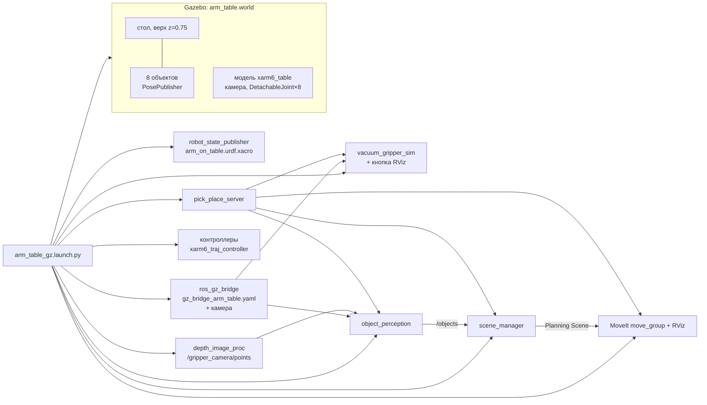
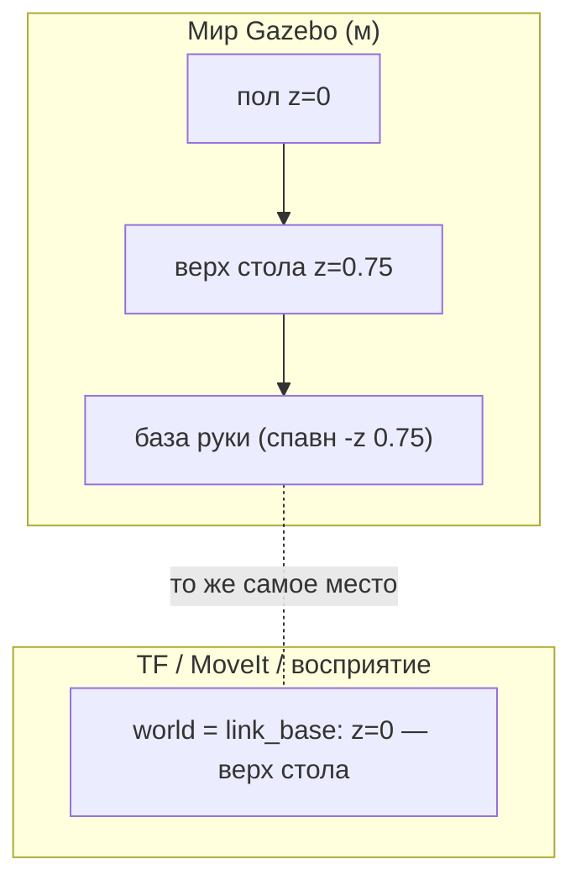
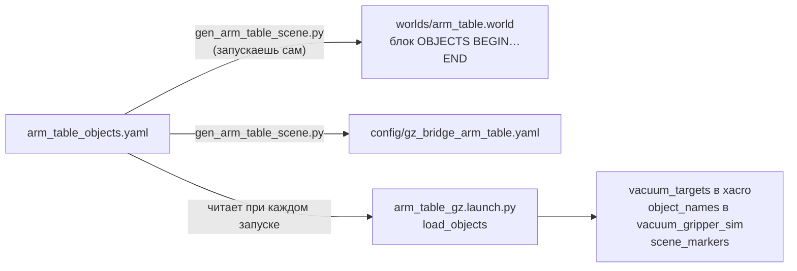
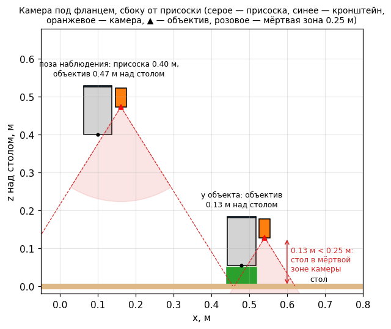
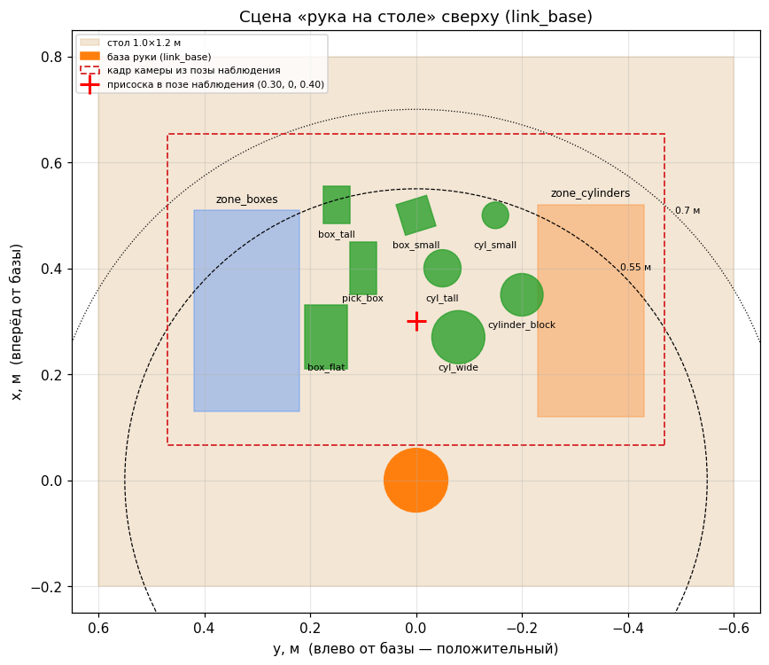

# Глава 8. Рука на столе: отдельный пример для отладки захвата и обучения

> Главные файлы: [`arm_table_gz.launch.py`](../../src/r2_robot/cart_xarm_bringup/launch/arm_table_gz.launch.py),
> [`arm_on_table.urdf.xacro`](../../src/r2_robot/quasi_cart_description/urdf/arm_on_table.urdf.xacro),
> [`arm_table.world`](../../src/r2_robot/cart_xarm_bringup/worlds/arm_table.world),
> [`arm_table_objects.yaml`](../../src/r2_robot/cart_xarm_bringup/config/arm_table_objects.yaml),
> [`gen_arm_table_scene.py`](../../src/r2_robot/cart_xarm_bringup/tools/gen_arm_table_scene.py).
> Номера строк — на состояние 2026-10-22.

---

## 8.1. Зачем отдельный пример

На тележке, чтобы что-то взять, сначала надо **подъехать** к столу, а потом
посмотреть, что на нём. Для отладки захвата и тем более для обучения модели это
лишнее: каждая попытка начинается с поездки, а положение руки относительно
стола каждый раз немного другое.

Поэтому есть второй сценарий: **та же самая рука** (присоска, камера на
кронштейне, вакуум, распознавание, MoveIt), но её база жёстко прикручена к
столу. Всё, что отлажено здесь, без изменений работает и на тележке: используется
одна и та же сборка руки `cart-arm.xacro` (глава 1) и одни и те же ноды.

```bash
ros2 launch cart_xarm_bringup arm_table_gz.launch.py              # с окнами Gazebo и RViz
ros2 launch cart_xarm_bringup arm_table_gz.launch.py headless:=true use_rviz:=false
```

| Аргумент | По умолчанию | Что делает |
|---|---|---|
| `use_moveit` | `true` | поднять `move_group` + RViz MoveIt; без него не работает `/pick_place` |
| `use_rviz` | `true` | окно RViz (`false` — без окон, для проверок) |
| `headless` | `false` | Gazebo без окна (сервер + рендер камеры без экрана) |
| `gripper_camera_preview` | `false` | камера гриппера 640×400 вместо 1280×800 (легче для слабого ПК) |
| `arm_initial_positions` | `0 -0.596 -1.013 0 1.609 0` | стартовые углы суставов (рад) — это **поза наблюдения**, см. 8.6 |

## 8.2. Что запускается



Ноды стартуют не одновременно, а с задержками (`TimerAction`,
[строки 233–239](../../src/r2_robot/cart_xarm_bringup/launch/arm_table_gz.launch.py#L233-L239)):

| Время, с | Что | Почему так |
|---|---|---|
| 0 | Gazebo, `robot_state_publisher`, мосты, `depth_image_proc` | мир и описание робота нужны всем |
| 3 | спавн робота (`ros_gz_sim create`) | Gazebo должен успеть загрузить мир |
| 6 | контроллеры | `controller_manager` живёт внутри Gazebo и появляется после спавна |
| 8 | вакуум, кнопка, маркеры сцены | нужны позы из Gazebo |
| 10 | анализатор, восприятие, `scene_manager`, RViz | нужно облако камеры |
| 12 | MoveIt | `move_group` сразу спрашивает состояние руки |
| 16 | `pick_place_server` | ему нужны MoveIt и восприятие |

> **Почитать.** Что такое launch-файл и как он устроен:
> [ROS 2: Creating a launch file](https://docs.ros.org/en/kilted/Tutorials/Intermediate/Launch/Creating-Launch-Files.html),
> [Using substitutions](https://docs.ros.org/en/kilted/Tutorials/Intermediate/Launch/Using-Substitutions.html).

## 8.3. Модель: та же рука, но база в мире

Файл [`arm_on_table.urdf.xacro`](../../src/r2_robot/quasi_cart_description/urdf/arm_on_table.urdf.xacro)
очень короткий — вся рука берётся из `cart-arm.xacro`:

```xml
<xacro:arg name="vacuum_targets" default="pick_box cylinder_block"/>
<!-- База руки ровно на крепёжной точке base_link -->
<xacro:property name="arm_mount_xyz" value="0 0 0"/>

<link name="world"/>
<link name="base_link"/>
<joint name="world_to_base" type="fixed">
  <parent link="world"/>
  <child link="base_link"/>
</joint>

<xacro:include filename="cart-arm.xacro"/>
<xacro:mount_xarm6_on_cart/>
```

Что здесь важно:

* **Звено `world` в URDF.** Если корневое звено URDF называется `world`, Gazebo
  при спавне жёстко приваривает модель к миру в точке спавна. Поэтому рука не
  падает со стола и не сдвигается от рывков.
* **Все кадры совпадают:** `world = base_link = arm_mount_link = link_base`.
  Это сделано специально: у MoveIt своя модель руки, в которой `world → link_base`
  тоже тождественное преобразование. Значит, в RViz картинка MoveIt и TF-дисплеи
  (облако, маркеры) совпадают без поправок. На тележке для этого пришлось
  публиковать отдельный TF `link_base → world` (глава 2).
* **Высота стола задаётся не в URDF, а позой спавна:** `-z 0.75`
  ([строка 98](../../src/r2_robot/cart_xarm_bringup/launch/arm_table_gz.launch.py#L98)).
  В Gazebo верх стола на z=0.75, а в ROS (TF, MoveIt, восприятие) **верх стола —
  z=0** в `link_base`. Все числа в конфигах восприятия и зон даны в `link_base`.



> ⚠️ **Обрати внимание.** Если поменять высоту стола в мире, нужно поменять
> `TABLE_TOP_Z` в launch (строка 45) **и** константу `TABLE_TOP` в генераторе
> сцены (8.4). Конфиги восприятия трогать не нужно: в `link_base` стол так и
> останется на z=0.

## 8.4. Мир и объекты: один список — три файла

На столе 8 объектов: 4 коробки и 4 цилиндра разных размеров. Каждый объект
нужно описать в **трёх** местах, и они обязаны совпадать:

1. в мире Gazebo (модель с формой, массой и `PosePublisher`);
2. в мосте ROS↔Gazebo (вакуумные топики и поза каждого объекта);
3. в launch (список для вакуума, маркеров сцены и `vacuum_targets` в xacro).

Чтобы они не разошлись, источник один:
[`config/arm_table_objects.yaml`](../../src/r2_robot/cart_xarm_bringup/config/arm_table_objects.yaml).

```yaml
objects:
  - {name: pick_box,       shape: box,      size: [0.10, 0.05, 0.05], xy: [0.40, 0.10],  yaw: 0.0, mass: 0.10}
  - {name: box_small,      shape: box,      size: [0.06, 0.06, 0.04], xy: [0.50, 0.00],  yaw: 0.3, mass: 0.08}
  - {name: box_tall,       shape: box,      size: [0.07, 0.05, 0.10], xy: [0.52, 0.15],  yaw: 0.0, mass: 0.15}
  - {name: box_flat,       shape: box,      size: [0.12, 0.08, 0.03], xy: [0.27, 0.17],  yaw: 0.0, mass: 0.12}
  - {name: cylinder_block, shape: cylinder, size: [0.04, 0.09],       xy: [0.35, -0.20], yaw: 0.0, mass: 0.10}
  - {name: cyl_small,      shape: cylinder, size: [0.025, 0.06],      xy: [0.50, -0.15], yaw: 0.0, mass: 0.05}
  - {name: cyl_wide,       shape: cylinder, size: [0.05, 0.05],       xy: [0.27, -0.08], yaw: 0.0, mass: 0.12}
  - {name: cyl_tall,       shape: cylinder, size: [0.035, 0.13],      xy: [0.40, -0.05], yaw: 0.0, mass: 0.12}
```

| Поле | Смысл |
|---|---|
| `name` | имя модели в Gazebo **и** класс объекта для распознавания (глава 10) |
| `shape` | `box` или `cylinder` |
| `size` | коробка — `[X, Y, Z]`; цилиндр — `[радиус, высота]`, м |
| `xy`, `yaw` | центр на столе в `link_base` и поворот вокруг вертикали |
| `mass` | масса, кг (инерция считается автоматически) |

Как это работает:



**Генератор** [`tools/gen_arm_table_scene.py`](../../src/r2_robot/cart_xarm_bringup/tools/gen_arm_table_scene.py):

```bash
python3 src/r2_robot/cart_xarm_bringup/tools/gen_arm_table_scene.py
# объектов: 8 -> worlds/arm_table.world, config/gz_bridge_arm_table.yaml
```

Он делает три вещи:

* **проверяет, что объекты не пересекаются**: расстояние между центрами должно
  быть больше суммы описанных радиусов + 1 см. Иначе он отказывается
  работать и показывает, какие объекты мешают друг другу;
* **заменяет в мире блок между маркерами** `<!-- OBJECTS BEGIN -->` и
  `<!-- OBJECTS END -->` ([строка 81 мира](../../src/r2_robot/cart_xarm_bringup/worlds/arm_table.world#L81)),
  остальной мир (стол, свет, плагины) не трогает;
* **пишет мост** заново целиком: для каждого объекта 4 записи (attach, detach,
  state, поза).

Для каждого объекта генератор строит такую модель (функция `model`,
[строка 46](../../src/r2_robot/cart_xarm_bringup/tools/gen_arm_table_scene.py#L46)):

```xml
<model name="cyl_small">
  <pose>0.5 -0.15 0.7805 0 0 0.0</pose>          <!-- z = верх стола + h/2 + 0.5 мм -->
  <plugin filename="gz-sim-pose-publisher-system" name="gz::sim::systems::PosePublisher">
    <publish_model_pose>true</publish_model_pose>
    ...
    <update_frequency>10</update_frequency>      <!-- /model/cyl_small/pose, 10 Гц -->
  </plugin>
  <link name="link">                              <!-- имя «link» ждёт вакуумный плагин -->
    <inertial><mass>0.05</mass><inertia>...</inertia></inertial>
    <visual>…<material>ярко-зелёный + emissive…</material></visual>
    <collision>…трение mu=1…</collision>
  </link>
</model>
```

Зачем каждая деталь:

* **Запас 0.5 мм по высоте.** Если объект создать ровно на поверхности стола,
  физика в первый момент видит «проникновение» и подбрасывает его.
* **Не `static`.** Статичный объект физика не двигает, и вакуумный плагин не
  смог бы его унести.
* **`PosePublisher`.** Истинная поза объекта из Gazebo. Она нужна вакууму (касается
  ли присоска объекта, глава 9) и маркерам сцены (сравнить распознавание с
  истиной).
* **Инерция** считается по формулам сплошных тел: коробка
  `Ixx = m(y²+z²)/12`, цилиндр `Ixx = m(3r²+h²)/12`, `Izz = m r²/2`. С неверной
  инерцией объект в присоске может странно раскачиваться.

> **Как добавить свой объект.** 1) Допиши строку в `arm_table_objects.yaml`.
> 2) Запусти генератор. 3) Если это новый класс — добавь правило в
> `xarm_grasping/config/objects.yaml` (глава 10), иначе он распознается просто как
> `box` / `cylinder`. 4) Перезапусти launch (пересборка не нужна:
> `--symlink-install`).

> **Почитать.** Формат мира SDF: [sdformat.org — model](http://sdformat.org/spec?elem=model),
> [link/inertial](http://sdformat.org/spec?elem=link);
> моменты инерции простых тел — [Wikipedia: List of moments of inertia](https://en.wikipedia.org/wiki/List_of_moments_of_inertia).

## 8.5. Кронштейн камеры Camera_Stand_1300

Раньше вместо кронштейна был условный кубик. Теперь стоит деталь из CAD:
[`quasi_camera_description/meshes/brackets/camera_stand_1300.stl`](../../src/r2_robot/quasi_camera_description/meshes/brackets/camera_stand_1300.stl).

Как разбирались с файлом:

* **Единицы.** Размеры в STL 113×3×75 → это миллиметры, отсюда
  `scale="0.001 0.001 0.001"`.
* **Форма.** Плоская пластина толщиной 3 мм: диск Ø75 с отверстием Ø30 и
  крепёжными отверстиями садится на фланец, лапка 45×60 мм с тремя пазами — под
  камеру.
* **Поворот.** В меше толщина идёт вдоль Y, а на руке она должна идти вдоль оси
  инструмента Z. Поворот `rpy = (π/2, 0, 0)` переводит Y меша в Z инструмента, а
  Z меша в −Y.
* **Камера.** Прикручена задней панелью к лапке (это подтвердил владелец
  железа) и смотрит вдоль оси инструмента. Ширина камеры 124 мм поперёк лапки,
  иначе корпус налез бы на присоску.

Код в [`gripper_camera.xacro`](../../src/r2_robot/quasi_camera_description/urdf/gripper_camera.xacro):

```xml
<xacro:macro name="gripper_camera"
    params="camera_model parent:=link_eef name:=gripper_camera
            mount_xyz:='0.075 0 0.015' mount_rpy:='0 ${-pi/2} 0' ...">
  <joint name="${name}_bracket_joint" type="fixed"> ... parent=link_eef ... </joint>
  <link name="${name}_bracket_link">
    <visual>
      <origin xyz="0 0 0" rpy="${pi/2} 0 0"/>
      <geometry>
        <mesh filename="file://$(find quasi_camera_description)/meshes/brackets/camera_stand_1300.stl"
              scale="0.001 0.001 0.001"/>
      </geometry>
    </visual>
    ...
```

`mount_rpy = (0, −π/2, 0)` поворачивает камеру так, что её ось взгляда X смотрит
вдоль +Z инструмента (вниз, туда же, куда присоска). Ширина Y остаётся поперёк, а
верх камеры смотрит к оси руки. `mount_xyz = (0.075, 0, 0.015)` — это нижний винт
камеры: на краю лапки, а задняя панель лежит на пластине (0.015 − 0.012 = 0.003 м
от фланца).

Перед тем как доверять позе, проверили по мешам, что ничего не пересекается
(кронштейн ±37.5 мм, присоска по X до 37.5 мм, камера по X 46…75.5 мм):



*Рис. 8.1. Геометрия: камера висит под фланцем сбоку от присоски, объектив на
7.3 см выше кончика присоски. Розовым — мёртвая зона камеры (ближе 0.25 м она
ничего не видит).*

## 8.6. Поза наблюдения

Рисунок 8.1 объясняет главное правило всей системы захвата: **камера видит
только то, что дальше 25 см**, а сидит всего на 7 см выше кончика присоски. Когда
присоска у объекта, стол для камеры в мёртвой зоне.

Поэтому есть **поза наблюдения**: присоска смотрит вниз в точке
(0.30, 0, 0.40) над столом, объектив примерно на 0.47 м. Из неё в кадр
попадают все объекты и обе зоны установки (рис. 8.2). Углы суставов для неё
посчитаны обратной кинематикой из `arm_goto_tcp.solve_ik` (глава 4):

```python
c = Chain(urdf, 'link_base', 'link_tcp')
q, err, tilt = solve_ik(c, np.array([0.30, 0.0, 0.40]), q0)
# q = [0, -0.596, -1.013, 0, 1.609, 0]
```

Это значение стоит по умолчанию в `arm_initial_positions`
([строка 230](../../src/r2_robot/cart_xarm_bringup/launch/arm_table_gz.launch.py#L230)),
поэтому **объекты распознаются сразу после запуска**. Ту же позу использует
`pick_place_server` (параметр `observe_pose`, глава 13).



*Рис. 8.2. Сцена в `link_base`: объекты (зелёные), зоны установки (глава 12),
кадр камеры из позы наблюдения (красный пунктир), досягаемость руки 0.55 и
0.7 м.*

> ⚠️ **Обрати внимание.** Камера стоит боком: ширина кадра (угол 90°) идёт вдоль
> Y стола, высота (около 64°) вдоль X. Поэтому кадр — вытянутый поперёк
> прямоугольник. Зоны установки специально поставлены внутрь кадра. Объект у края
> кадра виден частично, и распознаётся плохо.

## 8.7. Свет

Чтобы картинка камеры была светлой и тени не прятали объекты, в оба мира
(`arm_table.world` и `cart_table_offline.world`) добавлено:

```xml
<scene>
  <ambient>0.6 0.6 0.6 1</ambient>          <!-- рассеянный свет: тени светлее -->
  <background>0.75 0.8 0.85 1</background>
  <shadows>true</shadows>
</scene>
<light type="directional" name="sun">       <!-- солнце: 1.0 вместо 0.8 -->
  <diffuse>1.0 1.0 1.0 1</diffuse> ...
</light>
<light type="directional" name="fill">      <!-- заполняющий свет с другой стороны, без теней -->
  <cast_shadows>false</cast_shadows>
  <diffuse>0.5 0.5 0.5 1</diffuse>
  <direction>0.6 -0.3 -0.7</direction>
</light>
```

На распознавание свет не влияет: оно работает только по **глубине**. Свет нужен
человеку и будущим алгоритмам, которые будут смотреть на цвет (например,
нейросеть).

> **Почитать.** [SDF: scene](http://sdformat.org/spec?elem=scene),
> [SDF: light](http://sdformat.org/spec?elem=light).

## 8.8. Что здесь можно менять

| Хочу… | Где | Что |
|---|---|---|
| другие объекты на столе | `config/arm_table_objects.yaml` + генератор | строки списка |
| высоту стола | `TABLE_TOP_Z` в launch и `TABLE_TOP` в генераторе, стол в мире | 0.75 |
| другую позу наблюдения | `arm_initial_positions` (launch) и `observe_pose` (`pick_place_server`) | пересчитать IK |
| другой кронштейн / место камеры | `gripper_camera.xacro`: меш, `mount_xyz`, `mount_rpy` | — |
| светлее / темнее | `<scene><ambient>`, `diffuse` у `sun` и `fill` в мире | 0…1 |

## 8.9. Частые ошибки

| Симптом | Причина | Что делать |
|---|---|---|
| Новый объект есть в мире, но вакуум его не берёт | не запущен генератор или launch не перезапущен | генератор → перезапуск |
| Генератор пишет «пересекаются» | объекты слишком близко | раздвинуть `xy` |
| Ноды `object_perception`/`scene_manager`/`pick_place_server` падают сразу при старте | терминал сделал `source install/setup.bash` до сборки нового пакета `xarm_grasping_msgs` | новый терминал или повторный `source` |
| В RViz пусто, хотя всё запущено | не выбран Fixed Frame или выключены дисплеи Objects / PlaceZones | Fixed Frame `base_link` или `world`, включить дисплеи |

## 8.10. Проверь себя

1. Почему в TF верх стола на z=0, а в Gazebo на z=0.75? Где это задаётся?
2. Что будет, если у объекта в мире убрать `PosePublisher`?
3. Почему камера в позе «присоска у объекта» не видит стол?
4. Ты добавил в `arm_table_objects.yaml` коробку 8×8×8 см. Что ещё надо сделать,
   чтобы она распознавалась как `box_cube`, а не как просто `box`?
