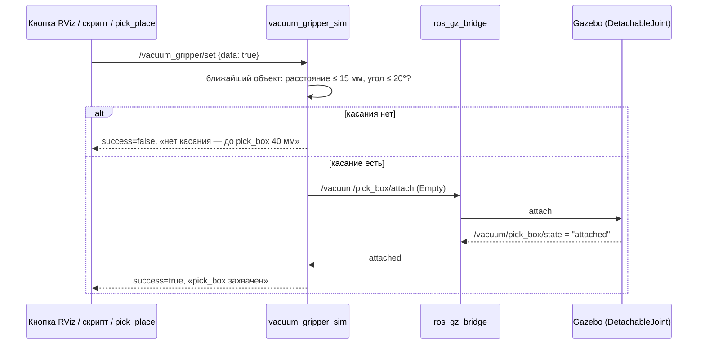
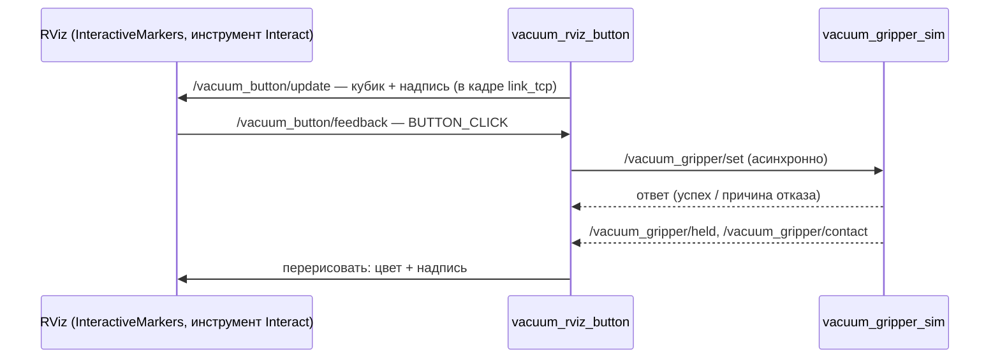

# Глава 9. Вакуум: несколько объектов, кнопка в RViz и «можно ли брать»

> Главные файлы: [`vacuum_gripper_sim.py`](../../src/xarm_grasping/scripts/vacuum_gripper_sim.py),
> [`vacuum_rviz_button.py`](../../src/xarm_grasping/scripts/vacuum_rviz_button.py),
> [`cart-arm.xacro`](../../src/r2_robot/quasi_cart_description/urdf/cart-arm.xacro) (плагины),
> [`docs/CAMERA_VACUUM_SIM.md`](../CAMERA_VACUUM_SIM.md) (справочник команд).
> Как вакуум был устроен изначально (один объект) — глава 4, раздел 6.

---

## 9.1. Как устроен «вакуум» в симуляции

Настоящей присоски с потоком воздуха в Gazebo нет. Вместо неё — **логическое
соединение**: плагин `gz::sim::systems::DetachableJoint` по команде создаёт жёсткое
соединение (fixed joint) между звеном руки и объектом. Объект с этого момента
двигается вместе с рукой, а по команде отпускается и падает.

Решение «можно ли сейчас присосаться» принимает наша нода `vacuum_gripper_sim`:
она проверяет, что присоска действительно **касается** грани объекта и
смотрит на неё почти перпендикулярно. Иначе можно было бы «присосать» коробку с
другого конца стола.



> **Почитать.** [DetachableJoint (API Gazebo Sim 9)](https://gazebosim.org/api/sim/9/classgz_1_1sim_1_1systems_1_1DetachableJoint.html);
> что такое сервис и чем он отличается от топика —
> [Understanding services](https://docs.ros.org/en/kilted/Tutorials/Beginner-CLI-Tools/Understanding-ROS2-Services/Understanding-ROS2-Services.html).

## 9.2. Несколько объектов: по плагину на каждый

Один плагин `DetachableJoint` умеет работать только с **одной** моделью
(`<child_model>`). Чтобы брать любой из 8 объектов, плагинов должно быть 8. В
xacro нет циклов, поэтому используется рекурсивный макрос
([`cart-arm.xacro`, строки 38–58](../../src/r2_robot/quasi_cart_description/urdf/cart-arm.xacro#L38-L58)):

```xml
<xacro:arg name="vacuum_targets" default="pick_box"/>

<xacro:macro name="vacuum_joints" params="targets">
  <xacro:if value="${len(targets) > 0}">
    <gazebo>
      <plugin filename="gz-sim-detachable-joint-system" name="gz::sim::systems::DetachableJoint">
        <parent_link>link6</parent_link>
        <child_model>${targets[0]}</child_model>
        <child_link>link</child_link>
        <attach_topic>/vacuum/${targets[0]}/attach</attach_topic>
        <detach_topic>/vacuum/${targets[0]}/detach</detach_topic>
        <output_topic>/vacuum/${targets[0]}/state</output_topic>
      </plugin>
    </gazebo>
    <xacro:vacuum_joints targets="${targets[1:]}"/>   <!-- остаток списка -->
  </xacro:if>
</xacro:macro>
...
<xacro:vacuum_joints targets="${'$(arg vacuum_targets)'.split()}"/>
```

Как работает рекурсия: макрос берёт первый элемент списка, вставляет для него
плагин и вызывает сам себя для остатка `targets[1:]`. Когда список пуст, условие
`len(targets) > 0` ложно, и рекурсия останавливается.

* **`parent_link` = `link6`, а не присоска.** Gazebo при загрузке URDF
  «схлопывает» звенья, соединённые неподвижными суставами: присоска, `link_eef`,
  камера и кронштейн становятся частью `link6`. Звена
  `xarm_vacuum_gripper_link` в Gazebo просто нет.
* **Топики на каждый объект:** `/vacuum/<имя>/attach|detach|state`. Для тележки
  список из одного `pick_box`, топики `/vacuum/pick_box/...`.
* **Список задаёт launch**: `vacuum_targets:="pick_box box_small ..."`
  (для стола он берётся из `arm_table_objects.yaml`, глава 8).

> **Почитать.** [xacro: макросы и условные блоки](https://github.com/ros/xacro/wiki)
> (разделы «Macros» и «Conditional Blocks»).

## 9.3. Нода `vacuum_gripper_sim`

### Интерфейс

| Тип | Имя | Что |
|---|---|---|
| сервис | `/vacuum_gripper/set` (`std_srvs/SetBool`) | включить/выключить, ответ с причиной |
| топик → | `/vacuum_gripper/cmd` (`std_msgs/Bool`) | то же самое без ответа (для скриптов) |
| топик ← | `/vacuum_gripper/state` (`Bool`, latched) | держит ли что-нибудь |
| топик ← | `/vacuum_gripper/held` (`String`, latched) | **имя** удерживаемого объекта или `''` |
| топик ← | `/vacuum_gripper/ready` (`Bool`, 10 Гц) | можно ли брать прямо сейчас (9.5) |
| топик ← | `/vacuum_gripper/contact` (`String`/JSON, 10 Гц) | расстояние, угол, уровень (9.5) |
| топик ← | `/vacuum_gripper/markers` (`MarkerArray`) | подсветка в RViz (9.5) |
| топик ← | `/vacuum_gripper/status` (`String`, 2 Гц) | строка для человека |

«latched» — это QoS `TRANSIENT_LOCAL`: подписчик, подключившийся позже, сразу
получает последнее сообщение. Так кнопка RViz, запущенная после вакуума, знает,
держит ли он что-то.

### Параметры

```python
self.declare_parameter('robot_model_name', 'cart_xarm6')   # имя модели робота в gz
self.declare_parameter('root_frame', 'base_footprint')     # корень модели в TF
self.declare_parameter('object_names', ['pick_box'])
self.declare_parameter('object_sizes', [0.10, 0.05, 0.05]) # по 3 числа на объект
self.declare_parameter('object_shapes', [''])              # для подсветки
self.declare_parameter('near_distance', 0.05)
self.declare_parameter('contact_distance', 0.015)
self.declare_parameter('max_angle_deg', 20.0)
```

Список параметров не может быть «списком словарей», поэтому размеры передаются
одним плоским списком по 3 числа на объект: `[0.10, 0.05, 0.05, 0.06, 0.06, 0.04, ...]`.
Цилиндр задаётся описанной коробкой 2r × 2r × h.

### Проверка касания: где присоска относительно объекта

Чтобы сравнивать присоску и объект, нужно, чтобы обе позы были в одной системе
координат. Позы объектов приходят из Gazebo в **мировых** координатах. Положение
кончика присоски `link_tcp` в мире складывается из двух частей
(`tcp_in_world`, [строка 222](../../src/xarm_grasping/scripts/vacuum_gripper_sim.py#L222)):

```
T_мир←tcp = T_мир←робот (поза модели робота из Gazebo) · T_корень←tcp (из TF)
```

Дальше всё считается в системе **объекта** (`contact_metrics`,
[строка 234](../../src/xarm_grasping/scripts/vacuum_gripper_sim.py#L234)):

```python
T_obj_tcp = np.linalg.inv(T_obj) @ T_w_tcp     # присоска в системе объекта
p = T_obj_tcp[:3, 3]
over = np.abs(p) - self.half[name]              # >0 — снаружи коробки по этой оси
dist = float(np.linalg.norm(np.maximum(over, 0.0)))
axis = int(np.argmax(over))                     # к какой грани ближе всего
n = np.zeros(3); n[axis] = math.copysign(1.0, p[axis])   # внешняя нормаль грани
tool_z = T_obj_tcp[:3, 2]                       # куда смотрит присоска
angle = degrees(acos(dot(tool_z, -n)))          # 0° — строго на грань
```

**Расстояние от точки до коробки.** Коробка задаётся полуразмерами `half`. Для
точки `p` в системе коробки по каждой оси считаем, на сколько точка выходит за
грань: `|p| − half`. Если по оси не выходит (отрицательное), берём 0. Длина
получившегося вектора — это расстояние до поверхности (внутри коробки оно 0).
Это стандартная формула расстояния до выровненного по осям параллелепипеда. Мы
сделали его выровненным, перейдя в систему объекта.

**Угол.** Присоска «смотрит» вдоль своей оси Z. Если она направлена внутрь
грани (против внешней нормали `n`), скалярное произведение `tool_z · (−n)` близко
к 1, угол к 0°.

> **Почитать.** Однородные матрицы преобразований 4×4 и их перемножение:
> [Wikipedia: Transformation matrix (Affine transformations)](https://en.wikipedia.org/wiki/Transformation_matrix#Affine_transformations).

### Какой объект берётся

Функция `nearest` ([строка 263](../../src/xarm_grasping/scripts/vacuum_gripper_sim.py#L263))
считает расстояние до **всех** объектов и берёт ближайший. Вакуум включается, только
если до него ≤ `contact_distance` (15 мм) **и** угол ≤ `max_angle_deg` (20°). Потом
нода шлёт `attach` этому объекту и до 1 с ждёт, пока плагин ответит `attached`.

### Ловушка: плагин приваривает всё при загрузке

`DetachableJoint` по умолчанию **сразу при загрузке модели** соединяет руку со
своим объектом и один раз сообщает `attached`. Нода в ответ шлёт `detach`. Но при
восьми объектах это сообщение часто уходит **раньше, чем поднимется мост**, и
теряется. Объект остаётся приваренным, а нода считает, что ничего не держит. В
итоге первое же движение руки тащило объекты за собой: цилиндр «сбивался», хотя
рука его не касалась.

Решение: после появления позы робота нода **6 раз подряд (3 с) сама рассылает
`detach`** всем объектам, которые держать не велели
(`on_status_timer`, [строка 328](../../src/xarm_grasping/scripts/vacuum_gripper_sim.py#L328)).
Лишний `detach` свободного объекта плагин просто игнорирует.

```python
if self.startup_detach_left > 0 and self.T_world_robot is not None:
    self.startup_detach_left -= 1
    for n, pub in self.pub_detach.items():
        if n != self.requested:
            pub.publish(Empty())
```

### Нода не должна падать

Однажды нода упала у пользователя (`exit 1`), а трейсбек остался только в
терминале. С тех пор:

* в `main()` любое исключение из колбэка ловится, **трейсбек пишется в лог ROS**
  (`~/.ros/log/python3_<pid>_*.log`), а работа продолжается;
* в launch у ноды `respawn=True, respawn_delay=2.0`: если всё же завершится,
  launch поднимет её снова.

```python
while rclpy.ok():
    try:
        ex.spin()
    except (KeyboardInterrupt, ExternalShutdownException):
        break
    except Exception:
        node.get_logger().error('исключение в колбэке, продолжаю работу:\n'
                                + traceback.format_exc())
```

> ⚠️ **Обрати внимание.** `get_logger().warn(...)` в rclpy устарел. Это обёртка над
> `warning()`, и все вызовы `warn` для rclpy выглядят как **один** вызов из одного
> места. Если в одном месте кода `warn` вызывается с `throttle_duration_sec`, а в
> другом без него, rclpy падает с ошибкой «Requested logging filters cannot be
> changed between calls». Везде используем `warning()`.

## 9.4. Кнопка в RViz: интерактивный маркер

В RViz нет готовой кнопки «вызвать сервис». Зато есть **интерактивные маркеры**:
нода публикует объект, по которому можно кликнуть мышью, а клик приходит ей
обратно как событие. Наша нода `vacuum_rviz_button` рисует кубик рядом с
присоской: клик включает или выключает вакуум.



Ключевой код ([`vacuum_rviz_button.py`](../../src/xarm_grasping/scripts/vacuum_rviz_button.py)):

```python
self.server = InteractiveMarkerServer(self, 'vacuum_button')   # namespace в RViz

im = InteractiveMarker()
im.header.frame_id = 'link_tcp'          # маркер «прикреплён» к присоске, едет с ней
im.name = 'vacuum_button'
im.pose.position.y = 0.12                # сбоку, чтобы не закрывать присоску

ctrl = InteractiveMarkerControl()
ctrl.interaction_mode = InteractiveMarkerControl.BUTTON   # клик = событие
ctrl.always_visible = True
ctrl.markers = [box, label]              # кубик + текст
im.controls.append(ctrl)

self.server.insert(im, feedback_callback=self.on_feedback)
self.menu.apply(self.server, 'vacuum_button')   # правая кнопка — меню
self.server.applyChanges()

def on_feedback(self, fb):
    if fb.event_type == InteractiveMarkerFeedback.BUTTON_CLICK:
        self.request(not self.held)
```

Как включить в RViz: дисплей **InteractiveMarkers**, namespace `/vacuum_button`
(уже есть в `cart_xarm.rviz` и `cart_xarm_moveit.rviz`). На панели инструментов
выбрать **Interact**, кликнуть по кубику.

**Почему сервис вызывается асинхронно** (`call_async` + `add_done_callback`). Если
вызвать сервис синхронно внутри колбэка клика, нода будет ждать ответа и в это время
не сможет обработать сам ответ (обе вещи идут в одном потоке): получится
взаимная блокировка. `call_async` сразу возвращает «обещание», а ответ приходит в
отдельный колбэк.

> **Почитать.** [RViz: Interactive Markers](https://docs.ros.org/en/kilted/Tutorials/Intermediate/RViz/Marker-Display-types/Marker-Display-types.html)
> (дисплеи маркеров), учебные примеры [interactive_marker_tutorials](https://github.com/ros-visualization/visualization_tutorials/tree/ros2/interactive_marker_tutorials);
> асинхронный клиент сервиса — [Writing a simple service and client (Python)](https://docs.ros.org/en/kilted/Tutorials/Beginner-Client-Libraries/Writing-A-Simple-Py-Service-And-Client.html).

## 9.5. «Можно ли брать»: светофор и подсветка цели

Задача: видеть заранее, сработает ли вакуум, а не узнавать это по отказу. Нода
вакуума 10 раз в секунду публикует готовность к захвату. Пороги **те же самые**, по
которым она решает включаться, поэтому «зелёный» всегда означает, что клик
сработает.

| Уровень `level` | Условие | Кнопка |
|---|---|---|
| `far` | дальше `near_distance` (5 см) | серая, «ВАКУУМ выкл · pick_box: 256 мм» |
| `near` | ближе 5 см | жёлтая, «pick_box: 23 мм, 4°» |
| `ready` | ≤ 15 мм **и** ≤ 20° | светло-зелёная, крупнее, «МОЖНО БРАТЬ — клик» |
| `held` | вакуум держит | зелёная, «держит pick_box» |
| (отказ) | последняя попытка не удалась | красная ~5 с, причина |

`/vacuum_gripper/contact` — JSON, удобно для скриптов и обучения:

```json
{"object": "pick_box", "dist": 0.001, "angle": 0.0, "level": "ready", "ready": true,
 "held": "", "frame": "world", "tcp": [0.4, 0.1, 0.051], "point": [0.4, 0.1, 0.05]}
```

`point` — **ближайшая к присоске точка поверхности** объекта. Её получают тем же
приёмом, что и расстояние: в системе объекта зажимаем координаты присоски в
пределы коробки (`np.clip(p, -half, half)`) и переводим обратно в мир
(`closest_point_world`, [строка 256](../../src/xarm_grasping/scripts/vacuum_gripper_sim.py#L256)).

Дисплей RViz **VacuumContact** (`/vacuum_gripper/markers`) показывает линию от
кончика присоски до этой точки, саму точку и полупрозрачную оболочку вокруг
объекта, который возьмётся, тем же цветом, что и кнопка.

Чтобы не перегружать RViz, кнопка перерисовывается не чаще 5 раз в секунду и только
если цвет или текст изменились (`on_contact`, [строка 85](../../src/xarm_grasping/scripts/vacuum_rviz_button.py#L85)).
Полная перестройка интерактивного маркера 10 раз в секунду заметно тормозила бы
RViz.

## 9.6. Рядом: парковка руки (для тележки)

На тележке работает ещё нода [`arm_parking.py`](../../src/xarm_grasping/scripts/arm_parking.py) —
«тормоза» руки. Пока на `/cmd_vel` идут ненулевые команды (тележка едет),
траекторный контроллер руки **выключается** через
`controller_manager/switch_controller`. Последняя позиционная команда
продолжает действовать, поэтому рука держит позу, а любые новые цели движения
отклоняются. Через 1 с после остановки контроллер включается снова. Вручную:
`/arm_parking/set` (`SetBool`).

## 9.7. Что здесь можно менять

| Хочу… | Где | Параметр |
|---|---|---|
| брать с большего расстояния | `vacuum_gripper_sim` | `contact_distance` (15 мм) |
| брать под большим углом | `vacuum_gripper_sim` | `max_angle_deg` (20°) |
| раньше видеть «жёлтый» | `vacuum_gripper_sim` | `near_distance` (5 см) |
| брать без проверки (отладка) | `vacuum_gripper_sim` | `require_contact:=false` |
| кнопку в другом месте | `vacuum_rviz_button` | `frame`, `offset` |
| новый объект для вакуума | список объектов сцены (глава 8) | — |

## 9.8. Частые ошибки

| Симптом | Причина | Что делать |
|---|---|---|
| Кнопка «не срабатывает» | нет ноды `vacuum_gripper_sim` (упала) | `ros2 node list`; лог `~/.ros/log/python3_*`; теперь есть `respawn` |
| Красная надпись «нет касания — до X 40 мм» | присоска не у объекта | подвести ближе (`arm_goto_tcp.py`, глава 4) |
| «attach отправлен, но плагин не подтвердил» | объекта нет в `vacuum_targets` или он `static` | список объектов и генератор (глава 8) |
| Объект едет за рукой без вакуума | приварен при загрузке и не отпущен | исправлено стартовым `detach`; если снова — `ros2 topic pub --once /vacuum/<имя>/detach std_msgs/msg/Empty` |

## 9.9. Проверь себя

1. Зачем `parent_link` плагина — `link6`, а не звено присоски?
2. Почему кнопка вызывает сервис через `call_async`, а не синхронно?
3. Присоска в 10 мм над коробкой, но наклонена на 30°. Какой будет `level` и
   почему?
4. Что напечатает `ros2 topic echo /vacuum_gripper/held --once`, когда вакуум держит
   цилиндр `cyl_tall`?
