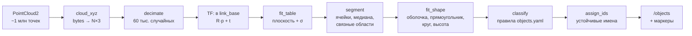
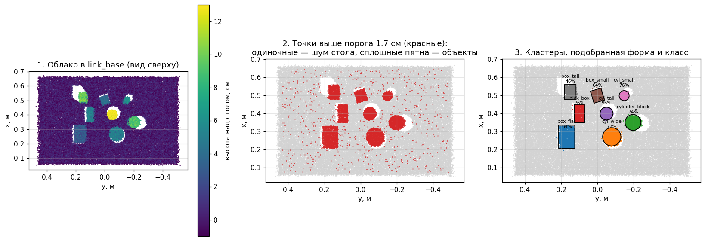
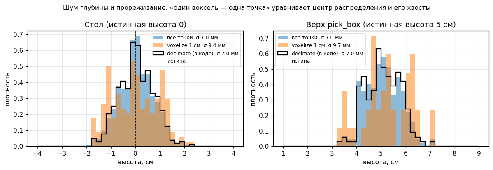
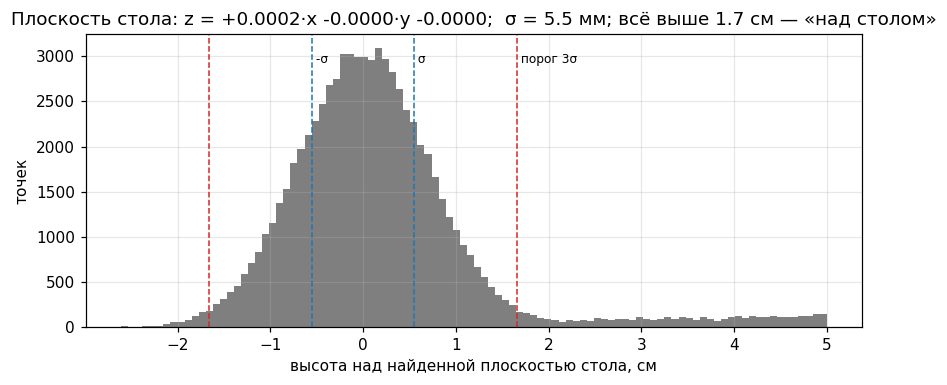
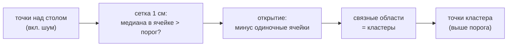
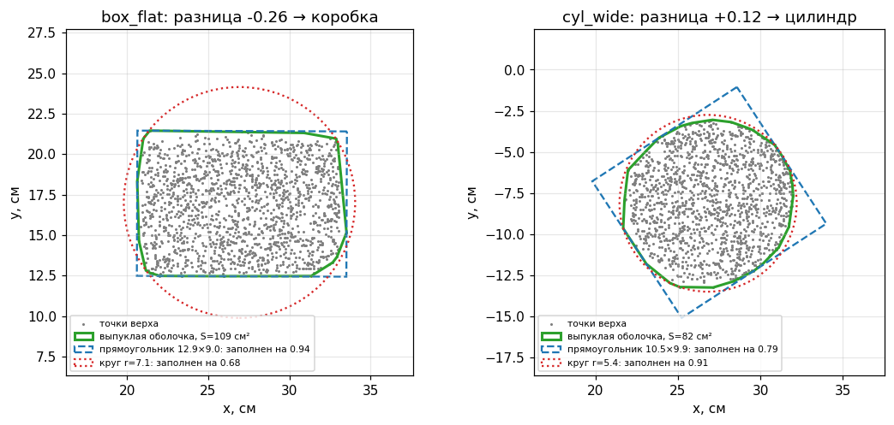
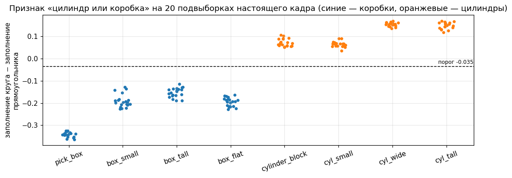
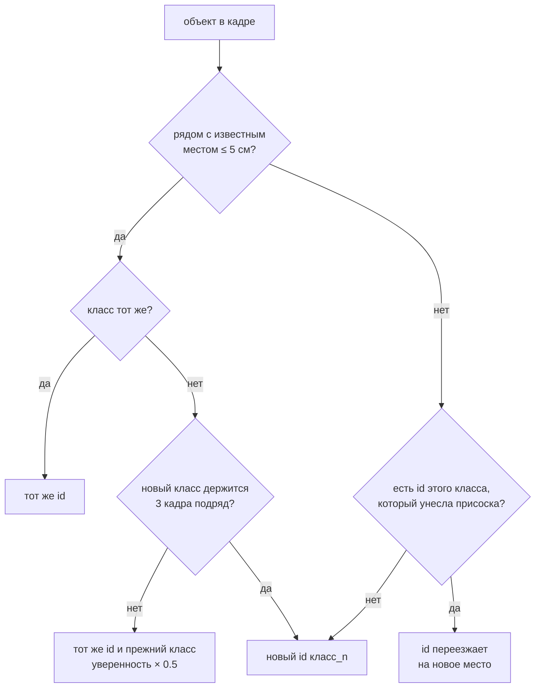

# Глава 10. Восприятие: что лежит на столе

> Главные файлы: [`xarm_grasping/perception.py`](../../src/xarm_grasping/xarm_grasping/perception.py)
> (алгоритмы, без ROS), [`scripts/object_perception.py`](../../src/xarm_grasping/scripts/object_perception.py)
> (нода), [`config/objects.yaml`](../../src/xarm_grasping/config/objects.yaml) (классы),
> [`xarm_grasping_msgs`](../../src/xarm_grasping_msgs) (сообщения).
> Рисунки построены по **настоящему кадру** камеры из симуляции:
> [`img/make_figures.py`](img/make_figures.py).

---

## 10.1. Задача и результат

На входе — облако точек камеры гриппера `/gripper_camera/points`, около миллиона
точек 7 раз в секунду. На выходе — список объектов на столе:

```text
$ ros2 topic echo /objects --once
objects:
- id: cyl_tall_0          ← имя, по которому отправляют команды
  label: cyl_tall          ← класс по правилам
  confidence: 0.95
  shape: 3                 ← 1 коробка, 3 цилиндр
  dimensions: [0.13, 0.034]    ← цилиндр: высота, радиус
  pose: {position: {x: 0.399, y: -0.05, z: 0.065}, orientation: ...}
  grasp_pose: ...          ← центр верхней грани, присоска вниз
table_z: 0.0
```

Конвейер (каждый шаг — отдельная функция `perception.py`, без ROS: её можно
вызывать из тестов и из скрипта рисунков):





*Рис. 10.1. Настоящий кадр из позы наблюдения. 1 — облако в `link_base`, цвет —
высота над столом. 2 — точки выше порога: одиночные красные точки по всему столу —
шум глубины, сплошные пятна — объекты. 3 — найденные кластеры, подобранная форма
и класс с уверенностью. Белые «тени» за объектами — места, которые камере не
видно (их закрывает объект).*

## 10.2. Облако точек и как его читать

`sensor_msgs/PointCloud2` — это не список точек, а **бинарный буфер**: для каждой
точки `point_step` байт, внутри по известным смещениям лежат поля `x`, `y`, `z`
(float32), цвет и др. Описание полей — в `msg.fields`. Читать облако поэлементно
в Python очень медленно, поэтому мы смотрим на буфер как на массив numpy
([`object_perception.py`, функция `cloud_xyz`](../../src/xarm_grasping/scripts/object_perception.py)):

```python
off = {f.name: f.offset for f in msg.fields}                 # где x, y, z в точке
raw = np.frombuffer(msg.data, dtype=np.uint8).reshape(-1, msg.point_step)
pts = np.column_stack([raw[:, off[c]:off[c] + 4].copy().view(np.float32).ravel()
                       for c in 'xyz'])                      # N×3 float
pts = pts[np.isfinite(pts).all(axis=1)]                      # NaN — «нет глубины»
```

Облако приходит в оптической системе камеры (`gripper_camera_color_optical_frame`:
Z — вперёд от объектива, X — вправо, Y — вниз). Его строит `depth_image_proc` из
картинки глубины и параметров камеры (`camera_info`), глава 3.

### Урок: облако не доходило до ноды — QoS

Подписка на облако долго была `BEST_EFFORT` («можно терять»). Облако 1280×800 —
это **~32 МБ** на сообщение. DDS режет его на тысячи UDP-пакетов, и при потере хотя
бы одного выбрасывает **всё сообщение**. При `BEST_EFFORT` пропавшие пакеты не
переспрашиваются, и до ноды не доходило ни одного облака. При этом
`ros2 topic hz` показывал 7 Гц: эта утилита подписывается как `RELIABLE`.

```python
self.create_subscription(PointCloud2, points_topic, self.on_cloud,
    QoSProfile(depth=1, reliability=ReliabilityPolicy.RELIABLE))
```

`depth=1` — храним только последнее облако, старые не нужны.

> **Почитать.** [About Quality of Service settings](https://docs.ros.org/en/kilted/Concepts/Intermediate/About-Quality-of-Service-Settings.html)
> (особенно таблица совместимости издатель/подписчик);
> формат облака — [sensor_msgs/PointCloud2](https://docs.ros.org/en/kilted/p/sensor_msgs/msg/PointCloud2.html).

## 10.3. В координаты стола: TF

Чтобы говорить «объект в 40 см перед рукой», точки переводят из системы камеры в
`link_base`. Нода спрашивает у TF преобразование `link_base ← камера` (позиция `t`
и поворот-кватернион `q`) и применяет его ко всем точкам сразу:

```python
tf = self.tf_buffer.lookup_transform('link_base', msg.header.frame_id, rclpy.time.Time())
R = quat_to_rot(q.x, q.y, q.z, q.w)          # кватернион → матрица 3×3
pts = pts @ R.T + t                          # p_base = R · p_cam + t, для всех N точек
```

**Кватернион** — компактная запись поворота четырьмя числами `(x, y, z, w)`. Для
поворота на угол θ вокруг единичной оси `u`:
`q = (u·sin(θ/2), cos(θ/2))`. Из него получается матрица поворота 3×3 (функция
`quat_to_rot`). `pts @ R.T` — это `R · p` сразу для всех точек (каждая точка —
строка).

`rclpy.time.Time()` (нулевое время) означает «последнее известное преобразование».
Камера неподвижна относительно руки, а рука в момент распознавания стоит, так что
этого достаточно.

> **Почитать.** [About tf2](https://docs.ros.org/en/kilted/Concepts/Intermediate/About-Tf2.html),
> [Writing a tf2 listener (Python)](https://docs.ros.org/en/kilted/Tutorials/Intermediate/Tf2/Writing-A-Tf2-Listener-Py.html);
> кватернионы на пальцах — [Wikipedia: Quaternions and spatial rotation](https://en.wikipedia.org/wiki/Quaternions_and_spatial_rotation).

## 10.4. Прореживание: почему не «один воксель — одна точка»

Миллион точек — это медленно, нам хватает 60 тысяч. Привычный способ проредить
облако — **воксельная сетка**: пространство режется на кубики 1 см и в каждом
оставляется одна точка. Мы так и сделали сначала, и высоты объектов стали завышаться на
1–1.3 см, а присоска не дотягивалась до коробки.

Причина — **шум глубины**. Камера ошибается по глубине примерно на σ ≈ 5–7 мм,
поэтому каждая плоская поверхность размазывается по высоте на 2–3 вокселя.
Воксельная сетка оставляет **по одной точке на воксель, независимо от того,
сколько их там было**. Редкие крайние значения (хвосты распределения) получают
тот же вес, что и плотный центр. Распределение становится шире и «площе», σ стола
выросла вдвое (5.5 → 13 мм).



*Рис. 10.2. Высоты точек на столе и на верху коробки: все точки (синее), после
воксельной сетки (оранжевое) и после случайного прореживания, которое стоит в коде
(чёрная линия). Случайная выборка сохраняет форму распределения, воксельная сетка
раздувает хвосты.*

Решение — **случайная выборка** (`decimate`,
[строка 45](../../src/xarm_grasping/xarm_grasping/perception.py#L45)): каждая точка
остаётся с одинаковой вероятностью, поэтому пропорции распределения не меняются.

```python
def decimate(pts, max_points=60000, seed=0):
    if pts.shape[0] <= max_points:
        return pts
    idx = np.random.default_rng(seed).choice(pts.shape[0], max_points, replace=False)
    return pts[idx]
```

## 10.5. Стол: плоскость методом наименьших квадратов

Стол — плоскость `z = a·x + b·y + c`. Даже если он стоит ровно, удобно не верить
этому на слово, а найти плоскость по данным: так автоматически учитывается
небольшой наклон камеры или тележки.

`fit_table` ([строка 59](../../src/xarm_grasping/xarm_grasping/perception.py#L59)):

```python
win = pts[np.abs(pts[:, 2] - z_guess) < search]       # точки около ожидаемой высоты ±5 см
A = np.c_[win[:, 0], win[:, 1], np.ones(len(win))]    # строки [x, y, 1]
z = win[:, 2]
for _ in range(4):
    coef = np.linalg.lstsq(A, z, rcond=None)[0]       # a, b, c
    res = z - A @ coef                                # отклонения от плоскости
    keep = np.abs(res) < max(0.004, 2.0 * np.std(res))
    A, z = A[keep], z[keep]                           # выкинуть выбросы и повторить
sigma = np.std(z - A @ coef)
```

**Метод наименьших квадратов.** Система `A · [a, b, c] = z` — это тысячи уравнений
(по одному на точку) с тремя неизвестными. Точного решения нет из-за шума.
`lstsq` находит `a, b, c`, при которых **сумма квадратов** отклонений минимальна.

**Итерации с отбрасыванием выбросов.** В окно ±5 см попадают и низы объектов,
которые тянут плоскость вверх. Поэтому после каждого шага выбрасываем точки дальше
2σ и пересчитываем. Четыре итерации хватает, чтобы остался чистый стол.

**σ — шум глубины.** Разброс точек стола вокруг плоскости — это и есть шум камеры
(~5.5 мм). Отсюда порог «над столом»: `tol = max(1 см, 3σ)`. Ниже 3σ лежит
99.7% точек стола (правило трёх сигм для нормального распределения).



*Рис. 10.3. Гистограмма высот точек стола относительно найденной плоскости, σ и
порог 3σ.*

> **Почитать.** [Wikipedia: Linear least squares](https://en.wikipedia.org/wiki/Linear_least_squares),
> [numpy.linalg.lstsq](https://numpy.org/doc/stable/reference/generated/numpy.linalg.lstsq.html);
> правило трёх сигм — [68–95–99.7 rule](https://en.wikipedia.org/wiki/68%E2%80%9395%E2%80%9399.7_rule);
> более устойчивый к выбросам метод — [RANSAC](https://en.wikipedia.org/wiki/Random_sample_consensus)
> (так ищут плоскости в R2, `object_segmentation.cpp`).

## 10.6. Сегментация: где отдельные объекты

Точек выше порога много, но часть из них — шум стола (рис. 10.1, панель 2). Если
просто склеивать все точки выше порога в группы, шум сливает соседние объекты в
один большой «объект». Так и было: коробка вместе с «ореолом» шума вокруг давала
объект радиусом 25–30 см.

`segment` ([строка 82](../../src/xarm_grasping/xarm_grasping/perception.py#L82))
работает на **сетке ячеек 1×1 см** в плане:

```python
ij = np.floor(w[:, :2] / cell).astype(np.int64)          # ячейка каждой точки
...
med = [np.median(высоты точек ячейки) for каждой ячейки]
grid[ячейки с med > tol] = True                          # 1. «предмет» по медиане
grid = ndimage.binary_opening(grid)                      # 2. убрать одиночные ячейки
labels, n = ndimage.label(ndimage.binary_dilation(grid)) # 3. связные области
```

1. **Медиана, а не любая точка.** В ячейке стола бывает отдельная точка выше
   порога (хвост шума), но **медиана** высот в ячейке остаётся у стола. У ячейки
   объекта медиана — на высоте объекта. Медиана устойчива к выбросам: чтобы её
   сдвинуть, нужно испортить больше половины точек.
2. **Морфологическое открытие** (`binary_opening` = эрозия, затем дилатация)
   удаляет из маски одиночные ячейки и тонкие «мостики», а крупные пятна оставляет
   почти без изменений.
3. **Связные области** (`ndimage.label`): соседние ячейки-«предметы» получают
   одинаковый номер. Это и есть объекты. Небольшая дилатация перед этим склеивает
   объект, если его разрезала тень.



> **Почитать.** [Медиана и устойчивая статистика](https://en.wikipedia.org/wiki/Robust_statistics);
> [морфологическое открытие](https://en.wikipedia.org/wiki/Opening_%28morphology%29);
> [связные компоненты](https://en.wikipedia.org/wiki/Connected-component_labeling),
> [scipy.ndimage.label](https://docs.scipy.org/doc/scipy/reference/generated/scipy.ndimage.label.html).
> В R2 сегментация сделана иначе: RANSAC-плоскости + евклидова кластеризация PCL
> (`docs/reference/quasi_ros_r2_grasp`).

## 10.7. Форма: коробка или цилиндр

`fit_shape` ([строка 150](../../src/xarm_grasping/xarm_grasping/perception.py#L150))
смотрит на объект **сверху**.

**Высота.** Медиана высот точек верхней грани (точки выше 80% от 95-го процентиля).
Сам 95-й процентиль на шумной грани завышает высоту на ~1.6σ, медиана нет.

**Контур верха.** Берутся точки верхней половины объекта (верх виден сверху
целиком, а низы боковых стенок шумнее) и их **выпуклая оболочка**: самый маленький
выпуклый многоугольник, содержащий все точки (как резинка, натянутая на гвозди).

Дальше на оболочку «примеряются» две фигуры:

* **Прямоугольник минимальной площади** (`_min_area_rect`) по методу «вращающихся
  калиперов». Известно, что одна сторона такого прямоугольника лежит на одном из
  рёбер оболочки. Поэтому перебираем рёбра: поворачиваем все точки так, чтобы ребро
  легло вдоль оси X, берём min/max по X и Y — получается прямоугольник, считаем
  площадь. Самый маленький и есть ответ, заодно с углом поворота `yaw`.

  ```python
  for i in range(len(hull)):
      e = hull[(i + 1) % len(hull)] - hull[i]            # ребро
      ang = math.atan2(e[1], e[0])
      R = np.array([[c, s], [-s, c]])                    # поворот: ребро → ось X
      p = hull @ R.T
      lo, hi = p.min(axis=0), p.max(axis=0)
      area = np.prod(hi - lo)                            # прямоугольник по осям
      ...                                                # запоминаем наименьший
  ```

* **Описанная окружность минимального радиуса** (`_min_circle`): центр, при
  котором самая дальняя вершина оболочки ближе всего. Это задача минимизации
  `max |вершина − центр|`, её решает `scipy.optimize.minimize` методом
  Нелдера–Мида (ему не нужны производные, а у функции «максимум» их нет в изломах).



*Рис. 10.4. Плоская коробка и широкий цилиндр на настоящем кадре: точки верха,
выпуклая оболочка (зелёная), прямоугольник (синий) и круг (красный), насколько
каждый заполнен оболочкой.*

**Как выбрать.** В R2 (`shape_extraction.cpp`) побеждает фигура с меньшим
объёмом. На шумном контуре это оказалось неустойчиво: плоская коробка 12×8 см в 1
кадре из 6 выходила цилиндром. Сейчас решаем по тому, **что контур заполняет
лучше**:

```python
fill_circle = hull_area / (math.pi * r * r)     # доля круга, занятая контуром
fill_rect   = hull_area / (L * W)               # доля прямоугольника
if fill_circle - fill_rect > CYLINDER_MARGIN:   # -0.035
    цилиндр
else:
    коробка
```

Почему это работает: круг вписан в квадрат, и его площадь — π/4 ≈ 0.79 площади
квадрата. У цилиндра контур почти совпадает с кругом (`fill_circle` ≈ 0.9–1), а
прямоугольник заполняет на ≈ 0.79. У коробки наоборот: прямоугольник ≈ 0.9, а в
описанном круге коробка занимает ≤ 0.64 (у квадрата 2/π). Порог −0.035 подобран на
настоящих кадрах так, чтобы между коробками и цилиндрами был запас в обе стороны:



*Рис. 10.5. Признак «заполнение круга − заполнение прямоугольника» для всех 8
объектов на 20 подвыборках кадра. Коробки (синие) ниже −0.1, цилиндры
(оранжевые) выше +0.03, порог посередине.*

> ⚠️ **Обрати внимание.** Перед построением оболочки отрезается 1% самых дальних от
> центра точек (выбросы раздувают оболочку). Больше нельзя: у прямоугольника самые
> дальние точки — это **углы**. Срежешь 5% — коробка скруглится и начнёт
> «превращаться» в цилиндр.

> **Почитать.** [Выпуклая оболочка](https://en.wikipedia.org/wiki/Convex_hull),
> [scipy.spatial.ConvexHull](https://docs.scipy.org/doc/scipy/reference/generated/scipy.spatial.ConvexHull.html)
> (в 2D свойство `volume` — это площадь, `area` — периметр);
> [Rotating calipers](https://en.wikipedia.org/wiki/Rotating_calipers),
> [Minimum bounding box algorithms](https://en.wikipedia.org/wiki/Minimum_bounding_box_algorithms);
> [Smallest-circle problem](https://en.wikipedia.org/wiki/Smallest-circle_problem);
> [метод Нелдера–Мида](https://en.wikipedia.org/wiki/Nelder%E2%80%93Mead_method).

## 10.8. Класс по правилам

Класс определяется по форме и размерам — правила в
[`config/objects.yaml`](../../src/xarm_grasping/config/objects.yaml):

```yaml
objects:
  pick_box:       {shape: box,      dims: [0.10, 0.05, 0.05], tol: 0.025, category: box}
  box_small:      {shape: box,      dims: [0.06, 0.06, 0.04], tol: 0.025, category: box}
  ...
  cyl_small:      {shape: cylinder, dims: [0.06, 0.025],      tol: 0.015, category: cylinder}
```

| Поле | Смысл |
|---|---|
| `shape` | `box` / `cylinder` |
| `dims` | коробка `[длина, ширина, высота]` (длина — длинная сторона); цилиндр `[высота, радиус]` |
| `tol` | допуск по **каждому** размеру, м |
| `category` | группа для правил зон (глава 12) |

`classify` ([строка 192](../../src/xarm_grasping/xarm_grasping/perception.py#L192))
перебирает правила той же формы и считает **наибольшее** отклонение по размерам.
Подходит правило, если оно ≤ `tol`; из подходящих — с наименьшим отклонением.
`confidence = 1 − отклонение / tol` (1 — размеры точно совпали, 0 — на краю
допуска). Не подошло ничего — класс = имя формы (`box`/`cylinder`), маркер в RViz
красный.

> ⚠️ **Обрати внимание.** Камера видит не только верх, но и боковую грань, поэтому
> ширина коробки выходит на ~1–1.5 см больше, радиус цилиндра на ~3 мм. Размеры
> классов должны отличаться **сильнее допуска**, иначе один объект подойдёт под
> два правила. Поэтому у коробок допуск 2.5 см, а разные классы коробок
> различаются минимум на 3 см хотя бы в одном размере.

## 10.9. Устойчивые id

Команду «возьми» отправляют по id: `pick_box_0`, `cyl_tall_0`. Если id «прыгает»,
команда промахивается. Обнаружилось три причины, почему он прыгал, и на каждую есть
правило в `assign_ids` ([строка 281](../../src/xarm_grasping/scripts/object_perception.py#L281)):



1. **Гистерезис класса.** Маленький цилиндр иногда в одном кадре выглядит как
   коробка. Теперь объект на прежнем месте **сохраняет класс**, пока новый класс
   не продержится `label_frames` (3) кадров подряд. Гистерезис — это когда
   переключение требует устойчивого сигнала, а не одного скачка (как у термостата).
2. **Переезд — только с присоской.** Когда `/vacuum_gripper/held` становится
   непустым, нода запоминает, какой известный объект был у присоски
   (`on_held`). На новом месте id переходит **только к нему**. Раньше «свободный» id
   отдавался любому объекту того же класса, и ошибочно распознанный цилиндр забрал
   id коробки, пока та ехала.
3. **Только хороший обзор.** Кадры, где камера ниже `min_view_height` (0.42 м над
   столом), отбрасываются **до** классификации: стол виден частично, объекты
   обрезаны, классы врут (глава 8, рис. 8.1).

Невидимые объекты не забываются: если объект закрыт рукой, его id сохранится.

## 10.10. Нода `object_perception`: режимы и интерфейс

| Тип | Имя | Что |
|---|---|---|
| топик ← | `/objects` (`xarm_grasping_msgs/DetectedObjectArray`, latched) | последний результат |
| топик ← | `/objects/markers` (`MarkerArray`) | формы и подписи «id (уверенность), размеры» |
| action | `/detect_objects` (`DetectObjects`) | распознать по **свежему** облаку |

* **Периодически** (`period` = 1 с) нода распознаёт и публикует `/objects` —
  если обзор хороший. Это держит сцену MoveIt в актуальном состоянии (глава 11).
* **По запросу** — action `/detect_objects`: ждёт облако, пришедшее **после**
  запроса (а не то, что было в буфере), и отвечает результатом. Им пользуется
  `pick_place_server` перед каждым захватом. При плохом обзоре отказывает с
  причиной: «обзор частичный: камера 0.13 м над столом (< 0.42)».

**Почему action, а не сервис.** Распознавание занимает до секунды-двух (ждём
свежее облако). Action даёт обратную связь (`stage`: «жду свежее облако»,
«распознаю») и его можно отменить. Сервис для долгих операций не предназначен.

```bash
ros2 action send_goal /detect_objects xarm_grasping_msgs/action/DetectObjects \
    "{update_scene: true}" --feedback
```

**Объект в присоске** в `/objects` не попадает: пока вакуум держит, кластеры ближе
12 см к присоске отбрасываются. Без вакуума — нет: на подходе присоска тоже рядом
с объектом, и он не должен исчезнуть из сцены.

### Сообщения — свой пакет `xarm_grasping_msgs`

Стандартные сообщения не описывают «объект с классом, формой и позой захвата»,
поэтому есть свой пакет интерфейсов (по мотивам `quasi_r2_msgs/Object` из R2):

```text
# msg/DetectedObject.msg
string id
string label
float32 confidence
uint8 SHAPE_BOX = 1
uint8 SHAPE_CYLINDER = 3          # совпадают с shape_msgs/SolidPrimitive
uint8 shape
float64[] dimensions              # BOX [X, Y, Z]; CYLINDER [высота, радиус]
geometry_msgs/Pose pose           # центр; Z вверх
geometry_msgs/Pose grasp_pose     # центр верхней грани, присоска вниз
uint32 num_points
```

> ⚠️ **Обрати внимание.** Новый пакет становится виден только после
> `source install/setup.bash`. Если терминал «засорсили» до сборки пакета, все три
> новые ноды падают при старте на импорте `xarm_grasping_msgs`.

> **Почитать.** [Creating custom msg and srv files](https://docs.ros.org/en/kilted/Tutorials/Beginner-Client-Libraries/Custom-ROS2-Interfaces.html);
> [Understanding actions](https://docs.ros.org/en/kilted/Tutorials/Beginner-CLI-Tools/Understanding-ROS2-Actions/Understanding-ROS2-Actions.html),
> [Writing an action server and client (Python)](https://docs.ros.org/en/kilted/Tutorials/Intermediate/Writing-an-Action-Server-Client/Py.html).

## 10.11. Что здесь можно менять

| Хочу… | Где | Параметр |
|---|---|---|
| новый класс объекта | `config/objects.yaml` | строка правила |
| строже/мягче классы | `config/objects.yaml` | `tol` |
| стол на другой высоте (в `link_base`) | `object_perception` | `table_height` |
| реже/чаще обновлять сцену | `object_perception` | `period` |
| распознавать с меньшей высоты | `object_perception` | `min_view_height` (осторожно: частичный обзор) |
| быстрее смена класса | `object_perception` | `label_frames` |
| точнее (медленнее) | `object_perception` | `max_points` |
| чувствительность «коробка/цилиндр» | `perception.py` | `CYLINDER_MARGIN` |

## 10.12. Как проверить алгоритм без ROS

`perception.py` не зависит от ROS, поэтому его можно гонять на сохранённом кадре:

```python
import numpy as np, yaml, sys
sys.path.insert(0, 'src/xarm_grasping')
from xarm_grasping import perception as P

pts = np.load('docs/book/img/data/frame_observe.npz')['base_01mm'] * 1e-4   # link_base, м
rules = yaml.safe_load(open('src/xarm_grasping/config/objects.yaml'))['objects']
coef, sigma, _ = P.fit_table(pts, 0.0)
tol = max(0.01, 3 * sigma)
for c in P.segment(pts, coef, tol):
    f = P.fit_shape(c, coef)
    print(P.classify(f, rules), np.round(f['dims'], 3), f['center'].round(3))
```

## 10.13. Проверь себя

1. Почему подписка на облако должна быть `RELIABLE`, хотя для сенсоров обычно
   советуют `BEST_EFFORT`?
2. Объясни своими словами, почему воксельная сетка раздувает разброс высот.
3. Порог «над столом» 3σ. Что будет, если взять 1σ? А 10σ?
4. Почему для цилиндра «заполнение прямоугольника» близко к 0.79?
5. Цилиндр в одном кадре распознался как коробка. Что произойдёт с его id?
