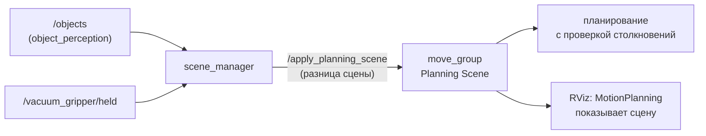
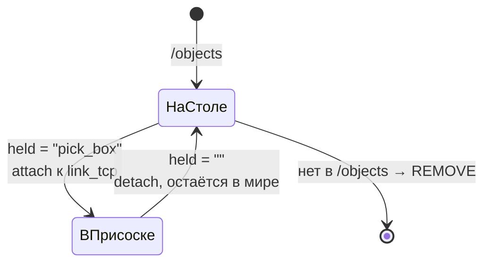

# Глава 11. Сцена MoveIt: чтобы рука не сбивала объекты

> Главный файл: [`scripts/scene_manager.py`](../../src/xarm_grasping/scripts/scene_manager.py)
> (первая половина — Planning Scene; вторая — зоны, глава 12).

---

## 11.1. Что такое Planning Scene и зачем она нам

MoveIt планирует движение руки так, чтобы она **ни с чем не столкнулась**. Но
сталкиваться он умеет только с тем, о чём знает. Это знание и есть **Planning
Scene** — модель мира внутри `move_group`:

* **робот** — его модель и текущее положение суставов (это MoveIt знает сам);
* **объекты мира** (`CollisionObject`) — препятствия: стол, коробки, цилиндры;
* **прикреплённые объекты** (`AttachedCollisionObject`) — тела, которые
  «приросли» к звену робота и двигаются вместе с ним: камера на кронштейне,
  коробка в присоске.

Без сцены MoveIt не знает про объекты, и при подходе к одному объекту рука
спокойно проводит корпус сквозь соседний. В первых прогонах так и сбивался
цилиндр.



> **Почитать.** [MoveIt: Planning Scene ROS API](https://moveit.picknik.ai/main/doc/examples/planning_scene_ros_api/planning_scene_ros_api_tutorial.html)
> (ровно то, что делает наша нода: добавить, прикрепить, открепить объект),
> [MoveIt concepts: move_group](https://moveit.picknik.ai/main/doc/concepts/move_group.html),
> [Planning Scene Monitor](https://moveit.picknik.ai/main/doc/concepts/planning_scene_monitor.html).

## 11.2. Как обновлять сцену: «разница» через сервис

`move_group` даёт сервис `/apply_planning_scene` (`moveit_msgs/srv/ApplyPlanningScene`).
В него отправляется **разница** (`is_diff = True`): «добавь этот объект, убери тот»,
а не вся сцена целиком.

```python
def apply(self, scene: PlanningScene, what=''):
    scene.is_diff = True
    scene.robot_state.is_diff = True          # робота не трогаем, только прикреплённые
    fut = self.scene_cli.call_async(ApplyPlanningScene.Request(scene=scene))
    ... ждём ответ до 3 с ...
    return fut.result().success
```

Объект сцены — это id, форма-примитив и поза в известном MoveIt кадре:

```python
def co(self, oid, primitive=None, pose=None, op=CollisionObject.ADD):
    c = CollisionObject()
    c.header.frame_id = 'link_base'          # MoveIt знает этот кадр — он в модели руки
    c.id, c.operation = oid, op              # ADD добавляет или заменяет, REMOVE убирает
    if primitive is not None:
        c.primitives, c.primitive_poses = [primitive], [pose]
    return c
```

Форма — `shape_msgs/SolidPrimitive`: `BOX` с размерами `[X, Y, Z]` или
`CYLINDER` с `[высота, радиус]`. Мы специально сделали константы
`DetectedObject.SHAPE_*` и порядок размеров такими же, поэтому распознанный
объект переносится в сцену один в один (`primitive_of`).

## 11.3. Что лежит в сцене

### Объекты со стола

На каждое сообщение `/objects` (`on_objects`,
[строка 215](../../src/xarm_grasping/scripts/scene_manager.py#L215)):

* каждый объект → `CollisionObject` с его `id` (ADD заменяет прежний с тем же id —
  объект «переезжает», если распознан в другом месте);
* id, которых больше нет в `/objects`, → `REMOVE`;
* объект, который сейчас в присоске, не трогается.

Поэтому **важно, чтобы `/objects` публиковался только при хорошем обзоре**
(глава 10, 10.9). Иначе, пока рука работает низко, объекты «исчезали» бы из
сцены прямо во время движения.

### Стол

```python
tp.position = Point(x=0.3, y=0.0, z=msg.table_z - 0.003 - 0.025)   # верх на 3 мм ниже плоскости
s.world.collision_objects.append(self.co('table', BOX[1.0, 1.2, 0.05], tp))
```

Почему **на 3 мм ниже** найденной плоскости. База руки стоит на столе вплотную. Если
верх стола в сцене совпадёт с низом базы, MoveIt сочтёт это касание столкновением,
и любое планирование провалится с «start state in collision». Размер стола в плане
задаётся параметрами `table_center`, `table_size`.

### Камера с кронштейном

MoveIt строит свою модель руки (`moveit_configs_builder`, глава 6), и в ней **нет
камеры**. Без неё MoveIt мог бы протащить камеру сквозь объект. Поэтому камера
добавляется **прикреплённым боксом** к `link_eef` (`add_camera`,
[строка 199](../../src/xarm_grasping/scripts/scene_manager.py#L199)):

```python
CAMERA_BOX_CENTER = (0.061, 0.0, 0.028)    # в link_eef: x 0.046..0.0755, z 0.003..0.053
CAMERA_BOX_SIZE   = (0.040, 0.134, 0.060)  # + запас 5 мм
GRIPPER_TOUCH_LINKS = ['link6', 'link_eef', 'link_tcp', 'xarm_vacuum_gripper_link']

a = AttachedCollisionObject(link_name='link_eef', touch_links=GRIPPER_TOUCH_LINKS)
a.object = self.co('gripper_camera', box, pose)
a.object.header.frame_id = 'link_eef'
```

**`touch_links`** — звенья робота, которым **разрешено** касаться прикреплённого
тела. Камера вплотную прилегает к фланцу и присоске; если не разрешить касание,
MoveIt будет считать столкновением саму руку.

## 11.4. Объект в присоске

Когда вакуум схватил объект (`/vacuum_gripper/held` стал непустым), MoveIt должен
узнать, что рука теперь **несёт** коробку: при переносе коробка не должна задевать
стол и соседей. `attach_nearest` ([строка 255](../../src/xarm_grasping/scripts/scene_manager.py#L255)):

```python
tcp = self.tcp_position()                                  # где присоска (TF)
o = объект из /objects, у которого grasp_pose ближе всего к присоске
if расстояние > attach_radius (8 см): не прикреплять       # странная ситуация — лучше не гадать

a = AttachedCollisionObject(link_name='link_tcp', touch_links=GRIPPER_TOUCH_LINKS)
a.object = self.co(o.id, primitive_of(o), o.pose)          # поза в link_base
s.robot_state.attached_collision_objects = [a]
self.apply(s)
```

* Поза объекта передаётся в `link_base`. MoveIt **сам** пересчитывает её
  относительно `link_tcp` и с этого момента двигает объект вместе с присоской.
* Объект с тем же id MoveIt **сам** убирает из мира, отдельный `REMOVE` не нужен.
  Мы сначала его посылали, и он мог завалить применение всей сцены: «удалить
  объект, которого уже нет» — ошибка.

**Открепить** (`detach`): `AttachedCollisionObject` с `REMOVE` → MoveIt
возвращает объект в мир **там, где его отпустили**. Следующее сообщение
`/objects` уточнит позу по камере.

Это работает при **любом** захвате: и через `/pick_place`, и через кнопку в RViz.



## 11.5. Как посмотреть сцену

* RViz, панель **MotionPlanning → Scene Objects**: список объектов сцены.
  Объекты видны в 3D как зелёные (мир) и фиолетовые (прикреплённые) тела.
* Из терминала:

```bash
ros2 service call /get_planning_scene moveit_msgs/srv/GetPlanningScene \
    "{components: {components: 1023}}" | grep -o "id='[a-z_0-9]*'" | sort -u
```

## 11.6. Что здесь можно менять

| Хочу… | Где | Что |
|---|---|---|
| стол другого размера/места | `scene_manager`: `table_center`, `table_size` | в `link_base` |
| прикреплять с большего расстояния | `scene_manager`: `attach_radius` | 0.08 м |
| другой кронштейн/камера | `CAMERA_BOX_*` в `scene_manager.py` | по мешам (глава 8, 8.5) |

## 11.7. Частые ошибки

| Симптом | Причина | Что делать |
|---|---|---|
| MoveIt: «start state in collision» | стол в сцене задевает базу | верх стола ниже плоскости (уже −3 мм) |
| Объекта нет в сцене | `/objects` не публикуется (обзор плохой) | руку в позу наблюдения |
| «Planning Scene не обновлена» в логе | `move_group` не запущен (`use_moveit:=false`) | запустить MoveIt |
| Рука сбивает соседний объект | объект не распознан → нет в сцене | `ros2 topic echo /objects` |

## 11.8. Проверь себя

1. Почему камера нужна в сцене, если она и так есть в URDF?
2. Что такое `touch_links` и что будет без них?
3. Зачем стол в сцене опущен на 3 мм?
4. Где окажется объект в сцене после `detach`, если камера его ещё не видела?
