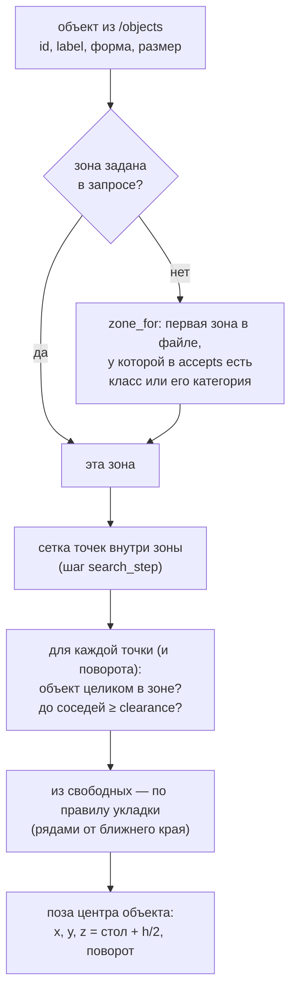
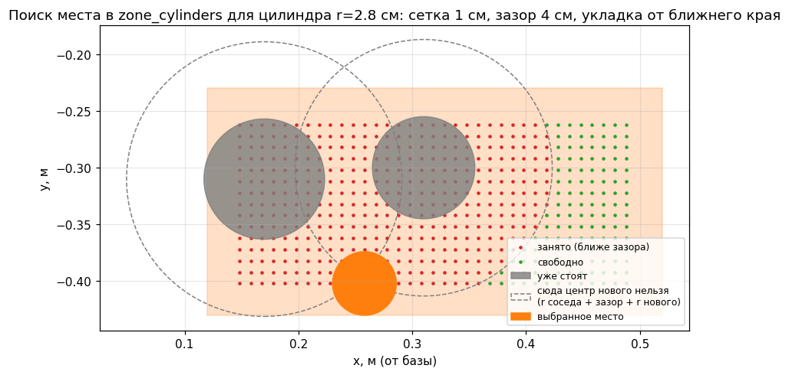

# Глава 12. Разметка стола: зоны установки и поиск свободного места

> Главные файлы: [`config/place_zones.yaml`](../../src/xarm_grasping/config/place_zones.yaml)
> (разметка), [`config/objects.yaml`](../../src/xarm_grasping/config/objects.yaml)
> (категории классов), [`scripts/scene_manager.py`](../../src/xarm_grasping/scripts/scene_manager.py)
> (вторая половина: `zone_for`, `find_place`, `publish_zones`, геометрия `footprint`/`gap`).

---

## 12.1. Что такое «разметка» и откуда робот знает, куда ставить

На настоящем столе можно было бы наклеить цветной скотч: «сюда коробки, сюда
цилиндры». Роботу скотч не нужен: **разметка — это описание прямоугольников на
столе в файле**. Робот не видит зоны камерой, он знает их координаты.

Вопрос «куда поставить объект» разбит на два шага:

1. **В какую зону?** — по классу объекта и правилам зон (`accepts`).
2. **Куда именно в зоне?** — свободное место, где объект целиком помещается в зону
   и не задевает уже стоящие там объекты.




*Рис. 12.1. Разметка стола: синяя `zone_boxes`, оранжевая `zone_cylinders`, объекты
до сортировки (зелёные), кадр камеры из позы наблюдения (красный пунктир) и
досягаемость руки. Оси — `link_base`, вид сверху; Y влево от базы положительный.*

## 12.2. Файл разметки `place_zones.yaml` — поле за полем

```yaml
frame: link_base
zones:
  zone_boxes:
    center: [0.32, 0.32]
    size: [0.38, 0.20]
    accepts: [box]
    color: [0.2, 0.5, 1.0]
  zone_cylinders:
    center: [0.32, -0.33]
    size: [0.40, 0.20]
    accepts: [cylinder]
    color: [1.0, 0.5, 0.1]
search_step: 0.01
clearance: 0.04
```

| Поле | Тип | Смысл |
|---|---|---|
| `frame` | строка | **для человека**: в каком кадре числа. Код его не читает — зоны всегда в `base_frame` ноды `scene_manager` (по умолчанию `link_base`, верх стола z=0) |
| `zones` | словарь | зоны; **ключ = имя зоны** (используется в командах и в RViz) |
| `center` | `[x, y]`, м | центр прямоугольника на столе в `link_base` |
| `size` | `[по X, по Y]`, м | размеры. Прямоугольник **всегда по осям** `link_base` (повернуть зону нельзя) |
| `accepts` | список строк | что сюда ставится: **классы** (`cyl_tall`) и/или **категории** (`cylinder`) из `objects.yaml` |
| `color` | `[r, g, b]` 0..1 | цвет в RViz |
| `search_step` | м | шаг сетки, по которой ищется место (1 см) |
| `clearance` | м | минимальный зазор между **контурами** объектов (4 см) |

Как читать `center` и `size` на примере `zone_boxes`:
центр (0.32, 0.32), размер 0.38 × 0.20 →
X от 0.32 − 0.19 = **0.13** до 0.32 + 0.19 = **0.51**,
Y от 0.32 − 0.10 = **0.22** до 0.32 + 0.10 = **0.42**.
То есть полоса на столе слева от базы руки, 13–51 см вперёд.

> ⚠️ **Обрати внимание.** Порядок зон в файле важен: если объект подходит под
> несколько зон, без явного указания зоны берётся **первая** по порядку.

## 12.3. Как класс объекта связан с зоной: категории

Связь идёт через `objects.yaml` (глава 10). У каждого класса есть `category`:

```yaml
# objects.yaml
pick_box:   {shape: box,      dims: [...], tol: 0.025, category: box}
cyl_tall:   {shape: cylinder, dims: [...], tol: 0.015, category: cylinder}
```

`zone_for` ([строка 292](../../src/xarm_grasping/scripts/scene_manager.py#L292)):

```python
def zone_for(self, o):
    cat = self.rules.get(o.label, {}).get('category', o.label)   # категория класса
    for name, z in self.zones.items():                           # в порядке файла
        acc = z.get('accepts', [])
        if o.label in acc or cat in acc:                         # класс ИЛИ категория
            return name
    return None
```

| Объект | `label` | `category` | Подходит к `accepts: [box]`? | к `accepts: [cylinder]`? |
|---|---|---|---|---|
| плоская коробка | `box_flat` | `box` | да (по категории) | нет |
| высокий цилиндр | `cyl_tall` | `cylinder` | нет | да |
| нераспознанная коробка | `box` (класс = форма) | `box` (нет правила → категория = класс) | да | нет |

Так можно делать и **специальные зоны для отдельных классов**. Например, все высокие
объекты — отдельно:

```yaml
zones:
  zone_tall:                       # ПЕРВОЙ — чтобы перехватить высокие до общих зон
    center: [0.50, 0.0]
    size: [0.10, 0.20]
    accepts: [box_tall, cyl_tall]  # конкретные классы
    color: [0.8, 0.2, 0.8]
  zone_boxes:   {... accepts: [box]}
  zone_cylinders: {... accepts: [cylinder]}
```

## 12.4. Зоны в RViz

`publish_zones` ([строка 366](../../src/xarm_grasping/scripts/scene_manager.py#L366))
раз в секунду публикует `/place_zones/markers`:

* **плоский полупрозрачный прямоугольник** (`Marker.CUBE` высотой 2 мм) на 1 мм
  выше стола. Ровно на уровне стола он бы мерцал (z-fighting: две поверхности на
  одной глубине, видеокарта не может решить, какая ближе);
* **подпись** над центром: `zone_boxes: box`.

QoS — `TRANSIENT_LOCAL`: RViz, открытый позже, сразу получит зоны. В RViz-конфигах
есть дисплей **PlaceZones** (MarkerArray, Durability «Transient Local»).

> ⚠️ **Обрати внимание.** Зоны читаются **при старте** `scene_manager`. После правки
> `place_zones.yaml` перезапусти launch (пересборка не нужна).

## 12.5. Как ищется свободное место

### Контуры объектов в плане

Чтобы понять, задевает ли новый объект соседей, нужны их **контуры сверху**
(`footprint`, [строка 85](../../src/xarm_grasping/scripts/scene_manager.py#L85)):

* коробка — **прямоугольник** с размерами и поворотом (из распознавания);
* цилиндр — **круг**.

Сначала мы считали каждый объект описанным кругом. Это просто, но у плоской
коробки 12×8 см такой круг радиусом 7.2 см, и места «не хватало», хотя оно было.
Поэтому сейчас используются настоящие контуры.

### Расстояние между контурами — функция `gap`

`gap(a, b)` ([строка 99](../../src/xarm_grasping/scripts/scene_manager.py#L99))
возвращает зазор между двумя контурами (отрицательный — пересекаются):

* **круг–круг:** расстояние между центрами − r₁ − r₂.
* **прямоугольник–круг:** переводим центр круга в систему прямоугольника
  (поворотом), там прямоугольник выровнен по осям, и расстояние от точки до него
  считается так же, как для присоски и коробки (глава 9): `max(|p| − half, 0)` по
  осям, длина вектора. Затем вычитаем радиус.
* **прямоугольник–прямоугольник:** **теорема о разделяющей оси**. Два выпуклых
  многоугольника не пересекаются тогда и только тогда, когда есть прямая, на
  проекцию на которую они не перекрываются. Для прямоугольников достаточно
  проверить 4 оси — направления их сторон. На каждую ось проецируем оба
  прямоугольника (это отрезки) и смотрим зазор между отрезками. Наибольший из этих
  зазоров — оценка расстояния (если он > 0, прямоугольники не пересекаются).

```python
for axes in (_rect_axes(a.yaw), _rect_axes(b.yaw)):      # 4 оси
    for ax in axes:
        ra = sum(|ax · v| * h for v, h in оси и полуразмеры a)   # «радиус» проекции a
        rb = то же для b
        best = max(best, |ax · (центр_b − центр_a)| − ra − rb)  # зазор проекций
```

Функцию проверили на пяти парах с известным ответом (две окружности, прямоугольник
и круг, два прямоугольника вплотную, прямоугольник повёрнутый на 90°,
пересечение) — все совпали.

> **Почитать.** [Hyperplane separation theorem](https://en.wikipedia.org/wiki/Hyperplane_separation_theorem)
> (там же «separating axis theorem» для многоугольников); простое объяснение с
> картинками — [dyn4j: SAT](https://dyn4j.org/2010/01/sat/).

### Сетка кандидатов и поворот коробок

`find_place` ([строка 312](../../src/xarm_grasping/scripts/scene_manager.py#L312)):

1. Для коробки пробуем **два поворота**: вдоль зоны (yaw 0) и поперёк (yaw 90°).
   Поперёк ставится, если так коробка помещается, а вдоль — нет (или если так
   плотнее). Цилиндру поворот не важен.
2. Центр кандидата ходит по сетке с шагом `search_step`, **отступив от краёв зоны
   на половину размера объекта**, — так объект всегда целиком в зоне.
3. Кандидат **свободен**, если зазор `gap` до каждого объекта в `/objects`
   (кроме самого переносимого) больше `clearance`.

```python
for yaw in yaws:
    half = полуразмеры объекта (с учётом поворота)
    for x in arange(cx - sx/2 + half_x, cx + sx/2 - half_x, step):
        for y in arange(cy - sy/2 + half_y, cy + sy/2 - half_y, step):
            fp = footprint(o, (x, y), yaw)
            if all(gap(fp, f) > clearance for f in others_fp):
                free.append((x, y))
```

### Какое из свободных мест выбрать: укладка рядами

```python
cost = (x - край_зоны_ближе_к_базе)                       # ближе к базе по X
       + 0.3 * | |y| - край_зоны_ближе_к_оси |             # прижать к ближнему краю по Y
       + 0.01 * (повёрнут на 90°)                          # без поворота — при прочих равных
best = free[argmin(cost)]
```

Объекты укладываются **плотно, рядами, от ближнего к базе конца зоны**. Раньше
место выбиралось ближе к центру зоны, и первый объект вставал посередине: у края
оставалось место, которым уже нельзя было воспользоваться, и четвёртый цилиндр «не
влезал».



*Рис. 12.2. Поиск места для маленького цилиндра в `zone_cylinders`, где уже стоят
два. Серые круги — стоящие объекты; пунктир — куда **центр** нового ставить нельзя
(радиус соседа + зазор + радиус нового); точки сетки: зелёные свободны, красные
заняты; оранжевый — выбранное место (ближайшее к базе свободное).*

### Что возвращается

`FindPlacePose.Result.place_pose` — поза **центра** объекта на новом месте:
x, y из сетки; z = высота стола + половина высоты объекта (дно ровно на столе);
поворот — кватернион вокруг вертикали `(0, 0, sin(yaw/2), cos(yaw/2))`.

```bash
$ ros2 action send_goal /find_place_pose xarm_grasping_msgs/action/FindPlacePose "{object_id: pick_box_0}"
Result:
    success: true
    message: pick_box_0 -> zone_boxes (0.191, 0.264, поворот 0°)
    zone: zone_boxes
    place_pose: {pose: {position: {x: 0.191, y: 0.264, z: 0.027}, orientation: {z: 0.0, w: 1.0}}}
```

`pick_place_server` (глава 13) поворачивает присоску на тот же угол: объект в
присоске повёрнут вместе с ней (при захвате присоска выровнена по объекту), значит,
и встанет с нужным поворотом.

## 12.6. Как разместить зоны правильно: три условия

Разметку нельзя рисовать где угодно. История ошибок, из которых сложились правила:

| Было | Что случилось | Правило |
|---|---|---|
| зона цилиндров до y = −0.50 | на краю кадра камера видела поставленный цилиндр частично, поиск места его «не знал» и поставил второй цилиндр прямо на него | **зона целиком в кадре камеры** из позы наблюдения |
| места искались по описанным кругам, первый объект — в центр | «нет места», хотя место было | **настоящие контуры** + укладка рядами |
| зазор 3 см | два цилиндра в зоне слились в один кластер (в одном кадре — один «объект») | **зазор ≥ 4 см** (и запас на неточность захвата 1–2 см) |
| зона 30×12 см на 4 коробки | не хватило места | **посчитать вместимость** (12.7) |

**Условие 1. В кадре камеры.** Из позы наблюдения (камера ≈0.47 м над столом,
стоит боком) кадр примерно такой:
* по Y (ширина кадра, угол 90°): ± 0.47·tan 45° ≈ **±0.47 м**;
* по X (высота кадра, угол ~64°): 0.36 ± 0.47·tan 32° ≈ **0.07…0.65 м**.

Оставь запас 5 см от краёв: на краю объект виден частично.

**Условие 2. В досягаемости.** xArm6 с присоской вертикально вниз уверенно
достаёт примерно до **0.55 м** от оси базы (на рис. 12.1 пунктир). Дальний угол
зоны `(x_max, y_max)` должен быть в пределах: `√(x² + y²) ≲ 0.55`. Для
`zone_boxes`: дальний угол (0.51, 0.42) → 0.66 м: это у предела, поэтому
укладка начинается с ближнего края, и дальние места занимаются последними.

**Условие 3. Не на исходных объектах.** Зона не должна накрывать места, где
объекты стоят до сортировки (иначе они мешают как препятствия, и места меньше).
Проверь по `arm_table_objects.yaml`.

## 12.7. Вместимость: прикинуть заранее

Камера даёт размеры с запасом (ширина коробки +1–1.5 см, радиус цилиндра
+0.3 см), считай с ним. Пример для 4 цилиндров в один ряд вдоль X:

| | диаметр (изм.) |
|---|---|
| cyl_wide | 10.6 |
| cylinder_block | 8.6 |
| cyl_tall | 7.6 |
| cyl_small | 5.6 |
| **сумма** | **32.4 см** |
| + 3 зазора × 4 см | 12 см |
| **итого** | **44.4 см > 40 см** длины зоны |

В один ряд не влезает, поэтому ширина зоны 20 см: два ряда (например, 10.6 + 4 +
5.6 = 20.2 — впритык, но крупный и маленький ставятся со смещением по X).

## 12.8. Как добавить свою зону — по шагам

1. **Нарисуй на рисунке 12.1** (или на бумаге в координатах `link_base`)
   прямоугольник: в кадре, в досягаемости, не на исходных объектах.
2. **Посчитай вместимость** (12.7) для объектов, которые туда пойдут.
3. **Допиши в `place_zones.yaml`** зону (имя, `center`, `size`, `accepts`, `color`).
   Если она для особых классов — поставь её **выше** общих.
4. **Если нужна новая категория** — пропиши её в `objects.yaml` у нужных классов
   (`category: fragile`) и в `accepts`.
5. **Перезапусти** launch и проверь в RViz (дисплей PlaceZones), что зона на месте.
6. **Проверь поиск места**, не двигая руку:
   ```bash
   ros2 action send_goal /find_place_pose xarm_grasping_msgs/action/FindPlacePose \
       "{object_id: cyl_tall_0, zone: zone_tall}"
   ```
7. **И только потом** — полный цикл `/pick_place` (глава 13).

## 12.9. Ограничения

* Зоны — только прямоугольники **по осям** `link_base` (без поворота).
* Объекты ставятся **только на стол** (не друг на друга) и **только вертикально**.
* «Занятость» зоны берётся из `/objects`, то есть из того, что видит камера. Поэтому
  зона должна быть в кадре (условие 1).
* Зоны задаются для сцены «рука на столе». На тележке стол в другом месте
  относительно руки, и разметку придётся задавать заново (и в `link_base` тележки).

## 12.10. Проверь себя

1. Объект `box_tall` (категория `box`), зоны в файле: `zone_tall` (accepts
   `[cyl_tall]`), `zone_boxes` (accepts `[box]`). В какую зону он пойдёт?
2. Почему центр кандидата ходит не от края зоны, а с отступом в половину объекта?
3. Зачем зона должна быть целиком в кадре камеры, если робот знает её координаты?
4. Прикинь, влезут ли 3 коробки `pick_box` (10×5 см, измеренная ширина 6 см) в
   зону 30×10 см при зазоре 4 см. В каком повороте?
