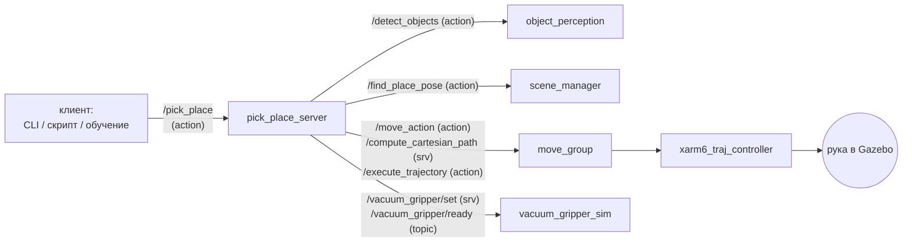
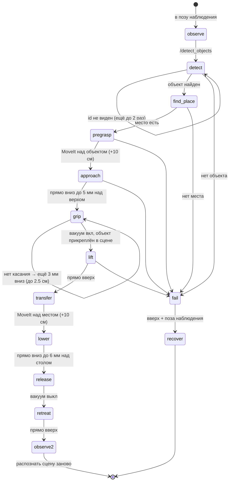

# Глава 13. Pick & place: взять объект и поставить в зону одной командой

> Главный файл: [`scripts/pick_place_server.py`](../../src/xarm_grasping/scripts/pick_place_server.py).
> Интерфейс: [`xarm_grasping_msgs/action/PickPlace.action`](../../src/xarm_grasping_msgs/action/PickPlace.action).
> Справочник команд: [`docs/PICK_PLACE.md`](../PICK_PLACE.md).

---

## 13.1. Одна команда

```bash
ros2 topic echo /objects --once                     # какие id есть на столе
ros2 action send_goal /pick_place xarm_grasping_msgs/action/PickPlace \
    "{object_id: cyl_tall_0}" --feedback            # зона по правилам (глава 12)
ros2 action send_goal /pick_place xarm_grasping_msgs/action/PickPlace \
    "{object_id: pick_box_0, zone: zone_boxes}" --feedback   # зона явно
```

```text
Feedback: stage: observe        detail: поза наблюдения (камера высоко над столом)
Feedback: stage: detect         detail: свежее распознавание
Feedback: stage: transfer       detail: ищу место в зоне
Feedback: stage: plan_pregrasp  detail: над cyl_tall_0
Feedback: stage: approach       detail: вниз до 5 мм над верхом
Feedback: stage: grip           detail: объект cyl_tall захвачен (DetachableJoint: attached)
Feedback: stage: lift ...  transfer ... lower ... release ... retreat ... observe
Result:   success: true   message: cyl_tall_0 поставлен
```



## 13.2. Почему это action

Pick & place длится 1–3 минуты. За это время клиенту нужно видеть, **на каком шаге**
робот, иметь возможность **отменить** и в конце получить **результат** с причиной
ошибки. Это ровно то, для чего в ROS 2 есть **action**:

| | Топик | Сервис | Action |
|---|---|---|---|
| ответ | нет | один, сразу | результат в конце |
| прогресс | — | — | **feedback** по ходу |
| отмена | — | — | **cancel** |
| для чего | поток данных | быстрые запросы | **долгие задачи** |

Action — это несколько сервисов и топиков под капотом: «отправить цель»,
«отменить», «получить результат», топик feedback и статуса. В Python сервер
выглядит так:

```python
ActionServer(self, PickPlace, '/pick_place', self.on_goal,
             callback_group=cbg, cancel_callback=lambda _: CancelResponse.ACCEPT)

def on_goal(self, goal_handle):
    ...
    goal_handle.publish_feedback(PickPlace.Feedback(stage='grip', detail='...'))
    if goal_handle.is_cancel_requested: ...
    goal_handle.succeed()        # или abort() / canceled()
    return PickPlace.Result(success=True, message='...')
```

> **Почитать.** [Understanding actions](https://docs.ros.org/en/kilted/Tutorials/Beginner-CLI-Tools/Understanding-ROS2-Actions/Understanding-ROS2-Actions.html),
> [Writing an action server and client (Python)](https://docs.ros.org/en/kilted/Tutorials/Intermediate/Writing-an-Action-Server-Client/Py.html),
> [Actions design article](https://design.ros2.org/articles/actions.html).

## 13.3. Как мы говорим с MoveIt без Python-API

В ROS 2 Kilted нет пакета `moveit_py` (Python-обёртки MoveIt) и нет MoveIt Task
Constructor. Зато у `move_group` есть стандартные ROS-интерфейсы. Ими и пользуемся:

### Свободное движение с объездом препятствий — action `/move_action`

```python
def plan_and_move(self, pose, what):
    g = MoveGroup.Goal()
    r = g.request                                   # moveit_msgs/MotionPlanRequest
    r.group_name = 'xarm6'                          # группа суставов (из SRDF)
    r.goal_constraints = [self.tcp_goal(pose)]      # ЧТО должно выполниться в конце
    r.num_planning_attempts = 5
    r.allowed_planning_time = 5.0
    r.max_velocity_scaling_factor = 0.3             # 30% от предельной скорости
    r.start_state.is_diff = True                    # старт = текущее состояние
    g.planning_options.plan_only = False            # спланировать И исполнить
    g.planning_options.replan = True                # не вышло — ещё 2 раза
```

Цель задаётся не позой, а **ограничениями** (`Constraints`) — так MoveIt
формулирует любую цель:

```python
pc = PositionConstraint()                       # точка link_tcp должна быть внутри
pc.link_name = 'link_tcp'                       # сферы радиусом 2 мм вокруг цели
pc.constraint_region.primitives = [SolidPrimitive(type=SPHERE, dimensions=[0.002])]
oc = OrientationConstraint()                    # ориентация link_tcp с допуском
oc.orientation = pose.orientation               # ±0.05 рад по каждой оси
oc.absolute_x_axis_tolerance = 0.05 ...
```

`link_tcp` — **кончик присоски**: группа `xarm6` с вакуумным схватом заканчивается
именно на нём (SRDF, глава 6). Поэтому цели задаются прямо для присоски.

Планировщик по умолчанию — OMPL (вероятностный: ищет путь в пространстве
суставов случайными пробами). Он объезжает всё, что есть в Planning Scene
(глава 11), но путь получается «кривым», не прямой линией.

### Прямая линия — сервис `/compute_cartesian_path` + action `/execute_trajectory`

Подход к объекту и отход должны быть **строго вертикальными**, иначе присоска
зацепит объект боком. Для этого MoveIt строит **декартов путь**: кончик присоски идёт
по прямой с шагом 5 мм, в каждой точке решается обратная кинематика.

```python
req = GetCartesianPath.Request()
req.group_name, req.link_name = 'xarm6', 'link_tcp'
req.waypoints = [pose]                     # конечная точка; путь — прямая к ней
req.max_step = 0.005                       # шаг 5 мм
req.avoid_collisions = True
res = wait(self.cartesian.call_async(req), 15.0)
if res.fraction < 0.98:                    # доля пути, которую удалось построить
    raise StepFailed('прямой путь пройден на ...%')
self.call_action(self.execute, ExecuteTrajectory.Goal(trajectory=res.solution), ...)
```

`fraction` — важное поле: если обратная кинематика где-то по пути не решается или
есть столкновение, путь обрывается, и `fraction < 1`.

> **Почитать.** [MoveIt: Motion Planning API / concepts](https://moveit.picknik.ai/main/doc/concepts/motion_planning.html),
> [Kinematic constraints](https://moveit.picknik.ai/main/doc/concepts/kinematics.html),
> [Cartesian planning (Move Group C++ tutorial, раздел Cartesian Paths)](https://moveit.picknik.ai/main/doc/examples/move_group_interface/move_group_interface_tutorial.html),
> [OMPL](https://ompl.kavrakilab.org/);
> что делает MoveIt Task Constructor (недоступен в Kilted) —
> [MTC pick and place](https://moveit.picknik.ai/main/doc/tutorials/pick_and_place_with_moveit_task_constructor/pick_and_place_with_moveit_task_constructor.html).

### Потоки: почему `MultiThreadedExecutor` и ожидание в цикле

Внутри `on_goal` нода много раз вызывает чужие action и сервисы и **ждёт** ответа.
Ответ приходит колбэком в ту же ноду. Если бы нода была однопоточной, она ждала бы
ответа и не могла бы его принять: взаимная блокировка. Поэтому:

* `MultiThreadedExecutor(num_threads=6)` + `ReentrantCallbackGroup` — колбэки могут
  выполняться параллельно;
* ожидание — простой цикл с таймаутом, пока **другой поток** заполняет future:

```python
def wait(fut, timeout):
    t0 = time.monotonic()
    while not fut.done():
        if time.monotonic() - t0 > timeout:
            raise StepFailed(f'таймаут {timeout:.0f} с')
        time.sleep(0.01)
    return fut.result()
```

> **Почитать.** [About Executors](https://docs.ros.org/en/kilted/Concepts/Intermediate/About-Executors.html)
> (раздел Callback groups), [Using callback groups](https://docs.ros.org/en/kilted/How-To-Guides/Using-callback-groups.html).

## 13.4. Шаги одного pick & place

`pick_place` ([`pick_place_server.py`](../../src/xarm_grasping/scripts/pick_place_server.py)):



Важные решения внутри:

**1. Распознавание только из позы наблюдения.** Камера видит только дальше 25 см
(глава 8, рис. 8.1). Из любой другой позы стол виден частично: в одном из прогонов из
стартовой позы 3 объекта из 8 распознались неверно.

**2. Место ищется до захвата.** Если места в зоне нет, нет смысла брать объект и
потом держать его в воздухе.

**3. Верх объекта известен с точностью ~1 см, поэтому — спуск до касания.** Присоска
опускается до 5 мм над **оценённым** верхом. Если вакуум ещё не «готов»
(`/vacuum_gripper/ready`, глава 9), рука опускается шагами по 3 мм, но не больше
2.5 см. Так работает настоящая присоска с датчиком давления: «опускаю, пока не
почувствую».

```python
z = top + gap
while not self.ready and z > top + gap - probe_depth:
    z -= probe_step
    self.straight(self.pose_at(x, y, z, q), 'спуск до касания', avoid_collisions=False)
    time.sleep(0.3)                      # дать /vacuum_gripper/ready обновиться
self.set_vacuum(True)
```

`avoid_collisions=False` здесь нужен: присоска вплотную к объекту в сцене, и MoveIt
счёл бы последние миллиметры столкновением.

**4. Высота установки учитывает фактический зазор захвата.** Объект висит в присоске
на том расстоянии, на котором его схватили (`z − top`). Чтобы дно встало на 6 мм над
столом (`place_drop`) и упало мягко:

```python
tcp_place_z = стол + place_drop + h + (z - top)
```

**5. Поворот при установке.** При захвате присоска выровнена по объекту (yaw
коробки), поэтому чтобы поставить коробку с поворотом из `find_place` (0° или 90°),
присоску поворачивают на этот угол: `q_place = grasp_quat(place_yaw)`.

**6. Восстановление.** Если любой шаг после начала движения упал, рука уходит
вверх и в позу наблюдения (`recover`). Если объект уже в присоске, он
**остаётся в ней** — отпусти кнопкой, когда рука над столом.

### Ориентация «присоска вниз» — кватернион

`grasp_quat(yaw)` ([`perception.py`](../../src/xarm_grasping/xarm_grasping/perception.py#L213))
возвращает поворот `R = Rz(yaw) · Rx(π)`: сначала перевернуть инструмент вниз
(поворот на 180° вокруг X), потом повернуть вокруг вертикали на yaw. В кватернионах
это `(x, y, z, w) = (cos(yaw/2), sin(yaw/2), 0, 0)`.

## 13.5. Параметры

| Параметр | По умолчанию | Смысл |
|---|---|---|
| `observe_pose` | `[0.30, 0.0, 0.40]` | присоска в позе наблюдения (`link_base`) |
| `approach_height` | 0.10 | на сколько выше объекта/места подлетать и уходить, м |
| `grasp_gap` | 0.005 | до скольки над оценённым верхом спускаться сразу, м |
| `probe_step`, `probe_depth` | 0.003, 0.025 | шаг и предел спуска до касания, м |
| `place_drop` | 0.006 | на какой высоте над столом отпускать (дно), м |
| `velocity_scaling`, `accel_scaling` | 0.3, 0.3 | доля предельной скорости/ускорения |
| `planning_time` | 5.0 | время на планирование, с |

## 13.6. Свой клиент: отсортировать весь стол

Тот же action можно вызывать из своего Python-скрипта — например, разложить всё,
что лежит на столе, по зонам:

```python
#!/usr/bin/env python3
import rclpy
from rclpy.action import ActionClient
from rclpy.node import Node
from rclpy.qos import QoSProfile, DurabilityPolicy
from xarm_grasping_msgs.action import PickPlace
from xarm_grasping_msgs.msg import DetectedObjectArray


def main():
    rclpy.init()
    node = Node('sort_table')
    latched = QoSProfile(depth=1, durability=DurabilityPolicy.TRANSIENT_LOCAL)
    objs = []
    node.create_subscription(DetectedObjectArray, '/objects',
                             lambda m: objs.__setitem__(slice(None), m.objects), latched)
    while not objs:                               # ждём первый /objects
        rclpy.spin_once(node, timeout_sec=0.5)
    client = ActionClient(node, PickPlace, '/pick_place')
    client.wait_for_server()
    for o in sorted(objs, key=lambda o: o.id):
        node.get_logger().info(f'беру {o.id} ({o.label})')
        fut = client.send_goal_async(
            PickPlace.Goal(object_id=o.id),
            feedback_callback=lambda fb: node.get_logger().info(
                f'  {fb.feedback.stage}: {fb.feedback.detail}'))
        rclpy.spin_until_future_complete(node, fut)
        res_fut = fut.result().get_result_async()
        rclpy.spin_until_future_complete(node, res_fut)
        r = res_fut.result().result
        node.get_logger().info(f'{o.id}: {"OK" if r.success else "ОШИБКА: " + r.message}')
    rclpy.shutdown()


if __name__ == '__main__':
    main()
```

> Подсказка для обучения: в цикле «попытка — результат» удобно читать
> `/vacuum_gripper/contact` (глава 9) — расстояние и угол до объекта на каждом шаге —
> и `/objects` до и после: это готовые признаки и награда.

## 13.7. Частые ошибки

| `message` в результате | Причина | Что делать |
|---|---|---|
| `объект X не найден (есть: ...)` | id сменился или объект не виден | `ros2 topic echo /objects --once`, взять актуальный id |
| `место: в zone_... нет свободного места` | зона заполнена | расширить зону / освободить (глава 12) |
| `подход над объектом: MoveIt код -1` и др. | MoveIt не нашёл путь (недостижимо, столкновение) | объект слишком далеко (> ~0.55 м) или зажат соседями |
| `спуск: прямой путь пройден на 60%` | обратная кинематика по прямой не решается | объект у предела досягаемости |
| `вакуум: отказ: нет касания — до X 30 мм` | верх оценён с ошибкой больше `probe_depth` | увеличить `probe_depth`; проверить распознавание высоты |
| `распознавание: обзор частичный` | рука не в позе наблюдения | обычно сам уходит в неё; проверь `observe_pose` |
| `нет сервера action` | MoveIt/восприятие не запущены | `use_moveit:=true`; `ros2 node list` |

Коды ошибок MoveIt — в `moveit_msgs/msg/MoveItErrorCodes`
(`ros2 interface show moveit_msgs/msg/MoveItErrorCodes`): −1 PLANNING_FAILED,
−2 INVALID_MOTION_PLAN, −4 CONTROL_FAILED (контроллер не смог исполнить —
например, рука упёрлась).

## 13.8. Проверь себя

1. Почему подход вниз делается декартовым путём, а не через `/move_action`?
2. Что будет, если нода `pick_place_server` однопоточная?
3. Объект распознан на 1.5 см выше, чем есть. Что сделает робот и чем закончится
   захват?
4. Как в своём клиенте отменить pick & place, если он идёт дольше 2 минут?
